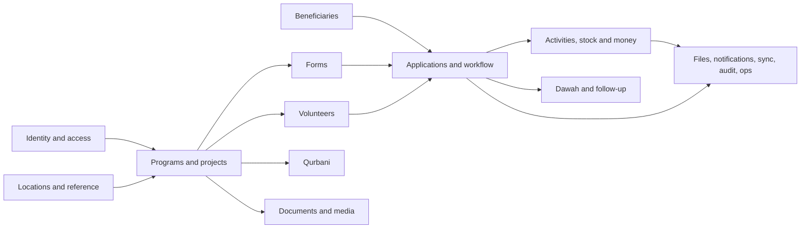

# ENTITY-RELATIONSHIP MODEL (conceptual and logical)

Status: complete, task T0.15 (2026-10-10). Logical model only: entities, keys, relationships, cardinality, classification and JSONB usage. Physical types, every column, indexes and constraints in SQL are the data dictionary of task T0.16 (`docs/database/DATABASE_SCHEMA.md`); the Prisma schema and migrations come in T1.2. Diagram: `docs/database/erd.mermaid` (one Mermaid `erDiagram` with the same entities and relationships).

Sources: blueprint B2 (entity tables, key rules) and B3 (hybrid storage); BD-01…BD-49; owner decisions O-01…O-36 (notably O-02, O-03, O-09, O-11, O-14, O-15, O-16, O-17, O-18, O-19, O-20, O-22, O-28, O-34); `docs/BUSINESS_RULES.md`; `docs/security/permissions.yaml`; `docs/architecture/WORKFLOW_ENGINE.md`, `OFFLINE_SYNC.md`, `FILES_AND_DOCUMENTS.md`, `NOTIFICATIONS.md`, `AUTH.md`. Ambiguities and entities added beyond the T0.15 entity list are flagged in section 20 (DECISION_LOG open question 29, answered by O-37).

## 1. Scope

95 entities in 12 clusters (the 91 of the T0.16 freeze plus the four added in Phase 1, section 20). Every entity cites the requirement it serves. Entities of the documentation module (M13) are included now so the data model does not change later, although the module is built last (O-34).

## 2. Conventions

| Topic | Rule |
|---|---|
| Primary keys | `id uuid` generated as UUID version 7 by the application (time-ordered, O-03). The beneficiary's `id` is the BEN-ID. Seeded configuration tables keyed by a natural key (roles, permissions, settings, holiday dates) use that key. |
| Human-readable ids | `applications.app_no` = project code + year + 5-digit sequence (O-03), unique; `projects.code`, `programs.code`, `locations.code` unique. |
| Audit columns | Every business table has `created_at`, `created_by`, `updated_at`, `updated_by` (constitution §13). Append-only log tables have only `created_at`, `created_by`. |
| Deletion | No hard delete of business data (§2, BR-207). Soft delete (`deleted_at`) only where approved: draft/pending applications (state `deleted`), export files. Deactivation flags (`active`, `revoked_at`, `released_at`) elsewhere. |
| Bilingual data | Labels, names of configuration items, statuses and stages carry `_bn` and `_en` columns or a JSONB `{bn, en}` (§11, BR-220). Personal names are stored as entered (one column). |
| Money | Decimal with two places, currency BDT; never floating point. |
| Time | Timestamps with time zone; dates for calendar values (deadlines, distribution dates, holidays). |
| Offline records | Entities created offline carry `client_uuid` (unique) and `client_created_at` (BR-194, O-13). |
| Locations | References to `locations.id` at the required level (division, district, upazila, union; O-09). |
| Naming | snake_case, plural table names; foreign keys `<entity>_id`; the physical names follow the T0.15 prompt where it differs from blueprint names (section 17). |

## 3. Classification

| Class | Meaning | Entities |
|---|---|---|
| Permanent master | Long-lived records that outlive projects; never deleted | users, volunteers, beneficiaries, beneficiary_family_members, locations, programs, media_consents |
| Configuration | Set up by officials or seeded; versioned or audited; read by many transactions | roles, permissions, user_roles, user_permissions, reference_lists, settings, holiday_calendar, nisab_versions, project_templates, workflow_definitions, workflow_transitions, form_library_sections, form_library_fields, notification_templates, document_templates |
| Project configuration | Belongs to one project, set during setup, snapshotted at activation | projects, project_components, project_areas, project_staff, project_quotas, fund_sources, forms, form_versions, form_sections, form_fields, field_options, dawah_syllabus_topics, project_volunteers, volunteer_teams, work_assignments |
| Project transaction | Operational records created during a project | applications, application_answers, application_scores, application_transfers, activities, distributions, stock_movements, construction_stages, issues, site_verifications, payments, expense_claims, expense_items, vouchers, budget_ledger, donors, animals, animal_shares, animal_photos, donor_messages, dawah_classes, class_attendance, learning_progress, exams, exam_results, documents, deficiency_reports, volunteer_ratings |
| Continuous (survive project close) | Added any time, also after close | followup_evaluations, call_logs, media_subjects, media_stories |
| Requests and decisions | Workflow of a single change, kept forever | profile_correction_requests, profile_merges, volunteer_change_requests, handovers, blocklist, volunteer_categories_log |
| Log (append-only) | Never updated except status fields of delivery | audit_log, field_changes, document_events, notifications, outbound_messages, sync_batches, storage_stats |
| Platform | Technical state | device_sessions, otp_codes, push_subscriptions, files, file_links, upload_sessions, alerts, export_jobs, id_sequences |

## 4. Overview

The project is the centre, the beneficiary is the backbone, the application is the transaction (blueprint diagram image4).

Cardinality notation below: `1 — n` one to many, `1 — 0..1` optional one, `n — m` many to many through the named link table.

## 5. Identity and access (M01, M02)

| Entity | Key columns | Relationships | Requirement |
|---|---|---|---|
| users | id; mobile (unique); email (unique, nullable for volunteers until verified); kind staff/volunteer; state pending/active/blocked/deactivated; is_system_owner; password_hash; permission_version; language; preferences (JSONB); designation, home program, home division, job_id, affiliation and its unit, supervisor (staff; D-097); password_change_required (true for an account created with a temporary password until its owner chooses a new one) | 1 — 0..1 volunteers; 1 — n user_roles, user_permissions, device_sessions, account_invitations; users 1 — n (supervisor) | AUTH.md §1, §2.2, §7; BR-025, BR-035, BR-261; O-05, O-25 |
| account_invitations | id; user_id; token_hash; expires_at (72 hours); emailed; used_at; revoked_at; created_by | users 1 — n (one open at a time) | AUTH.md §2.2; BR-262; D-097 |
| roles | key (text, from permissions.yaml); name_bn/en; kind; global_scope | 1 — n user_roles | RBAC.md §3 |
| user_roles | user_id; role_key; granted_by; granted_at; revoked_at | users n — m roles | A4; RBAC.md §1 (addition, section 20) |
| permissions | name (text, from permissions.yaml); module; sensitive | 1 — n user_permissions | permissions.yaml |
| user_permissions | user_id; permission_name; effect grant/revoke; scope_type; scope_ref (program, project or location id); condition; reason; granted_by; expires_at; revoked_at | users n — m permissions (panel overrides) | RBAC.md §7; BR-180 |
| device_sessions | id; user_id; device name/platform/app version; refresh_token_hash; last_seen_at; last_ip; expires_at (≤ 180 days); revoked_at, revoked_by, reason | users 1 — n; 1 — n push_subscriptions, sync_batches | AUTH.md §5, §8; BR-201, BR-232 |
| otp_codes | id; purpose registration/password_reset/contact_change; channel; address_hash; code_hash; expires_at; attempts; consumed_at | — | AUTH.md §2; BR-231 |
| registration_drafts | id; kind volunteer/staff; mobile, email (nullable until given); mobile_verified_at, email_verified_at (each channel verified by its own OTP); otp_sends; token_hash (the verified-draft token, null once spent); verified_at; expires_at; reference_lookups (0..5); photo_file_id, nid_photo_file_id, nid_photo_back_file_id; submitted_user_id, submitted_at (set when the registration is submitted) | files 1 — n (the three photo slots); users 1 — 0..1 (the account created on submit); expired unsubmitted rows are purged by a daily job | BD-44; BR-231; T1.9 (addition, section 20) |
| handovers | id; from_user_id; to_user_id (default receiver); scope (JSONB: items with new owners); approved_by; completed_at | users 1 — n (from), users 1 — n (to) | BD-08; BR-034 |

## 6. Locations, reference data and settings (M19, M21)

| Entity | Key columns | Relationships | Requirement |
|---|---|---|---|
| locations | id; parent_id; level division/district/upazila/union; kind (city_corporation, pourosova, thana besides the plain levels, D-061); code (internal, unique); bbs_code (unique when present); name_bn/en; active; version | self 1 — n (parent → children); referenced by beneficiaries, volunteers, project_areas, project_quotas, animals, work_assignments | B2; O-09; BR-084, BR-228 |
| reference_lists | id; list_key (payment_method, consent_channel, expense_category_default, beneficiary_class_default, issue_type_default); code; label_bn/en; active; sort | — (referenced by code) | O-14, O-17, O-22, BD-14 (addition) |
| settings | key; value (JSONB); updated_by | — | O-04, O-29, O-30, O-35; BR-213 (addition) |
| holiday_calendar | date; name_bn/en | — | O-16 (addition) |
| nisab_versions | id; value (BDT); effective_from (unique); basis note; set_by; withdrawn_at, withdrawn_by, withdraw_reason (a version is withdrawn, never deleted; T1.13) | 1 — n applications (snapshot reference) | O-15; BR-211 (addition) |

## 7. Programs and projects (M06, M10)

| Entity | Key columns | Relationships | Requirement |
|---|---|---|---|
| programs | id; code; name_bn/en; pm_user_id | 1 — n projects; users 1 — n (PM) | B2; A2 |
| projects | id; program_id; code (unique); year; name_bn/en; status draft/active/closing/closed/cancelled; cancelled_at, cancelled_by (a draft is cancelled, never deleted); workflow_definition_id, workflow_version, workflow_snapshot (JSONB); apply_from, apply_to; per_volunteer_limit; cost_per_beneficiary; target_beneficiaries; rules (JSONB, four bilingual texts); rules_version (number of the current version, 0 until rules are saved; T1.12); dawah_enabled; source template or copied-from project | programs 1 — n; 1 — n everything project-scoped | B2; A6; BD-09, BD-10, BD-16, BD-20; O-03, O-12 |
| project_components | id; project_id; component_key; enabled; settings (JSONB) | projects 1 — n; unique (project, component) | B2 additions; BD-09; BR-062 |
| project_areas | id; project_id; location_id (division, or district when split); rpm_user_id | projects 1 — n; users 1 — n (RPM) | B2; A6; Q-08; BR-060 |
| project_staff | id; project_id; user_id; role_key; area location_id; access view/edit/delete; extra_permissions (list) | projects n — m users (staff) | A6 staff assignment; BR-061, BR-234; RBAC.md §6 |
| project_templates | id; key; name_bn/en; project_type; source_project_id; description; definition (JSONB: workflow key, components with their settings (stages, photo rule, rating criteria, issue types, expense categories), syllabus, rules texts; the form v1, scoring criteria and document checklist join with their tasks, D-096); version | projects 1 — n (created from) | A6 templates; BD-10; BR-064, BR-065 |
| project_quotas | id; project_id; level district/union; location_id; target; approved_count | projects 1 — n; unique (project, location) | B2 additions; BD-17; BR-098 |
| fund_sources | id; project_id; source zakat/sadaqah/general/donor; label; amount | projects 1 — n; 1 — n budget_ledger | B2 additions; BD-30; BR-071 |
| project_rules_versions | id; project_id; version (unique per project); texts (JSONB, the four bilingual rules texts of that version); created_by, created_at | projects 1 — n; append-only, `projects.rules_version` names the current one; saving a new version resets every acceptance | BD-09; BR-039; D-096 (T1.12) |

## 8. Forms (M07)

| Entity | Key columns | Relationships | Requirement |
|---|---|---|---|
| forms | id; project_id; key (application type, e.g. institution, personal_garden); title_bn/en | projects 1 — n | B2; B3; A8.5 two application types |
| form_versions | id; form_id; version_no; status draft/published/retired; published_at, published_by | forms 1 — n; unique (form, version_no); 1 — n applications | B3; BD-12; BR-077 |
| form_sections | id; form_version_id; library_section_id (nullable); key; title_bn/en; order; visibility volunteer/official_only; condition (JSONB) | form_versions 1 — n | B2 additions; BD-12; BR-073 |
| form_fields | id; form_section_id; library_field_id (nullable); field_key; type; label_bn/en; required; standard_column (target beneficiary column, nullable); settings (JSONB); logic (JSONB); calculation (JSONB); order | form_sections 1 — n; unique (form_version, field_key) | B2; B3; BR-074…085 |
| field_options | id; form_field_id; code; label_bn/en; depends_on_option_id (branching); allows_other_text; order | form_fields 1 — n | B2; BD-14; BR-079, BR-080 |
| form_library_sections | id; key; title_bn/en; default visibility; fields (ordered list of library field ids) | 1 — n form_sections (copied from) | B3 section library; BD-12 (addition) |
| form_library_fields | id; key; type; label_bn/en; standard_column; default settings (JSONB) | 1 — n form_fields (copied from) | B3 field library; App B.3; BR-089 (addition) |

## 9. Beneficiaries (M05)

| Entity | Key columns | Relationships | Requirement |
|---|---|---|---|
| beneficiaries | id (BEN-ID, UUID v7); nid (unique, nullable); birth_reg (unique, nullable), check: at least one present; name; father_or_husband_name; mother_name; mobile (not unique, indexed); gender; dob; marital_status; education; class_code + other text; occupation; division/district/upazila/union ids; village; post office; post code; landmark; gps; photo_file_id; household figures (members 14+, children under 14, total computed); daily_income; monthly_income; monthly_expense; status active/deceased/relocated; merged_into_id (nullable) | 1 — n applications, beneficiary_family_members, profile_correction_requests, media_consents, followup_evaluations, call_logs, class_attendance, learning_progress, exam_results, media_subjects; self 0..1 (merged_into) | B2; B3; BD-01…BD-05; O-02, O-03, O-18; BR-001…022 |
| beneficiary_family_members | id; beneficiary_id; name; relationship; gender; dob or age; occupation; monthly_income; is_earner; active | beneficiaries 1 — n; 1 — n class_attendance, learning_progress, exam_results (nullable FK) | B3 (multiple earners repeat group); O-11 |
| profile_merges | id; kept_id; merged_id; status (proposed, merged, reverted); reason; proposed_by, proposed_at; snapshot (JSONB); merged_by, merged_at; reverted_by, reverted_at | beneficiaries 1 — n (kept), beneficiaries 1 — 0..1 (merged) | B2 additions; BD-05; BR-013, BR-014 |
| profile_correction_requests | id; beneficiary_id; field; old_value; new_value; reason; requested_by; status; decided_by, decided_at | beneficiaries 1 — n | BD-02; BR-006 |
| media_consents | id; beneficiary_id; granted; channels (list of reference codes); recorded_by, recorded_at; evidence_file_id; revoked_at | beneficiaries 1 — n (history; latest active applies) | B2 additions; BD-38; O-17; BR-022 |

## 10. Volunteers (M03, M04)

| Entity | Key columns | Relationships | Requirement |
|---|---|---|---|
| volunteers | id; user_id (unique); nid (unique, O-20); type general/local_daee/both/team_member/paid; father_name; mother_name; whatsapp; division/district/upazila/union ids; education; experience; work description; previous projects; facebook_id; bank name/account name/account number/branch name/routing number (sensitive, nullable); reference_nid; reference_volunteer_id; photo_file_id; nid_photo_file_id; nid_photo_back_file_id; profile details (blood group, date of birth, t-shirt size, volunteering area, profession and its details, interest areas, vehicle, can swim, availability, emergency full time, education details (JSONB), permanent address (JSONB)); address line; category A/B/C/D; inactive flag; approved_by, approved_at | users 1 — 0..1; self 1 — n (reference → team members); 1 — n project_volunteers, volunteer_teams, volunteer_ratings, volunteer_categories_log, volunteer_change_requests, expense_claims, applications (owner), animals (assigned) | B2; A5; BD-44; O-20; BR-025…033, BR-230 |
| volunteer_teams | id; project_id; lead_volunteer_id; member_volunteer_id; added_at; removed_at; consent_status, consent_at (T1.12) | projects 1 — n; unique (project, member) | B2; A5 teams; BR-040, BR-041 |
| project_volunteers | id; project_id; volunteer_id; region location_id; permission_set; extra_permissions (list); is_paid; consent_status, consent_at; assigned_by; applications_counted (T1.12) | projects n — m volunteers; unique (project, volunteer) | B2; A5 assignment; BR-037…039, BR-051 |
| project_consents | id; project_id; volunteer_id; project_volunteer_id and volunteer_team_id (exactly one is set); rules_version; decision accepted/refused; parts (the rules parts accepted); created_by, created_at | projects 1 — n; volunteers 1 — n; project_volunteers 1 — n; volunteer_teams 1 — n; append-only, the latest row for the current rules version decides whether the volunteer may work | BD-09; BR-039, BR-040; D-096 (T1.12) |
| volunteer_ratings | id; project_id; volunteer_id; work_kind application_distribution/dawah; proposed_scores (JSONB); final_scores (JSONB); finalized_by, finalized_at | unique (project, volunteer, work_kind) | A5 ratings; BD-40; O-10; BR-042…044 |
| volunteer_categories_log | id; volunteer_id; from_category; to_category; inactive change; comment (required); changed_by, at | volunteers 1 — n | BD-40; BR-045 |
| blocklist | id; subject_type volunteer/beneficiary; subject_id; reason; blocked_by, blocked_at; released_by, released_at, release_reason; active | polymorphic to volunteers or beneficiaries; one active row per subject | B2 additions; BD-06; BR-010, BR-015, BR-047 |
| volunteer_change_requests | id; volunteer_id; kind registration_correction/profile_edit; field; new_value; requested_by; status; decided_by, decided_at | volunteers 1 — n | A5; BR-030, BR-031 (addition) |
| work_assignments | id; project_id; assignee_user_id; kind local_daee/paid_volunteer/site_verifier/official_daee_area; target_type application/beneficiary/location; target_id; gender_scope (nullable); active_from, active_to | projects 1 — n; users 1 — n | BD-24, BD-26; B4 ASSIGNED; BR-117, BR-156 (addition) |

## 11. Applications and workflow (M08)

| Entity | Key columns | Relationships | Requirement |
|---|---|---|---|
| applications | id; app_no (unique); project_id; form_version_id; beneficiary_id (nullable while needs_verification); candidate_beneficiary_id; owner_volunteer_id; created_by; status; stage; outcome; flags (list); client_uuid (unique), client_created_at; reviewed_by/at; approved_by/at; completed_at; nisab_version_id, nisab_value, zakat_decision, zakat_decided_by; deleted_at | projects 1 — n; beneficiaries 1 — n; form_versions 1 — n; volunteers 1 — n; unique (project, beneficiary) among non-deleted; 1 — n application_answers, activities, field_changes, application_transfers, payments, vouchers, issues, site_verifications, construction_stages; 1 — 0..1 application_scores | B2; A7; BD-11, BD-16…18, BD-28, BD-48; O-03, O-13, O-15; BR-016, BR-090…106 |
| application_answers | id; application_id; field_id; repeat_index; value (JSONB) | applications 1 — n; form_fields 1 — n; unique (application, field, repeat_index) | B2; B3 hybrid storage; BR-018 |
| application_scores | id; application_id (unique); criteria (JSONB); total_score; computed_at; snapshot_at | applications 1 — 0..1 | B2 additions; BD-17; O-21; BR-097 |
| field_changes | id; entity_type (application, beneficiary, volunteer); entity_id; field; old_value (JSONB); new_value (JSONB); kind unlock/contact_update/correction/sync_conflict; requested_by; approved_by; reason; at | polymorphic | B2; BD-18; BR-007, BR-095, BR-199 |
| application_transfers | id; application_id; from_volunteer_id; to_volunteer_id; approved_by; reason; transfer_batch; at | applications 1 — n | B2 additions; BD-07; BR-049 |
| workflow_definitions | id; key; version; title_bn/en; definition (JSONB, merged template); schema_version | unique (key, version); 1 — n workflow_transitions; 1 — n projects | B2 (workflow_templates); BD-11; WORKFLOW_ENGINE §5, §12 |
| workflow_transitions | id; workflow_definition_id; scope application/stage/project/donor_flow/field_unlock; from_state; to_state; permission_name; guards (list); effects (list) | workflow_definitions 1 — n (derived for querying) | B2; WORKFLOW_ENGINE §5 |

## 12. Activities, stock and money (M09, M10)

| Entity | Key columns | Relationships | Requirement |
|---|---|---|---|
| activities | id; project_id; application_id (nullable for project-level work); type (11 types); stage; status; outcome; done_by; done_at; comment; client_uuid (unique) | projects 1 — n; applications 1 — n; 1 — 0..1 distributions; files through file_links | B2 (project_activities); B5; BR-125, BR-126 |
| distributions | activity_id (PK and FK); items (JSONB: partial ticks); later_date; received_by_note | activities 1 — 0..1 | A8.1 edge states; BD-23 (detail of a distribution activity, section 20 item 3) |
| stock_movements | id; project_id; volunteer_id; item (package/sapling/animal/…); kind sent/received/distributed/remaining/damaged/returned; quantity; reason; activity_id; recorded_by; at | projects 1 — n; volunteers 1 — n; balance per (project, volunteer, item) computed | B2 additions; BD-22; BR-110, BR-127 |
| construction_stages | id; application_id; stage_key; status; started_at; completed_at; last_activity_id | applications 1 — n; unique (application, stage_key) | A8.2, A8.4; BR-117 (detail, section 20 item 3) |
| issues | id; project_id; application_id (nullable); type; description; status new/in_progress/resolved; raised_by; assigned_to; resolution; resolved_by, resolved_at | projects 1 — n; applications 1 — n | B2 additions; BD-25; BR-118, BR-119 |
| site_verifications | id; application_id; verified_by; date; comment; recommendation approve/reject/revisit; activity_id | applications 1 — n | B2 additions; BR-106 |
| payments | id; project_id; application_id (nullable); expense_claim_id (nullable); type beneficiary_support/advance/volunteer_reimbursement; date; amount; method_code; transaction_id (unique); recorded_by; verified_by; confirmation_file_id | projects 1 — n; applications 1 — n; expense_claims 1 — n | B2 additions; BD-31; O-22, O-24; BR-134…138, BR-229 |
| expense_claims | id; project_id; volunteer_id; status submitted/verified/paid/rejected; submitted_at; verified_by, verified_at; total | projects 1 — n; volunteers 1 — n; 1 — n expense_items, payments | B2 additions; O-14; BR-137 |
| expense_items | id; expense_claim_id; category_code; amount; description; voucher_file_id | expense_claims 1 — n | B2 additions; BR-137 |
| vouchers | id; project_id; application_id (nullable); animal_id (nullable); kind purchase/advance_settlement/qurbani/construction; amount; status submitted/verified/rejected; submitted_by; verified_by; locked_at | projects 1 — n; applications 1 — n; animals 1 — n | A6 component; BD-27, BD-29; BR-122, BR-123 |
| budget_ledger | id; project_id; application_id (nullable); fund_source_id (nullable); bucket; amount; reference_type; reference_id; created_by; at | projects 1 — n; append-only | B2; BD-29, BD-30; BR-128…133 |

## 13. Qurbani (M11)

| Entity | Key columns | Relationships | Requirement |
|---|---|---|---|
| donors | id; project_id; source ssl/manual; transaction_id (unique per project when present); name; mobile; email; amount; purpose; cow_shares; goat_count; approval_status; approved_by; comment; import_batch | projects 1 — n; 1 — n animal_shares, donor_messages | B2 additions; BD-32; BR-142 |
| animals | id; project_id; type cow/goat; number; total_shares (7 or 1, O-19); status empty/full/allocated; flow_state imported…voucher; assigned_volunteer_id; spot district/upazila/union ids | projects 1 — n; unique (project, type, number); volunteers 1 — n (assigned); 1 — n animal_shares, animal_photos, vouchers | B2 additions; BD-33; O-19; BR-143…146 |
| animal_shares | id; animal_id; donor_id; shares | animals n — m donors | B2 additions; BR-143 |
| animal_photos | id; animal_id; kind animal/meat/packet; file_id | animals 1 — n; unique (animal, kind) | B2 additions; BD-34; BR-148 |
| donor_messages | id; donor_id; animal_id; kind pre_notification/animal_photos; channel; outbound_message_id; status; sent_at | donors 1 — n; outbound_messages 1 — 0..1 | BD-34; BR-147, BR-148 |

## 14. Dawah and follow-up (M12, M14)

| Entity | Key columns | Relationships | Requirement |
|---|---|---|---|
| dawah_syllabus_topics | id; project_id; title_bn/en; order | projects 1 — n | A9; BR-153 |
| dawah_classes | id; project_id; daee_user_id; date; place; client_uuid | projects 1 — n; 1 — n class_attendance | B2; A9 |
| class_attendance | id; class_id; beneficiary_id; family_member_id (nullable); present; absence_reason | dawah_classes 1 — n; unique (class, beneficiary, family_member) | B2; BD-26; O-11; BR-154, BR-155 |
| learning_progress | id; topic_id; beneficiary_id; family_member_id (nullable); status in_progress/learned; class_id; learned_at | unique (topic, beneficiary, family_member) | B2; BR-154 |
| exams | id; project_id; type initial/final; date; conducted_by | projects 1 — n; 1 — n exam_results | B2; BD-26; BR-157 |
| exam_results | id; exam_id; beneficiary_id; family_member_id (nullable); score; passed | exams 1 — n; unique (exam, beneficiary, family_member) | B2; BD-27; BR-121 |
| call_logs | id; beneficiary_id; project_id; called_by; at; duration_seconds; topic; remarks | beneficiaries 1 — n | B2; A9; BR-159 |
| followup_evaluations | id; beneficiary_id; project_id; by; at; method visit/phone; answers (JSONB, follow-up template); result; remarks | beneficiaries 1 — n; photos through file_links | B2; BD-19; O-23; BR-070 |

## 15. Documents (built last, O-34) and media (M13, M18)

| Entity | Key columns | Relationships | Requirement |
|---|---|---|---|
| document_templates | id; project_type; rows (JSONB: name_bn/en, requirement, owner_role, deadline_rule, retention_years, order); version | 1 — n documents (copied rows) | BD-35; FILES_AND_DOCUMENTS §9 |
| documents | id; project_id; district_id (nullable); template_row_key; name_bn/en; requirement; owner_role; owner_user_id; due_at; status; file_id; hard_copy_code (unique, nullable); submitted/verified/approved/archived timestamps; retain_until; non_compliant_at; legacy; legacy_recoverable; legacy_note_file_id; extension_count | projects 1 — n; 1 — n document_events, deficiency_reports | B2 (A5 placement); BD-35…BD-39; BR-162…171 |
| document_events | id; document_id; event; by; at; reason | documents 1 — n; append-only | FILES_AND_DOCUMENTS §9 (addition) |
| deficiency_reports | id; document_id (nullable for legacy); project_id; responsible_user_id; reported_by; event_date; description; loss_type; recovery_steps; evidence (file ids); prior_count; pm_decision, decided_by, decided_at; escalated_at; legacy | documents 1 — n | B2; BD-37; BR-167 (fields to confirm against the SOP) |
| media_subjects | id; beneficiary_id; project_id (nullable); added_by; media_status planned/in_progress/published; notes | beneficiaries 1 — n; 1 — n media_stories | O-28; BR-235 (addition) |
| media_stories | id; media_subject_id; title; text; author_id; status; channel; published_at | media_subjects 1 — n | B2 additions; A10; O-28 |

## 16. Files, notifications, sync, audit and operations (M15, M16, M17, M18, M22)

| Entity | Key columns | Relationships | Requirement |
|---|---|---|---|
| files | id; bucket; key; kind; mime; size; sha256; project_id; uploaded_by, uploaded_at; captured_at; gps; source; flags (list); phash; thumbnail keys; virus_scan; locked_at; client_uuid; deleted_at (exports only) | 1 — n file_links | FILES_AND_DOCUMENTS §2; O-30; BR-109, BR-239, BR-240 |
| file_links | id; file_id; entity_type; entity_id; slot; position | files 1 — n; polymorphic to the owning entity | FILES_AND_DOCUMENTS §2 (addition) |
| upload_sessions | id; user_id; declared metadata; client_uuid; target bucket and key; part count; parts received; bytes received; expires_at; finalized_file_id | users 1 — n; files 1 — 0..1 | FILES_AND_DOCUMENTS §4 (addition), D-108 |
| notifications | id; user_id; template_key; params (JSONB); read_at; coalesce_key; count | users 1 — n | NOTIFICATIONS §7 |
| notification_templates | id; key; channel; locale; subject/title; body; variables; version; active | 1 — n outbound_messages (by key and version) | NOTIFICATIONS §6 |
| outbound_messages | id; event_id; recipient; address; channel; template key and version; params (JSONB); idempotency_key (unique); status; provider_message_id; attempts; next_attempt_at; last_error; sent_at; delivered_at | 1 — 0..1 donor_messages | NOTIFICATIONS §7; ADR-007 (addition) |
| push_subscriptions | id; device_session_id; endpoint; keys; created_at; revoked_at | device_sessions 1 — n | O-35 (addition) |
| audit_log | id; actor user_id and role; action; entity_type; entity_id; old (JSONB); new (JSONB); reason; ip; device_session_id; client_uuid; at | append-only; no update or delete | B2; B8; BR-177…179 |
| sync_batches | id; user_id; device_session_id; idempotency_key (unique); received_at; record_count; results (JSONB) | device_sessions 1 — n | OFFLINE_SYNC §4; BR-194 |
| alerts | id; kind; severity; project_id; subject_type; subject_id; status open/acknowledged/resolved; details (JSONB); raised_at; resolved_at | projects 1 — n | BD-42; BR-173 (addition) |
| export_jobs | id; requested_by; kind; filters (JSONB); sensitive; status; file_id; row_count; created_at | users 1 — n; files 1 — 0..1 | NFR-10; BR-224 (addition) |
| storage_stats | id; captured_at; bucket; project_id (nullable); bytes; objects; database_bytes | — | BD-46; BR-208 (addition) |
| id_sequences | scope_key (`app:<project id>`); last_value | — (counter per project for `applications.app_no`) | O-03; technical table added in T0.16 (DATABASE_SCHEMA.md §4) |

## 17. JSONB usages

| Column | Shape | Validated by |
|---|---|---|
| users.preferences | email mode, digest time, push opt-in per device | zod `UserPreferences` |
| projects.workflow_snapshot | merged workflow definition (template + `_common` + overrides) | `workflow-templates/schema.json` |
| projects.rules | four bilingual texts (volunteer duties, implementation, Local দায়ী duties, measures) | zod `ProjectRules` |
| project_components.settings | per component: photo rule and source, limits, stages override, rating criteria, issue types, expense categories, public link token, scoring criteria, follow-up template | zod per component key |
| project_templates.definition | snapshot of a project setup per BR-065 | zod `ProjectTemplate` |
| form_sections.condition, form_fields.logic, form_fields.calculation, form_fields.settings | no-code logic, calculation and validation definitions | zod `FormLogic` (shared evaluator, BR-076) |
| application_answers.value | typed answer per field type (text, number, money, date, option codes with other text, GPS, file references, repeat-group rows) | zod per field type |
| application_scores.criteria | criteria, weights, inputs, points | zod `ScoreBreakdown` |
| field_changes.old_value / new_value | the field's typed value | zod per field type |
| volunteer_ratings.proposed_scores / final_scores | criterion key → 1..5 | zod `RatingScores` |
| handovers.scope | list of items (type, id, new owner) | zod `HandoverScope` |
| profile_merges.snapshot | both profiles before merge (for revert) | zod `MergeSnapshot` |
| distributions.items | items received / pending for partial distribution | zod `DistributionItems` |
| followup_evaluations.answers | answers to the follow-up template | zod per template |
| document_templates.rows | checklist rows | zod `ChecklistRow[]` |
| workflow_definitions.definition | template definition | `schema.json` |
| notifications.params, outbound_messages.params | template variables | zod per template key |
| settings.value | per setting key | zod per key |
| sync_batches.results | per-record results | zod `SyncResult[]` |
| alerts.details, export_jobs.filters | kind-specific | zod per kind |
| audit_log.old / new | entity snapshot or changed fields | none (free, append-only) |

## 18. Constraints, idempotency keys and checks

| Kind | Constraint | Rule |
|---|---|---|
| Unique | beneficiaries.nid; beneficiaries.birth_reg (each when present) | BR-003 |
| Check | beneficiaries: nid or birth_reg present; formats 10/13/17 and 17 digits | BR-001, BR-002 |
| Constraint/trigger | beneficiary mobile ≠ the submitting volunteer's mobile | BR-008 |
| Unique | users.mobile; users.email; volunteers.user_id; volunteers.nid | BR-025, O-20 |
| Unique | applications (project_id, beneficiary_id) among non-deleted rows; applications.app_no | BR-016, O-03 |
| Unique | applications.client_uuid; activities.client_uuid; dawah_classes.client_uuid; files.client_uuid + slot; sync_batches.idempotency_key | BR-194 |
| Unique | payments.transaction_id | BR-134 |
| Unique | animals (project, type, number); animal_photos (animal, kind) | BR-145, BR-148 |
| Check/trigger | an animal has one assigned volunteer; reassignment only after deallocation | BR-145 |
| Unique | project_volunteers (project, volunteer); volunteer_teams (project, member); project_staff (project, user); project_components (project, component); project_quotas (project, location); form_versions (form, version_no); volunteer_ratings (project, volunteer, work_kind) | data integrity |
| Partial unique | one active blocklist row per (subject_type, subject_id) | BR-047 |
| Unique | outbound_messages.idempotency_key | D-054 |
| Unique | files (project_id, sha256) subject to the project deduplication policy | O-30 |
| Privilege | audit_log, field_changes, budget_ledger, document_events: no UPDATE/DELETE for the application role | BR-177 |
| Unique | documents.hard_copy_code (when present) | BR-162 |

## 19. Naming map (blueprint or earlier documents → physical name)

| Blueprint / earlier name | Physical name | Note |
|---|---|---|
| project_activities (B2) | activities | T0.15 prompt |
| workflow_templates (B2, T0.11) | workflow_definitions | T0.15 prompt; the YAML files stay "workflow templates" |
| project_settings (B2) | folded into projects columns and project_components.settings | section 20 |
| project_staff_access (T0.10) | project_staff | T0.15 prompt |
| ratings, rating_criteria (B2, T0.10) | volunteer_ratings; criteria in project_components.settings | T0.15 prompt |
| category_changes (T0.4) | volunteer_categories_log | T0.15 prompt |
| document_checklist_templates (T0.13) | document_templates | T0.15 prompt |
| beneficiary_earners (T0.1 outline) | beneficiary_family_members (is_earner flag) | T0.15 prompt |
| daee_assignments (T0.4) | work_assignments (kind local_daee) | addition |
| beneficiary_contact_changes (T0.4) | field_changes (kind contact_update) | folded |
| registration_requests, correction_requests, edit_requests (T0.4) | users/volunteers state + volunteer_change_requests | addition |
| dawah_classes, class_attendance, learning_progress, exams, call_logs (B2) | dawah_classes, class_attendance, learning_progress, exams + exam_results, call_logs | exam results split per participant |

`docs/MASTER_SPEC.md` B2 keeps the blueprint names because it translates the blueprint; every other document uses the physical names.

## 20. Additions, folded entities and ambiguities (resolved by O-37, 2026-10-10)

Entities added beyond the T0.15 list, each with its documented requirement: user_roles (A4), work_assignments (BD-24, BD-26, B4 ASSIGNED), volunteer_change_requests (BR-030, BR-031), form_library_sections and form_library_fields (BD-12), nisab_versions (O-15), holiday_calendar (O-16), reference_lists (O-14, O-17, O-22), settings (O-04, O-29, O-30, O-35), alerts (BD-42), outbound_messages (T0.14), push_subscriptions (O-35), file_links and upload_sessions (T0.13), document_events (T0.13), media_subjects (O-28), storage_stats (BD-46), export_jobs (NFR-10). Added in T0.16: id_sequences (O-03 application number counter), bringing the physical model to 91 tables. Added in T1.12 (D-096): project_rules_versions (every saved version of a project's rules, BR-039) and project_consents (who accepted or refused which version, BR-039, BR-040), both append-only logs; 93 tables. Added in T1.9 and T1.11: registration_drafts (the volunteer or staff registration before it is submitted, BD-44, BR-231) and account_invitations (the set-password link of an official, BR-262, D-097); 95 tables.

Folded (no own table): blueprint project_settings → projects and project_components.settings; beneficiary contact changes and correction history → field_changes; public form links and rating criteria → project_components.settings; handover items → handovers.scope; notification preferences → users.preferences.

Ambiguities, resolved as recommended by O-37 (2026-10-10):
1. **Family and income data over time**: the beneficiary row and `beneficiary_family_members` hold the current household; each application keeps a snapshot of the family and income answers in `application_answers`; dawah attendance references family members (O-11). Recommended.
2. **Donors per project**: donors belong to one Qurbani project (each year's SSL sheet and cash form is its own set); no cross-year donor master. Recommended.
3. **`distributions` and `construction_stages` as detail extensions of `activities`**: one distribution row per distribution activity (items, partial ticks, later date); one construction stage row per application and stage (status, dates); stage definitions stay in the project's workflow snapshot. Recommended.
4. **Issue history**: resolution on the issue row, history in the audit log; no separate visible comment thread for now. Recommended (a thread can be added later without changing other entities).
5. **Volunteer and staff accounts**: volunteers are 1 — 0..1 with users; staff are users without a volunteer row; a volunteer who becomes staff gets a new staff user (AUTH.md §1). Recommended.
6. **Stock as movement rows**: `stock_movements` stores one row per movement (sent, received, distributed, remaining, damaged, returned) and the balance is computed, instead of the blueprint's single row with five columns, so every change is traceable. Recommended.
