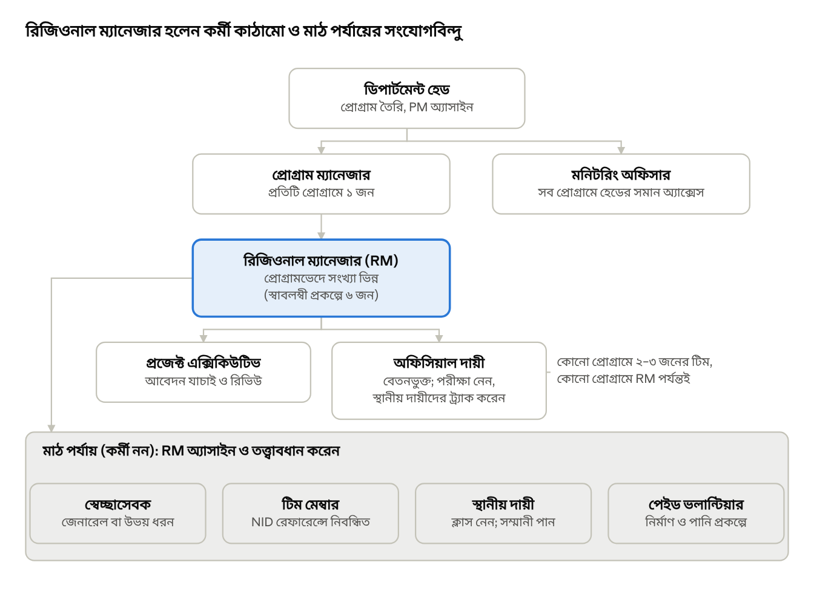
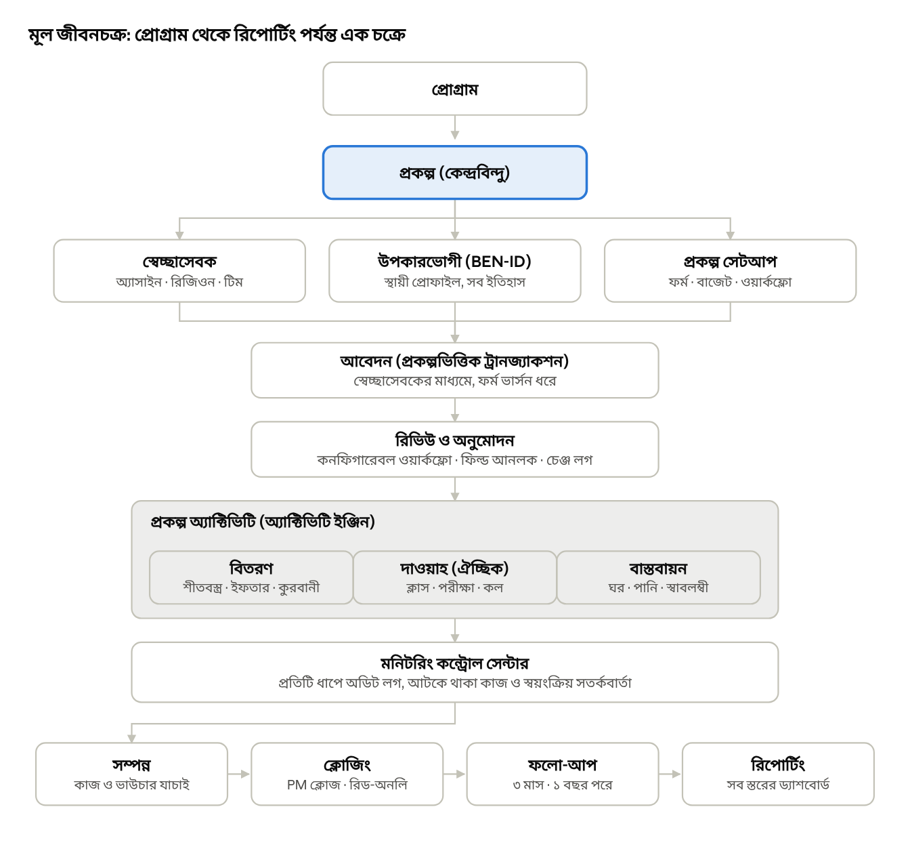
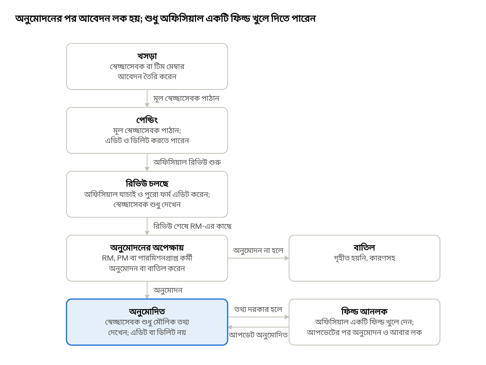
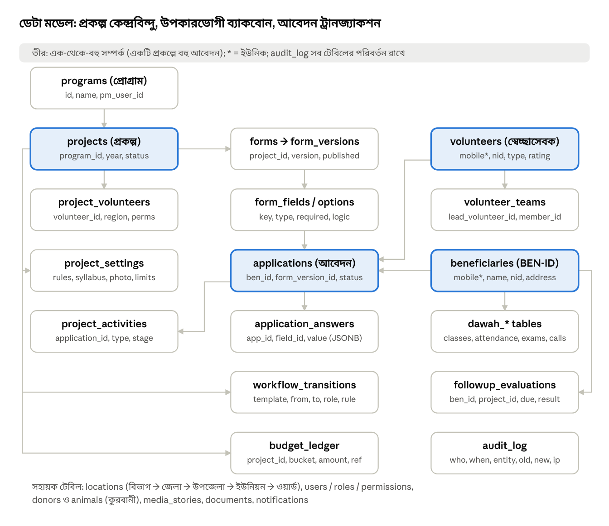
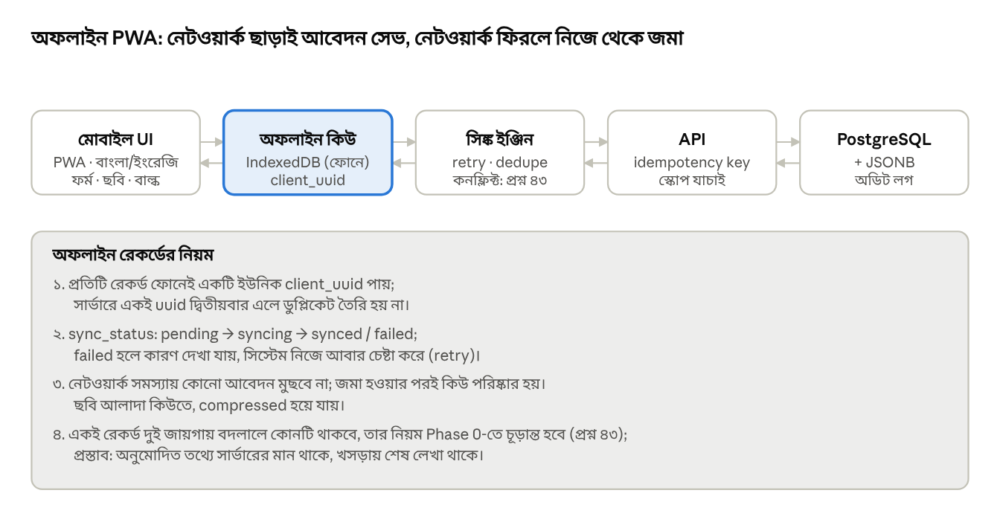
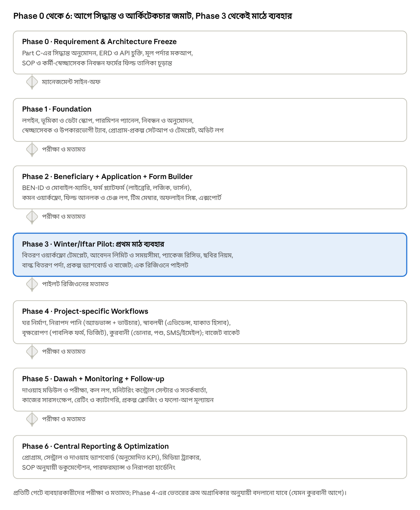

<!-- Converted from the owner's Claude Doc export (docx, version 2 of 5 Oct 2026). Regenerated 10 Oct 2026: numbered lists, sub-headings (####), bold and figure captions preserved. This file is the business authority (/docs/source/ERP_BLUEPRINT_BN.md). If the blueprint changes, re-export the Claude Doc and replace this file. -->

# চ্যারিটি এন্ড সোশ্যাল সার্ভিস ERP সিস্টেম — প্রস্তাবনা ও কার্যপ্রণালী

Oct 1, 2026 · @Robeyoul Awal Raju

সংস্করণ ২ (৫ অক্টোবর ২০২৬): প্রস্তাবনা, সিস্টেম আর্কিটেকচার ও ডেভেলপমেন্ট ব্লুপ্রিন্ট এক ডকুমেন্টে। আগের সংস্করণের সব সিদ্ধান্ত অপরিবর্তিত; নতুন আর্কিটেকচার পরামর্শ "প্রস্তাবিত" হিসেবে যুক্ত।

#### এই ডকুমেন্ট কীভাবে পড়বেন

| অংশ | কার জন্য | কী আছে |
|---|---|---|
| Part A: কার্যক্রম ব্লুপ্রিন্ট | ম্যানেজমেন্ট, প্রজেক্ট টিম, MEAL | বিভাগের কাজ সিস্টেমে কীভাবে চলবে: ভূমিকা, নিবন্ধন, প্রকল্প সেটআপ, আবেদন, কার্যপ্রবাহ, দাওয়াহ, মনিটরিং, ড্যাশবোর্ড |
| Part B: সিস্টেম ও টেকনিক্যাল আর্কিটেকচার | ডেভেলপার ও টেকনিক্যাল লিড; ম্যানেজমেন্টও বুঝবেন | ডেটা মডেল, ডায়নামিক ফর্ম প্ল্যাটফর্ম, ডেটা স্কোপ, ওয়ার্কফ্লো ইঞ্জিন, বাজেট মডেল, অফলাইন PWA, নিরাপত্তা |
| Part C: অনুমোদনের অপেক্ষায় থাকা সিদ্ধান্ত | ম্যানেজমেন্ট | কী সিদ্ধান্ত হয়েছে, কী আলোচনা বাকি, ডেভেলপমেন্টের আগে কী চূড়ান্ত করতেই হবে |
| Part D: ডেভেলপমেন্ট রোডম্যাপ | সবাই | Phase 0 থেকে 6 |
| পরিশিষ্ট | প্রজেক্ট টিম, ডেভেলপার | পরিভাষা; বর্তমান ফর্মের ফিল্ড ম্যাপিং |

তিন ধরনের বক্তব্য আলাদা করে লেখা: **সিদ্ধান্ত হয়েছে** (বিভাগ থেকে নিশ্চিত; সাধারণভাবে লেখা), **প্রস্তাবিত** (আর্কিটেকচার বা ডিজাইন পরামর্শ, পাশে "(প্রস্তাবিত)" লেখা; অনুমোদন পেলে সিদ্ধান্ত হবে), **আলোচনা দরকার** (পাশে "(প্রশ্ন N)" লেখা; Part C-তে তালিকা ও অবস্থা)।

#### সূচিপত্র

- Part A (কার্যক্রম ব্লুপ্রিন্ট): A১ ভূমিকা, উদ্দেশ্য ও মূল নীতি · A২ বিভাগ, প্রোগ্রাম ও প্রকল্প কাঠামো · A৩ মূল জীবনচক্র · A৪ ব্যবহারকারী, ভূমিকা ও পারমিশন · A৫ নিবন্ধন, প্রোফাইল ও স্বেচ্ছাসেবক ব্যবস্থাপনা · A৬ প্রোগ্রাম ও প্রকল্প সেটআপ · A৭ আবেদন ও অনুমোদন কার্যপ্রবাহ · A৮ প্রকল্পভিত্তিক কার্যপ্রবাহ · A৯ দাওয়াহ মডিউল · A১০ মনিটরিং কন্ট্রোল সেন্টার, অডিট লগ, ডকুমেন্টেশন ও মিডিয়া · A১১ ড্যাশবোর্ড, রিপোর্ট ও ডাউনলোড
- Part B: B১ আর্কিটেকচার ওভারভিউ ও কোর মডিউল · B২ ডেটা মডেল ও সম্পর্ক · B৩ ডায়নামিক ফর্ম প্ল্যাটফর্ম · B৪ ভূমিকা, পারমিশন ও ডেটা স্কোপ · B৫ ওয়ার্কফ্লো ও অ্যাক্টিভিটি ইঞ্জিন · B৬ বাজেট ও হিসাব মডেল · B৭ অফলাইন PWA ও সিঙ্ক · B৮ নিরাপত্তা, অডিট ও ডেটা সুরক্ষা · B৯ প্রযুক্তি স্ট্যাক
- Part C: C১ সিদ্ধান্ত ও প্রশ্নের তালিকা · C২ নতুন টেকনিক্যাল সিদ্ধান্ত · C৩ Development শুরু করার আগে অবশ্যই চূড়ান্ত করতে হবে
- Part D: D১ ডেভেলপমেন্ট ব্লুপ্রিন্ট (Phase 0–6) · D২ কাজের পদ্ধতি
- পরিশিষ্ট ক পরিভাষা · পরিশিষ্ট খ বর্তমান ফর্মের ফিল্ড ও নতুন সিস্টেমে ম্যাপিং

## Part A — কার্যক্রম ব্লুপ্রিন্ট (Operational Blueprint)

### A১. ভূমিকা, উদ্দেশ্য ও মূল নীতি

এই ERP সিস্টেম আস-সুন্নাহ ফাউন্ডেশনের চ্যারিটি এন্ড সোশ্যাল সার্ভিস ডিপার্টমেন্টের সব প্রকল্পের কাজ এক জায়গায় আনবে: স্বেচ্ছাসেবক নিবন্ধন থেকে উপকারভোগীর আবেদন, যাচাই, অনুমোদন, বিতরণ বা বাস্তবায়ন, দাওয়াহ ক্লাস, বাজেট-হিসাব, মনিটরিং, ফলো-আপ ও রিপোর্টিং পর্যন্ত। প্রতিটি কাজ কে, কখন, কতদূর করলেন তা যেকোনো সময় দেখা যাবে।

#### পরিধি (Scope)

সিস্টেমের কেন্দ্র শুধু এই বিভাগের কাজ: প্রকল্প, উপকারভোগী, আবেদন, স্বেচ্ছাসেবক, ওয়ার্কফ্লো, প্রকল্প অ্যাক্টিভিটি, দাওয়াহ, মনিটরিং, ফলো-আপ ও রিপোর্টিং। HR, পে-রোল, প্রকিউরমেন্ট, ইনভেন্টরির মতো সাধারণ এন্টারপ্রাইজ মডিউল এই পরিধির বাইরে; ভবিষ্যতে দরকার হলে আলাদা মডিউল হিসেবে যুক্ত হতে পারে, মূল আর্কিটেকচারে নয়। তবে প্রকিউরমেন্ট টিমের জন্য একটি ভিউয়ার ভূমিকা থাকবে (A৪), যাতে ঘর নির্মাণের ইস্যু তাঁরা সমাধান করতে পারেন; এটি প্রকিউরমেন্ট মডিউল নয়, শুধু একটি ভূমিকা।

#### এই ডকুমেন্টের উদ্দেশ্য

ডেভেলপমেন্ট শুরুর আগে ম্যানেজমেন্ট কার্যপ্রক্রিয়া অনুমোদন করবেন, MEAL মনিটরিং ও রিপোর্টিং বুঝবেন, প্রজেক্ট টিম ওয়ার্কফ্লো বুঝবে, আর ডেভেলপার ডেটাবেস, API ও মডিউল ডিজাইন শুরু করতে পারবে। Part C-তে যা এখনো চূড়ান্ত হয়নি তার তালিকা আছে; সেখানে সরাসরি মতামত দেওয়া যাবে।

#### সিস্টেমের মূল নীতি

1. সব কাজ প্রোগ্রাম → প্রকল্প কাঠামোর ভেতরে; প্রতি বছর নতুন প্রকল্প, আগের বছরের সেটআপ টেমপ্লেট থেকে কপি করা যাবে।
2. উপকারভোগী ও আবেদন আলাদা: একজন মানুষের একটিই স্থায়ী প্রোফাইল (BEN-ID), যার ভিত্তি NID বা জন্মনিবন্ধন; বিভিন্ন বছর ও প্রকল্পে তাঁর একাধিক আবেদন, কিন্তু প্রোফাইল একটিই।
3. পারমিশন ভূমিকা ও ডেটা স্কোপ, দুটোর ওপর নির্ভর করে এবং প্রকল্পভিত্তিক; কোনোটিই হার্ডকোড নয়, পারমিশন প্যানেল থেকে বদলানো যায়।
4. অনুমোদিত তথ্য কেউ নিজে বদলাতে পারবেন না; শুধু ফিল্ড আনলক করে সংশোধন, প্রতিটি পরিবর্তনের আগের ও পরের মান কারণসহ লগে।
5. প্রকল্পের কাজ রিজিওন ধরে; স্বেচ্ছাসেবক ও উপকারভোগীর কেন্দ্রীয় তালিকা সব অফিসিয়াল সারা দেশের দেখবেন।
6. প্রতিটি প্রকল্পের বাজেট সিস্টেমে: উপকারভোগীপ্রতি খরচ × সংখ্যা = পরিকল্পিত বাজেট; কত বিতরণ হলো, কত বাকি, সব সময় দেখা যাবে।
7. মাঠের আপডেট এক পর্দা থেকে একসাথে (বাল্ক); মোবাইল PWA, নেটওয়ার্ক ছাড়াও কাজ; ইন্টারফেস শুরু থেকেই বাংলা ও ইংরেজি।
8. দাওয়াহ প্রকল্পের ঐচ্ছিক উপাদান; চালু করলে সিলেবাস, ক্লাস, উপস্থিতি, পরীক্ষা ও কল লগ সক্রিয় হয়।
9. মনিটরিং শুধু রিপোর্ট নয়, অপারেশনাল কন্ট্রোল সেন্টার: আটকে থাকা কাজ ও সমস্যা নিজে থেকে চিহ্নিত করবে। প্রকল্প ক্লোজের পর ফলো-আপ মূল্যায়নে সহায়তার ফল মাপা হবে।
10. প্রতিটি ধাপের স্থায়ী অডিট লগ; সব তালিকা ও রিপোর্ট Excel/CSV ও PDF-এ ডাউনলোড।

### A২. বিভাগ, প্রোগ্রাম ও প্রকল্প কাঠামো

বিভাগটি সারা বাংলাদেশে দরিদ্র মানুষদের নিয়ে কাজ করে; কাজ সাজানো প্রোগ্রাম → প্রকল্প কাঠামোতে। বর্তমানে তিনটি প্রোগ্রাম, প্রতিটির অধীনে এক বা একাধিক প্রকল্প; প্রোগ্রামের বাইরে আলাদা উইং আছে, যেমন মিডিয়া টিম।

| প্রোগ্রাম | প্রকল্প | কার্যপ্রবাহের ধরন |
|---|---|---|
| হিউম্যানিটেরিয়ান প্রোগ্রাম | শীতবস্ত্র, ইফতার, কুরবানী, বৃক্ষরোপণ, নিরাপদ পানি ইত্যাদি | বিতরণ; কুরবানীতে ডোনার ও পশু; বৃক্ষরোপণে ওপেন আবেদন ও ভিজিট; নিরাপদ পানিতে অ্যাডভান্স ও ভাউচার |
| আন্ডারপ্রিভিলেজড কমিউনিটি ডেভেলপমেন্ট প্রোগ্রাম | স্বাবলম্বী প্রকল্প | বাস্তবায়ন, এভিডেন্স (ভাউচার, ছবি), দাওয়াহ, ফলো-আপ |
| ইমারজেন্সি রেসপন্স এন্ড রেজিলিয়েন্স প্রোগ্রাম | বন্যা প্রকল্প, সেমি পাকা ঘর নির্মাণ, টিনের ঘর নির্মাণ | নির্মাণ ধাপ, পেইড ভলান্টিয়ার, দাওয়াহ |

#### সাংগঠনিক কাঠামো

- ডিপার্টমেন্ট হেড: সবার উপরে; প্রোগ্রাম তৈরি করেন ও প্রোগ্রাম ম্যানেজার অ্যাসাইন করেন।
- প্রোগ্রাম ম্যানেজার (প্রতিটি প্রোগ্রামে একজন) ও মনিটরিং অফিসার: ডিপার্টমেন্ট হেডের অধীনে। মনিটরিং অফিসারের অ্যাক্সেস সব জায়গায় ডিপার্টমেন্ট হেডের সমান।
- রিজিওনাল ম্যানেজার (RM; রিজিওনাল অফিসার একই ভূমিকা): প্রোগ্রাম ম্যানেজারের অধীনে; সংখ্যা প্রোগ্রামভেদে ভিন্ন, যেমন স্বাবলম্বী প্রকল্পে ৬ জন।
- প্রজেক্ট এক্সিকিউটিভ (প্রজেক্ট অফিসার, একই পদ) ও অফিসিয়াল দায়ী: রিজিওনাল ম্যানেজারের অধীনে বেতনভুক্ত কর্মী। কোনো প্রোগ্রামে ২–৩ জনের টিম, কোনো প্রোগ্রামে রিজিওনাল ম্যানেজার পর্যন্তই; পরে বাড়তে পারে।

প্রজেক্ট এক্সিকিউটিভরা স্বেচ্ছাসেবকদের পাঠানো আবেদন যাচাই-বাছাই ও রিভিউ করেন। দায়ী দুই ধরনের: অফিসিয়াল দায়ী (বেতনভুক্ত কর্মী) প্রাথমিক ও সমাপনী পরীক্ষা নেন, স্থানীয় দায়ীরা প্রতিদিনের ক্লাসের আপডেট দিচ্ছেন কি না ট্র্যাক করেন এবং উপকারভোগীদের ফোনে খোঁজ নেন; স্থানীয় দায়ী (মাঠ পর্যায়ে, পেইড ভলান্টিয়ারের মতো সম্মানীভুক্ত) উপকারভোগীদের ক্লাস নেন ও প্রতিদিন কী শেখানো হলো তার আপডেট দেন।

সাংগঠনিক কাঠামো · ৪ স্তর ও মাঠ পর্যায়

উপরের চার স্তর বিভাগের বেতনভুক্ত কর্মী; মাঠ পর্যায়ের স্বেচ্ছাসেবক, টিম মেম্বার, স্থানীয় দায়ী ও পেইড ভলান্টিয়ারদের RM-ই প্রকল্পে অ্যাসাইন করেন ও তত্ত্বাবধান করেন।

#### তিনটি মাস্টার ডেটা

| মাস্টার | কী | বিস্তারিত |
|---|---|---|
| উপকারভোগী মাস্টার | একজন মানুষের একটিই স্থায়ী প্রোফাইল (BEN-ID): নাম, মোবাইল, NID/জন্মনিবন্ধন, ঠিকানা, GPS, ছবি, পরিবার, আয়; সব বছরের সহায়তা, দাওয়াহ ও ফলো-আপের ইতিহাস | A৭, B২ |
| স্বেচ্ছাসেবক মাস্টার | নিবন্ধিত সব স্বেচ্ছাসেবক; একাধিক প্রকল্পে থাকতে পারেন, প্রকল্প অনুযায়ী পারমিশন আলাদা; টিম, রেটিং ও ক্যাটাগরি | A৫ |
| প্রকল্প | পুরো কার্যক্রমের কেন্দ্র: প্রোগ্রাম → প্রকল্প → রিজিওন → স্বেচ্ছাসেবক → আবেদন; সেটআপই প্রকল্পের নিয়ম ঠিক করে | A৬ |

### A৩. মূল জীবনচক্র (Core Business Lifecycle)

সিস্টেমের সব কাজ একটি মূল চক্রে চলে: প্রোগ্রাম → প্রকল্প → উপকারভোগী → আবেদন → রিভিউ/অনুমোদন → প্রকল্প অ্যাক্টিভিটি → সম্পন্ন → মনিটরিং → ফলো-আপ → রিপোর্টিং। প্রকল্প এই চক্রের কেন্দ্রবিন্দু, উপকারভোগী ডেটার ব্যাকবোন, আর আবেদন প্রতিটি প্রকল্পের অপারেশনাল ট্রানজ্যাকশন; স্বেচ্ছাসেবক মাঠের মূল কর্মী, ওয়ার্কফ্লো নিয়ন্ত্রণের স্তর, মনিটরিং ম্যানেজমেন্টের স্তর।

মূল জীবনচক্র · প্রকল্প কেন্দ্রবিন্দু, উপকারভোগী ব্যাকবোন, আবেদন ট্রানজ্যাকশন

| ধাপ | কী হয় | কে | অধ্যায় |
|---|---|---|---|
| প্রোগ্রাম | ডিপার্টমেন্ট হেড প্রোগ্রাম খোলেন, PM অ্যাসাইন করেন | ডিপার্টমেন্ট হেড | A২, A৬ |
| প্রকল্প | PM প্রকল্প তৈরি ও কনফিগার করেন: এলাকা, RM, ফর্ম, বাজেট, নিয়ম, ওয়ার্কফ্লো টেমপ্লেট | PM | A৬ |
| উপকারভোগী | NID বা জন্মনিবন্ধন দিয়ে শনাক্ত; আগে আবেদন করে থাকলে প্রাথমিক তথ্য নিজে থেকে চলে আসে | স্বেচ্ছাসেবক, সিস্টেম | A৭, B৩ |
| আবেদন | স্বেচ্ছাসেবক বা টিম প্রকল্পের ফর্মে আবেদন তৈরি ও পাঠান | স্বেচ্ছাসেবক, RM, অফিসিয়াল | A৭ |
| রিভিউ ও অনুমোদন | কনফিগার করা ওয়ার্কফ্লোতে যাচাই, এডিট, অনুমোদন বা বাতিল | এক্সিকিউটিভ, RM (ঘর নির্মাণে PM) | A৭, B৫ |
| প্রকল্প অ্যাক্টিভিটি | বিতরণ, নির্মাণ, টাকা পাঠানো, ভাউচার, ভিজিট, দাওয়াহ ক্লাস; বাল্ক আপডেট ও ছবি | স্বেচ্ছাসেবক, পেইড ভলান্টিয়ার, দায়ী | A৮, A৯ |
| সম্পন্ন | কাজ ও ভাউচার যাচাই, আবেদন "সম্পন্ন"; প্রকল্প শেষে PM ক্লোজ | অফিসিয়াল, PM | A৬, A৭ |
| মনিটরিং | প্রতিটি ধাপে অডিট লগ, আটকে থাকা কাজ, সতর্কবার্তা, কাজের সারসংক্ষেপ | মনিটরিং অফিসার, ডিপার্টমেন্ট হেড | A১০ |
| ফলো-আপ | চলমান কাজ: ক্লোজের পরও যখনই খোঁজ নেওয়া হয়, মূল্যায়ন যোগ হয় | অফিসিয়াল, অফিসিয়াল দায়ী | A৬ |
| রিপোর্টিং | প্রকল্প, প্রোগ্রাম, সেন্ট্রাল ও দাওয়াহ ড্যাশবোর্ড; Excel/CSV/PDF | সবাই (স্কোপ অনুযায়ী) | A১১ |

### A৪. ব্যবহারকারী, ভূমিকা ও পারমিশন

সিস্টেমে দুই ধরনের ব্যবহারকারী: অফিসিয়াল (কর্মী) ও স্বেচ্ছাসেবক। প্রতিটি ভূমিকার পারমিশন প্রকল্পভিত্তিক; একই ব্যক্তি এক প্রকল্পে রিভিউয়ার, অন্য প্রকল্পে শুধু ভিউয়ার হতে পারেন। কে কোন তথ্য দেখবেন বা বদলাবেন তা ভূমিকা এবং ডেটা স্কোপ (সারা দেশ, প্রোগ্রাম, প্রকল্প, রিজিওন, জেলা, নিজের) দুটো মিলিয়ে ঠিক হয় (B৪)। রিজিওনাল ম্যানেজার ও রিজিওনাল অফিসার একই ভূমিকা; প্রজেক্ট অফিসার ও প্রজেক্ট এক্সিকিউটিভ একই পদ।

#### অফিসিয়াল ভূমিকা

| ভূমিকা | মূল দায়িত্ব |
|---|---|
| ডিপার্টমেন্ট হেড | সর্বোচ্চ অ্যাক্সেস: সব প্রোগ্রাম, উইং ও সেন্ট্রাল ড্যাশবোর্ড; প্রোগ্রাম তৈরি ও PM অ্যাসাইন; কর্মী ও স্বেচ্ছাসেবক নিবন্ধন অনুমোদন; ব্লকলিস্ট; পারমিশন প্যানেল |
| প্রোগ্রাম ম্যানেজার (PM) | নিজ প্রোগ্রামে প্রকল্প তৈরি ও সেটআপ (উপাদান বাছাই, আবেদন ফর্ম, বাজেট, সময়সীমা, নিয়মাবলি), এলাকা ও RPM অ্যাসাইন, প্রোগ্রাম ড্যাশবোর্ড; ঘর নির্মাণ প্রকল্পে আবেদনের চূড়ান্ত অনুমোদন; প্রকল্প ক্লোজ; SOP অনুযায়ী প্রস্তাবনা, মানদণ্ড ও সমাপ্তি প্রতিবেদনের দায়িত্ব |
| মনিটরিং অফিসার / টিম | সব জায়গায় ডিপার্টমেন্ট হেডের সমান অ্যাক্সেস; মনিটরিং কন্ট্রোল সেন্টার, অডিট লগ ও কর্মীদের কাজ পর্যবেক্ষণ; নিবন্ধন অনুমোদন; ব্লকলিস্ট; পারমিশন প্যানেল |
| রিজিওনাল প্রোগ্রাম ম্যানেজার (RPM) | SOP-এর RPM; নিজ রিজিওনে প্রকল্পের পূর্ণ অ্যাক্সেস; স্বেচ্ছাসেবক, পেইড ভলান্টিয়ার ও স্থানীয় দায়ী যোগ; আবেদন নিয়ে আসা ও চূড়ান্ত অনুমোদন; আবেদন হস্তান্তর; টিমকে অনুমোদনসহ যেকোনো পারমিশন দেওয়া; মাঠপর্যায়ের ডকুমেন্ট সংগ্রহ ও জমা |
| প্রজেক্ট এক্সিকিউটিভ (প্রজেক্ট অফিসার) | আবেদন যাচাই, রিভিউ ও এডিট; রিভিউ শেষে RPM-এর কাছে পাঠানো; নিজেও মাঠ থেকে আবেদন আনতে পারেন (ঘর নির্মাণ); স্বেচ্ছাসেবক নিবন্ধন ও এডিট রিকোয়েস্ট অনুমোদন |
| বাস্তবায়নকারী | SOP-এর পদবী; নিরাপদ পানি প্রকল্পের সার্বিক বাস্তবায়ন ও সংশ্লিষ্ট সব ডকুমেন্টের দায়িত্ব |
| অফিসিয়াল দায়ী | RPM-এর অধীনে বেতনভুক্ত কর্মী: প্রাথমিক ও সমাপনী পরীক্ষা নেওয়া; স্থানীয় দায়ীরা প্রতিদিনের ক্লাসের আপডেট দিচ্ছেন কি না ট্র্যাক করা; উপকারভোগীদের ফোনে খোঁজ নেওয়া ও কল লগ রাখা |
| প্রকিউরমেন্ট টিম | বর্তমানে শুধু ঘর নির্মাণ প্রকল্পে। আবেদন শুধু দেখতে পারবেন (এডিট বা ডিলিট নয়); ইস্যু লগে নিজেরা ইস্যু দিতে পারবেন, এবং নিজেদের বা পেইড ভলান্টিয়ারের দেওয়া ইস্যু সমাধান করে এন্ট্রি দিতে পারবেন |
| মিডিয়া টিম | আবেদন ও উপকারভোগীর গল্প দেখতে পারবেন, গল্প পড়ে প্রয়োজনে নতুন গল্প লিখতে ও সম্পাদনা করতে পারবেন, মাঠ থেকে ছবি-ভিডিও এনে প্রচারের জন্য ট্র্যাকারে রাখবেন। প্রকল্প, আবেদন বা উপকারভোগীর কোনো তথ্য বদলাতে পারবেন না—শুধু নিজেদের গল্প ও মিডিয়া কনটেন্ট |
| ফাইন্যান্স টিম | ভিউয়ার: বাজেট, পরিশোধ, ভাউচার ও খরচের হিসাব দেখতে পারবেন এবং CSV/PDF রিপোর্ট নিতে পারবেন; কোনো এন্ট্রি, এডিট বা অনুমোদন নয় |

#### স্বেচ্ছাসেবকের ধরন

| ধরন | কাজ |
|---|---|
| জেনারেল | সব প্রকল্পে উপকারভোগীর আবেদন পাঠানো ও বিতরণ |
| দায়ী (স্থানীয় দায়ী) | উপকারভোগীদের ইসলামের মৌলিক জ্ঞানের ক্লাস; প্রতিদিনের ক্লাসে উপস্থিতি ও কী শেখানো হলো তার আপডেট; পেইড ভলান্টিয়ারের মতো সম্মানী পান |
| দাঈ-স্বেচ্ছাসেবক (উভয়) | আবেদন, বিতরণ ও ক্লাস—সব কাজ; টিম মেম্বারও যুক্ত করতে পারেন। রেটিং ভূমিকা ধরে নয়, কাজ ধরে: আবেদন-বিতরণের জন্য এক সেট নম্বর, দাওয়াহর জন্য আলাদা সেট; প্রোফাইলে দুটো আলাদা দেখাবে, গড় করা হবে না |
| টিম মেম্বার | মূল স্বেচ্ছাসেবকের NID রেফারেন্সে নিবন্ধিত; শুধু আবেদন তৈরি করতে পারেন |
| পেইড ভলান্টিয়ার | একই নিবন্ধন ফর্মে আলাদা ধরন; প্রকল্পে RPM পেইড হিসেবে চিহ্নিত করেন। ঘর নির্মাণ ও নিরাপদ পানি প্রকল্পে কাজের অগ্রগতি আপডেট ও ইস্যু জানানো; আবেদন দেখতে পারেন, এডিট নয় |

#### পারমিশন ম্যাট্রিক্স (একটি প্রকল্পের ভেতরে, ডিফল্ট)

"RM দিলে" মানে ডিফল্টে নেই, RM পারমিশন দিলে পাবেন। ডিপার্টমেন্ট হেড ও মনিটরিং অফিসারের সব জায়গায় সর্বোচ্চ অ্যাক্সেস, তাই তাঁদের আলাদা কলাম নেই। "স্বেচ্ছাসেবক" কলামে জেনারেল ও উভয় ধরন; "দায়ী" কলাম স্থানীয় দায়ীর।

| কাজ | PM | RM | এক্সিকিউটিভ | স্বেচ্ছাসেবক | টিম মেম্বার | দায়ী | পেইড ভল. |
|---|---|---|---|---|---|---|---|
| প্রকল্প তৈরি, উপাদান বাছাই, আবেদন ফর্ম, বাজেট, সময়সীমা, নিয়মাবলি, সিলেবাস, রেটিং মানদণ্ড, সেটিং | ✓ | — | — | — | — | — | — |
| আবেদনের সময়সীমা বাড়ানো; প্রকল্প ক্লোজ করা | ✓ | — | — | — | — | — | — |
| এলাকা ও RM অ্যাসাইন; RM-দের মধ্যে জেলা ভাগ | ✓ | — | — | — | — | — | — |
| কর্মীকে ভিউ/এডিট/ডিলিট অ্যাক্সেস দেওয়া | ✓ | ✓ | — | — | — | — | — |
| স্বেচ্ছাসেবক নিবন্ধন অনুমোদন (ডিপার্টমেন্ট হেড ও মনিটরিং টিমও) | ✓ | ✓ | ✓ | — | — | — | — |
| স্বেচ্ছাসেবক, স্থানীয় দায়ী, পেইড ভলান্টিয়ার প্রকল্পে যোগ | — | ✓ | RM দিলে | — | — | — | — |
| স্বেচ্ছাসেবকের রেটিং ও ক্যাটাগরি দেখা ও দেওয়া | ✓ | ✓ | ✓ | — | — | — | — |
| স্বেচ্ছাসেবক বা উপকারভোগীকে ব্লকলিস্টে দেওয়া ও তোলা (কারণসহ; হেড ও মনিটরিং টিমও) | ✓ | ✓ | — | — | — | — | — |
| আবেদন অন্য স্বেচ্ছাসেবকের কাছে হস্তান্তর | — | ✓ | RM দিলে | — | — | — | — |
| টিম মেম্বার যুক্ত করা | — | — | — | ✓ | — | উভয় ধরন হলে ✓ | — |
| আবেদন তৈরি | — | ✓ | ✓ | ✓ | ✓ | — | — |
| আবেদন অফিসে পাঠানো | — | ✓ | ✓ | ✓ | — | — | — |
| আবেদন রিভিউ ও পুরো ফর্ম এডিট | — | ✓ | ✓ | — | — | — | — |
| সরেজমিন যাচাই: মন্তব্য ও সুপারিশ (বৃক্ষরোপণ) | — | ✓ | ✓ | ✓ | — | — | — |
| আবেদন অনুমোদন | ঘর নির্মাণে ✓ | ✓ | RM দিলে | — | — | — | — |
| অনুমোদনের পর ফিল্ড আনলক | — | ✓ | ✓ | — | — | — | — |
| স্বেচ্ছাসেবকের এডিট রিকোয়েস্ট অনুমোদন | — | ✓ | ✓ | — | — | — | — |
| সব আবেদন দেখা | ✓ | ✓ | ✓ | নিজেরগুলো | নিজেরগুলো | নিজের উপকারভোগী | ✓ |
| সারা দেশের স্বেচ্ছাসেবক ও উপকারভোগী ট্যাব | ✓ | ✓ | ✓ | — | — | — | — |
| বিতরণের আপডেট ও ছবি | — | ✓ | ✓ | ✓ | — | — | — |
| নির্মাণ/কাজের অগ্রগতি আপডেট | — | ✓ | ✓ | নিরাপদ পানিতে ✓ | — | — | ✓ |
| ইস্যু লগে সমস্যা জানানো (ছবিসহ; প্রকিউরমেন্ট টিমও) | — | ✓ | ✓ | ✓ | — | ✓ | ✓ |
| ইস্যু সমাধান ও সমাধানের আপডেট (প্রকিউরমেন্ট টিমও) | ✓ | ✓ | ✓ | — | — | — | — |
| উপকারভোগীকে টাকা পাঠানোর রেকর্ড (তারিখ, পরিমাণ, ট্রানজেকশন আইডি) | ✓ | ✓ | ✓ | — | — | — | — |
| ভাউচার ও ছবি জমা (স্বাবলম্বী, নিরাপদ পানি, কুরবানী) | — | ✓ | ✓ | ✓ | — | — | — |
| নিজের কার্যক্রম খরচের হিসাব ও ভাউচার জমা | — | — | — | ✓ | — | ✓ | ✓ |
| খরচ যাচাই ও পরিশোধের রেকর্ড (বিকাশ ট্রানজেকশন আইডি) | ✓ | ✓ | ✓ | — | — | — | — |
| ক্লাসের উপস্থিতি ও শেখার আপডেট | — | — | — | — | — | ✓ | — |
| প্রাথমিক ও সমাপনী পরীক্ষা | — | ✓ | — | — | — | অফিসিয়াল দায়ী; স্থানীয় দায়ী RM দিলে | — |
| উপকারভোগীকে ফলো-আপ কল ও কল লগ | — | — | — | — | — | অফিসিয়াল দায়ী ✓ | — |
| ক্লোজের পর ফলো-আপ মূল্যায়ন যোগ (প্রস্তাবিত) | — | ✓ | ✓ | — | — | অফিসিয়াল দায়ী ✓ | — |
| কর্মী ও স্বেচ্ছাসেবকের কাজের সারসংক্ষেপ (CSV/PDF) | ✓ | নিজ রিজিওন | — | — | — | — | — |
| প্রকল্প ড্যাশবোর্ড, বাজেট ও রিপোর্ট | ✓ | নিজ রিজিওন | নিজ রিজিওন | — | — | — | — |

মিডিয়া, ফাইন্যান্স ও প্রকিউরমেন্ট টিম প্রকল্পের কাজ করেন না, তাই উপরের ম্যাট্রিক্সে তাঁদের আলাদা কলাম নেই; তাঁদের অ্যাক্সেস নিচে:

| কাজ | মিডিয়া টিম | ফাইন্যান্স টিম | প্রকিউরমেন্ট টিম |
|---|---|---|---|
| আবেদন ও উপকারভোগীর তথ্য দেখা | ✓ | — | ঘর নির্মাণে ✓ |
| আবেদন তৈরি, এডিট বা ডিলিট | — | — | — |
| উপকারভোগীর গল্প পড়া, লেখা ও সম্পাদনা | ✓ | — | — |
| ছবি ও ভিডিও সংগ্রহ, প্রচারের ট্র্যাকার | ✓ | — | — |
| মিডিয়া সম্মতির অবস্থা দেখা | ✓ | — | — |
| বাজেট, পরিশোধ, ভাউচার ও খরচের হিসাব দেখা | — | ✓ | — |
| রিপোর্ট ডাউনলোড (CSV/PDF) | নিজের অংশ | ✓ | নিজের অংশ |
| টাকা পরিশোধ বা অনুমোদন | — | — | — |
| ইস্যু লগে ইস্যু দেওয়া | — | — | ✓ |
| ইস্যু সমাধান করে এন্ট্রি দেওয়া | — | — | ✓ |
| রেটিং, ক্যাটাগরি, NID ও ডোনারের তথ্য | — | — | — |

মিডিয়া টিম শুধু নিজেদের গল্প ও মিডিয়া কনটেন্ট বদলাতে পারবেন; প্রকল্প, আবেদন বা উপকারভোগীর কোনো তথ্য নয়।

#### পারমিশন প্যানেল

উপরের ম্যাট্রিক্স ডিফল্ট মাত্র; কোনো পারমিশনই হার্ডকোড হবে না। ডিপার্টমেন্ট হেড বা মনিটরিং অফিসার একটি আলাদা পারমিশন প্যানেল থেকে যে কাউকে যেকোনো দায়িত্ব বা পারমিশন দিতে ও তুলে নিতে পারবেন; প্রতিটি পরিবর্তন অডিট লগে থাকবে।

#### ভূমিকা অনুযায়ী কাজের পর্দা (My Work, প্রস্তাবিত বিন্যাস)

একই সিস্টেম, কিন্তু লগইন করলে প্রত্যেকে নিজের কাজের পর্দা দেখবেন:

| ভূমিকা | লগইন করলে যা দেখবেন |
|---|---|
| স্বেচ্ছাসেবক | আমার প্রকল্প, আমার আবেদন (খসড়া / পেন্ডিং / অনুমোদিত), আজকের বিতরণ, আমার টিম, নোটিফিকেশন |
| টিম মেম্বার | মূল স্বেচ্ছাসেবকের প্রকল্প, নিজের তৈরি আবেদন |
| স্থানীয় দায়ী | আমার উপকারভোগী, আজকের ক্লাস, উপস্থিতি, শেখার অগ্রগতি, বাকি আপডেট |
| পেইড ভলান্টিয়ার | অ্যাসাইন করা উপকারভোগী, বর্তমান ধাপ, অগ্রগতি আপডেট, ইস্যু, ছবি |
| অফিসিয়াল দায়ী | স্থানীয় দায়ীদের ট্র্যাকিং, পরীক্ষার সূচি, কল লগ, ফলো-আপ |
| প্রজেক্ট এক্সিকিউটিভ / RM | রিভিউ ও অনুমোদনের অপেক্ষায় থাকা আবেদন, স্বেচ্ছাসেবক অ্যাসাইন, রিজিওনের অগ্রগতি, এডিট রিকোয়েস্ট |
| PM | প্রকল্প সেটআপ ও টেমপ্লেট, প্রোগ্রাম ড্যাশবোর্ড, বাজেট, সময়সীমা ও ক্লোজিং |
| ডিপার্টমেন্ট হেড / মনিটরিং অফিসার | সেন্ট্রাল ড্যাশবোর্ড, মনিটরিং কন্ট্রোল সেন্টার, পারমিশন প্যানেল, কাজের সারসংক্ষেপ |

### A৫. নিবন্ধন, প্রোফাইল ও স্বেচ্ছাসেবক ব্যবস্থাপনা

সিস্টেমে ঢোকার প্রথম ধাপ দুটি ফর্ম: কর্মী নিবন্ধন ও স্বেচ্ছাসেবক নিবন্ধন; অনুমোদনের পরই কাজ করা যাবে। স্বেচ্ছাসেবক ফর্মের ফিল্ড নিচে (প্রশ্ন ৪২); কর্মী নিবন্ধনে একই ফর্ম ব্যবহার হবে, সাথে পদ ও কর্মস্থলের তথ্য।

#### কর্মী নিবন্ধন

নাম, ছবি, যোগাযোগের তথ্য, পদবি, প্রোগ্রাম ও রিজিওন। অনুমোদন ও ভূমিকা (role) দেবেন ডিপার্টমেন্ট হেড বা মনিটরিং অফিসার।

#### স্বেচ্ছাসেবক নিবন্ধন

পরীক্ষার সময় (Phase 1–2) OTP ডামি রাখা হবে—একটি নির্দিষ্ট কোড, যাতে SMS বা ইমেইল সার্ভিস ছাড়াই নিবন্ধন পরীক্ষা করা যায়। প্রোডাকশনে যাওয়ার আগে আসল SMS ও ইমেইল গেটওয়ে যুক্ত করে ডামি কোড বন্ধ করা হবে (B৯)।

নিবন্ধন শুরু হয় যাচাই দিয়ে: প্রথমে মোবাইল নম্বর ও ইমেইল দিতে হবে, দুটিতেই আলাদা OTP যাবে; দুটি OTP মিললেই বাকি ফর্ম খুলবে। এতে ভুল বা নকল নম্বরে নিবন্ধন আটকায় এবং মোবাইল নম্বরই পরে লগইন আইডি হিসেবে কাজ করে।

| অংশ | ফিল্ড |
|---|---|
| যাচাই | মোবাইল নম্বর (OTP), ইমেইল (OTP) |
| পরিচয় | নাম, পিতার নাম, মাতার নাম, NID নম্বর, WhatsApp নম্বর, ঠিকানা |
| শিক্ষা ও অভিজ্ঞতা | সর্বশেষ শিক্ষাগত যোগ্যতা, অভিজ্ঞতা, কাজের বিবরণ, আগে কোন প্রকল্পে কাজ করেছেন |
| যোগাযোগ | ফেসবুক আইডি |
| ব্যাংক তথ্য (ঐচ্ছিক) | ব্যাংকের নাম, অ্যাকাউন্টের নাম, অ্যাকাউন্ট নম্বর, রাউটিং নম্বর |
| রেফারেন্স | কার মাধ্যমে এসেছেন (টিম মেম্বার হলে মূল স্বেচ্ছাসেবকের NID) |
| সংযুক্তি | নিজের ছবি, NID-এর ছবি |

| এনটিটি (ডকুমেন্টেশন) | মূল ফিল্ড | কী কাজে |
|---|---|---|
| documents | project_id, district, checklist_item, name, required, owner_role, due_date, submitted_at, status, soft_copy_file, hard_copy_code, retain_until | SOP অনুযায়ী ডকুমেন্ট রেজিস্টার; ট্র্যাকিং শিটের বদলে (A১০)। owner_role শুধু অফিসিয়াল ভূমিকা, স্বেচ্ছাসেবক নয় |
| deficiency_reports | document_id, reported_by, event_date, description, loss_type, recovery_steps, evidence, prior_count, pm_decision, at | ঘাটতি প্রতিবেদন ও কেন্দ্রীয় লগ (SOP ধারা ৭) |

| এনটিটি (সর্বশেষ সংযোজন) | মূল ফিল্ড | কী কাজে |
|---|---|---|
| application_scores | application_id, criteria (JSONB), total_score, computed_at | অগ্রাধিকার স্কোর ও তালিকা সাজানো (A৭) |
| project_quotas | project_id, level (district/union), area_id, target, approved_count | এলাকাভিত্তিক কোটা (A৭) |
| stock_movements | project_id, volunteer_id, item, sent, received, distributed, remaining, damaged, note | মালামালের মিলকরণ (A৮.১) |
| profile_merges | kept_ben_id, merged_ben_id, reason, by, at, reverted_at | প্রোফাইল মার্জের রেকর্ড ও বাতিল (A৭) |
| handovers | from_user_id, to_user_id, scope (JSONB), approved_by, at | কর্মীর প্রস্থান ও দায়িত্ব হস্তান্তর (A৫) |
| fund_sources | project_id, source (যাকাত / সাদাকা / জেনারেল / নির্দিষ্ট ডোনার), amount | ফান্ডের উৎস ট্যাগ ও আলাদা হিসাব (B৬) |
| media_consents | beneficiary_id, granted, channels, date, by | মিডিয়া ব্যবহারের সম্মতি (A১০, SOP ধারা ১২) |
| media_stories | title, project_id, beneficiary_id, author, status, published_at, channel | মিডিয়া টিমের গল্প ও প্রচার ট্র্যাকার |
| device_sessions | user_id, device, last_seen, revoked_at | ফোন হারালে সেশন বাতিল (B১০) |

ব্যাংক তথ্য বাধ্যতামূলক নয়, তবে কার্যক্রম খরচ পরিশোধের সময় কাজে লাগে (B৬)। ব্যাংক ও NID-এর তথ্য সংবেদনশীল, তাই শুধু অনুমোদিত অফিসিয়ালরা দেখবেন (B৮)।

- ব্যক্তিগত তথ্য, ছবি, NID নম্বর, মোবাইল
- ঠিকানা: বিভাগ, জেলা, উপজেলা, ইউনিয়ন (পরে এই দিয়েই সব ফিল্টার হবে)
- ধরন: জেনারেল / দায়ী / উভয় / পেইড ভলান্টিয়ার
- রেফারেন্স (ফর্মের শেষে): টিম মেম্বার হলে মূল স্বেচ্ছাসেবকের NID নম্বর; নম্বর মিললে সিস্টেম তাঁর নাম দেখাবে

#### যাচাই ও অনুমোদন

1. নিবন্ধনের পর আবেদনটি "পেন্ডিং" অবস্থায় থাকে এবং স্বেচ্ছাসেবক ট্যাবে দেখা যায়।
2. প্রজেক্ট অফিসার (এক্সিকিউটিভ), RM, PM, মনিটরিং টিম বা ডিপার্টমেন্ট হেড—এঁদের যে কেউ সেখান থেকেই যাচাই ও অনুমোদন করতে পারেন।
3. কোনো তথ্যে সমস্যা থাকলে (যেমন নাম ভুল, ছবি নেই) পুরো ফর্ম ফেরত যায় না; শুধু সেই ফিল্ডের জন্য সংশোধন অনুরোধ যায়; স্বেচ্ছাসেবক সেই ফিল্ড ঠিক করে আবার জমা দেন।
4. সব ঠিক থাকলে অনুমোদন; স্বেচ্ছাসেবক সক্রিয় হন।

#### স্বেচ্ছাসেবক ট্যাব (কেন্দ্রীয় তালিকা)

- সব নিবন্ধিত স্বেচ্ছাসেবক একটি আলাদা ট্যাবে; নতুন নিবন্ধনের আবেদনও এখানেই পেন্ডিং হিসেবে থাকবে। অনুমোদন দেওয়া বা নির্দিষ্ট ফিল্ডের সংশোধন অনুরোধ পাঠানো এখান থেকেই হবে।
- যেকোনো অফিসিয়াল বা অফিসিয়াল দায়ী সারা বাংলাদেশের সব স্বেচ্ছাসেবকের তালিকা দেখবেন; বিভাগ, জেলা, উপজেলা, ইউনিয়ন, ধরন, অবস্থা, প্রকল্পসহ সব ভাবে ফিল্টার করা যাবে।
- উপরে পরিসংখ্যান: মোট স্বেচ্ছাসেবক, মোট আবেদন, কতটি অনুমোদিত, কতটি রিভিউতে ইত্যাদি।
- প্রত্যেকের পাশে ক্যাটাগরি ও রেটিং (শুধু অফিসিয়ালদের জন্য) এবং কাজের সারসংক্ষেপ (A১০); ক্যাটাগরি ও রেটিং দিয়েও ফিল্টার করা যাবে।
- প্রকল্পে অ্যাসাইন ও আবেদনের কাজ অবশ্য রিজিওন ধরেই হবে।

#### প্রোফাইলের নিয়ম

- অনুমোদনের আগে স্বেচ্ছাসেবক শুধু নিজের প্রোফাইল দেখেন; প্রকল্প অংশে লেখা থাকবে "আপনি এখনো কোনো প্রকল্পে অংশগ্রহণ করেননি"।
- অনুমোদনের পর নিজের তথ্য সরাসরি এডিট করতে পারবেন না; "এডিট রিকোয়েস্ট" পাঠাতে পারবেন।
- এডিট রিকোয়েস্ট অনুমোদন করবেন RM বা প্রজেক্ট এক্সিকিউটিভ, যে কেউ; তিনি নির্দিষ্ট তথ্য খুলে দিলে তবেই তা বদলানো যাবে, বদলের পর আবার লক।
- প্রতিটি নিবন্ধন, সংশোধন ও অনুমোদন অডিট লগে থাকবে।

#### প্রকল্পে স্বেচ্ছাসেবক অ্যাসাইন

প্রকল্পের মূল কাজ আবেদন নিয়ে আসা, আর সব আবেদন আসে স্বেচ্ছাসেবকদের মাধ্যমে; তাই প্রকল্প তৈরির পর প্রথম কাজ স্বেচ্ছাসেবক যোগ করা। আবেদন RM ও অফিসাররাও করতে পারবেন।

- স্বেচ্ছাসেবক ট্যাবে সারা দেশের তালিকা থাকলেও প্রকল্পে স্বেচ্ছাসেবক ও আবেদন রিজিওন অনুযায়ী আসবে: অ্যাসাইন করার সময় RM নিজ রিজিওনের অনুমোদিত স্বেচ্ছাসেবকদের দেখবেন।
- জেলা, উপজেলা, ইউনিয়ন দিয়ে ফিল্টার করে এক বা একাধিক স্বেচ্ছাসেবককে একসাথে অ্যাসাইন করা যাবে।
- অ্যাসাইনের সময় স্বেচ্ছাসেবকের ধরন অনুযায়ী পারমিশন সেট দেওয়া হবে; পেইড ভলান্টিয়ারকে RM এখানেই পেইড হিসেবে চিহ্নিত করবেন। একই স্বেচ্ছাসেবক একসাথে একাধিক প্রকল্পে অ্যাসাইন হতে পারবেন; পারমিশন প্রকল্পভিত্তিক।

| পারমিশন সেট | কাদের জন্য | কী করতে পারবেন |
|---|---|---|
| আবেদন + বিতরণ | জেনারেল | উপকারভোগীর আবেদন পাঠানো, প্যাকেজ গ্রহণ ও বিতরণের আপডেট |
| আবেদন + বিতরণ + দাওয়াহ | স্থানীয় দায়ী / উভয় | উপরের সব এবং ক্লাস, উপস্থিতি, শেখার অগ্রগতি ও পরীক্ষার আপডেট |
| কাজের অগ্রগতি | পেইড ভলান্টিয়ার | নির্মাণ বা পানির কাজের ধাপভিত্তিক আপডেট ও ইস্যু জানানো; আবেদন দেখা, এডিট নয় |

#### টিম ব্যবস্থাপনা (NID রেফারেন্স)

একজন স্বেচ্ছাসেবকের একার পক্ষে সব কাজ করা সম্ভব হয় না; তাঁর ৪–৫ বা ১০ জনের টিম থাকতে পারে।

1. টিম মেম্বার সাধারণ স্বেচ্ছাসেবক ফর্মেই নিবন্ধন করেন; রেফারেন্স অংশে মূল স্বেচ্ছাসেবকের NID নম্বর দেন। নম্বর মিললে মূল স্বেচ্ছাসেবকের নাম দেখায়।
2. প্রকল্পে অ্যাসাইন হওয়া মূল স্বেচ্ছাসেবক "টিম মেম্বার অ্যাসাইন" অংশে গিয়ে তাঁর NID রেফারেন্সে যাঁরা নিবন্ধন করেছেন তাঁদের তালিকা দেখেন।
3. সেখান থেকে যাঁদের চান তাঁদের সিলেক্ট করে এই প্রকল্পের টিমে যুক্ত করেন। জেনারেল ও উভয়, দুই ধরনের স্বেচ্ছাসেবকই টিম মেম্বার যুক্ত করতে পারবেন; সব প্রকল্পে একই নিয়ম।

| কাজ | মূল স্বেচ্ছাসেবক | টিম মেম্বার |
|---|---|---|
| আবেদন তৈরি | ✓ | ✓ |
| পাঠানোর আগে (খসড়া) আবেদন এডিট | ✓ | নিজের তৈরি |
| আবেদন অফিসে পাঠানো | ✓ | — |
| পাঠানো (পেন্ডিং) আবেদন এডিট ও ডিলিট | ✓ | — |
| অনুমোদিত আবেদনের মৌলিক তথ্য দেখা | ✓ | নিজের তৈরি করা |

#### স্বেচ্ছাসেবক রেটিং ও ক্যাটাগরি (শুধু অফিসিয়ালদের জন্য)

- রেটিং মানদণ্ড: প্রকল্প তৈরির সময় PM সর্বোচ্চ ৫টি মানদণ্ড ঠিক করবেন (যেমন সময়মতো আবেদন জমা, তথ্যের শুদ্ধতা, বিতরণের ছবি ও আপডেট, নিয়ম মানা); প্রতিটিতে স্বেচ্ছাসেবক ১ থেকে ৫ রেটিং পান।
- রেটিং প্রকল্পভিত্তিক; প্রোফাইলে সব প্রকল্পের রেটিং ও গড় দেখা যাবে। রেটিং কাজের ডেটা থেকে সিস্টেম স্বয়ংক্রিয়ভাবে দিতে পারে, অথবা অফিসিয়াল হাতে দেবেন (প্রশ্ন ৩২)।
- স্বেচ্ছাসেবক ক্যাটাগরি: স্বেচ্ছাসেবক তালিকায় প্রত্যেকের একটি ক্যাটাগরি থাকবে; ক্যাটাগরির তালিকা বিভাগ ঠিক করে দেবে (প্রশ্ন ৩৪)। ক্যাটাগরি কখনো স্বয়ংক্রিয় নয়: অফিসিয়াল কেউ হাতে দেবেন বা বদলাবেন, এবং বদলানোর সময় একটি মন্তব্য দিতেই হবে; কে, কবে, কী থেকে কী করলেন তা মন্তব্যসহ লগে থাকবে।
- রেটিং, ক্যাটাগরি ও সংশ্লিষ্ট মন্তব্য শুধু অফিসিয়ালরা দেখবেন; স্বেচ্ছাসেবক নিজের বা অন্যের কোনোটিই দেখবেন না।

#### ব্লকলিস্ট (স্বেচ্ছাসেবক)

- RM বা তাঁর ঊর্ধ্বতন (PM, মনিটরিং টিম, ডিপার্টমেন্ট হেড) যেকোনো সময় কারণ লিখে কোনো স্বেচ্ছাসেবককে ব্লকলিস্টে দিতে পারবেন; ব্লক তোলার ক্ষেত্রেও একই নিয়ম।
- ব্লক হলে তিনি নতুন আবেদন করতে পারবেন না, নতুন প্রকল্পে অ্যাসাইন হবেন না, এবং আগের আবেদনগুলোও আর দেখতে পারবেন না; লগইন করলে ব্লকের বার্তা দেখবেন।
- ব্লকের তারিখ, কারণ, কে দিলেন এবং পরে তুললে কে তুললেন—সব অডিট লগে থাকবে; স্বেচ্ছাসেবক ট্যাবে ব্লকলিস্ট ফিল্টার থাকবে।
- তাঁর চলমান আবেদনগুলো যেমন আছে তেমনই থাকবে; নতুন স্বেচ্ছাসেবক যুক্ত করে আবেদন হস্তান্তর করলে তিনিই সেগুলো ম্যানেজ করবেন (নিচে)।

#### আবেদন হস্তান্তর (স্বেচ্ছাসেবক বদল)

কোনো স্বেচ্ছাসেবক ব্লক, বাতিল বা অনুপস্থিত হলে তাঁর কাজ যেন থেমে না থাকে:

1. RM (বা পারমিশনপ্রাপ্ত এক্সিকিউটিভ) প্রকল্পে নতুন স্বেচ্ছাসেবক যুক্ত করেন।
2. পুরোনো স্বেচ্ছাসেবকের আবেদনগুলো—সব একসাথে, বা বেছে বেছে—নতুন জনের কাছে হস্তান্তর করেন।
3. নতুন স্বেচ্ছাসেবক ঠিক আগের মতোই পূর্ণ অ্যাক্সেস পান: আবেদন দেখা ও এডিট (স্ট্যাটাস অনুযায়ী), বিতরণ ও অগ্রগতির আপডেট, ছবি, ভাউচার ও খরচের হিসাব।
4. পুরোনো জন ওই আবেদনগুলোর কিছুই আর দেখতে পারবেন না।
5. কে, কার কাছ থেকে, কবে, কার অনুমোদনে ও কী কারণে হস্তান্তর হলো তা আবেদনে ও অডিট লগে থাকবে; উপকারভোগীর ইতিহাস অক্ষত থাকে।

টিম মেম্বারের ক্ষেত্রেও একই নিয়ম; মূল স্বেচ্ছাসেবক বদলালে তাঁর টিমও নতুন জনের অধীনে যাবে কি না RM ঠিক করবেন।

#### কর্মীর প্রস্থান ও হ্যান্ডওভার

কোনো কর্মকর্তা (RPM, এক্সিকিউটিভ, অফিসিয়াল দায়ী) চাকরি ছাড়লে বা বদলি হলে তাঁর অ্যাকাউন্ট সরাসরি বন্ধ করা যাবে না—আগে হ্যান্ডওভার করতে হবে, নইলে তাঁর পেন্ডিং কাজ আটকে যাবে:

1. অ্যাকাউন্ট "নিষ্ক্রিয় করা হবে" চিহ্নিত করলে সিস্টেম তাঁর বকেয়া কাজের তালিকা দেখাবে: পেন্ডিং রিভিউ ও অনুমোদন, তাঁর জেলা বা রিজিওনের চলমান প্রকল্প, তাঁর নামে থাকা ডকুমেন্ট (SOP ধারা ৭.৩), ইস্যু ও ফলো-আপ।
2. প্রতিটি কাজের জন্য নতুন দায়িত্বপ্রাপ্ত ব্যক্তি বাছাই করতে হবে; এক ক্লিকে পুরো তালিকা একজনের কাছে দেওয়াও যাবে।
3. হ্যান্ডওভার সম্পন্ন হলে অ্যাকাউন্ট নিষ্ক্রিয় হবে: লগইন বন্ধ, কিন্তু তাঁর করা সব কাজ ও অডিট লগ অক্ষত থাকবে (কখনো মুছবে না)।
4. কে কার কাছ থেকে কী কী দায়িত্ব নিলেন তার একটি হ্যান্ডওভার রেকর্ড জমা থাকবে।

স্বেচ্ছাসেবকের ক্ষেত্রে এই কাজটি হয় আবেদন হস্তান্তর দিয়ে (উপরে); কর্মকর্তার ক্ষেত্রে তার সাথে অনুমোদনের দায়িত্ব ও ডকুমেন্টও যায়।

### A৬. প্রোগ্রাম ও প্রকল্প সেটআপ (Project Configuration)

ডিপার্টমেন্ট হেড প্রথমে প্রোগ্রাম খুলবেন ও PM অ্যাসাইন করবেন; প্রতিটি প্রোগ্রামের অধীনে PM প্রকল্প তৈরি করবেন। প্রকল্প সেটআপই সিস্টেমের সবচেয়ে গুরুত্বপূর্ণ কনফিগারেশন পর্দা: এখানে যা ঠিক হয়, পুরো প্রকল্প সেই নিয়মে চলে। প্রকল্প তৈরি লম্বা প্রক্রিয়া, তাই যতটুকু হয়েছে ততটুকু ড্রাফট হিসেবে সেভ থাকবে; সব ধাপ শেষ করে PM প্রকল্প "সক্রিয়" করবেন। প্রোগ্রামের তালিকা শুধু অফিসিয়ালরা দেখবেন; স্বেচ্ছাসেবকরা শুধু যে প্রকল্পে অ্যাসাইন হয়েছেন সেটি দেখবেন, সক্রিয় হওয়ার পর।

#### প্রকল্প কনফিগারেশন কাঠামো

| সেটিং গ্রুপ | কী ঠিক হয় | মন্তব্য |
|---|---|---|
| মৌলিক তথ্য | নাম, বছর, প্রোগ্রাম, বিবরণ, ওয়ার্কফ্লো টেমপ্লেট (বিতরণ / নির্মাণ / অ্যাডভান্স+ভাউচার / বাস্তবায়ন / কুরবানী / ওপেন আবেদন) | টেমপ্লেট: প্রস্তাবিত, B৫ |
| বাজেট | উপকারভোগীপ্রতি খরচ × লক্ষ্য উপকারভোগী = পরিকল্পিত বাজেট; অ্যাডভান্স-ভিত্তিক প্রকল্পে অ্যাডভান্স ও প্রকৃত খরচ আলাদা | B৬ |
| আবেদনের সময়সীমা | শুরু ও শেষ তারিখ; শেষ তারিখের পর সিস্টেম আবেদন নেবে না; PM কারণসহ বাড়াতে পারবেন, লগে থাকবে |  |
| এলাকা ও RM | বিভাগ বা এক/একাধিক জেলা; প্রতিটি এলাকার RM। এক বিভাগে একাধিক RM থাকলে প্রাথমিকভাবে সবাই সমান; PM চাইলে জেলা ভাগ করে দেবেন, তখন আলাদা ভিউ |  |
| কর্মী অ্যাসাইন | RM-এর অধীনের কর্মীদের ভিউ / এডিট / ডিলিট অ্যাক্সেস (PM বা RM); RM-এর সব অ্যাক্সেস |  |
| আবেদন ফর্ম | ফর্ম বিল্ডারে এই প্রকল্পের ফর্ম: ফিল্ড লাইব্রেরি + কাস্টম ফিল্ড, লজিক, ভার্সন | B৩ |
| নিয়মাবলি ও সম্মতি | চার অংশ (নিচে); স্বেচ্ছাসেবক পড়ে accept করলে তবেই প্রকল্পে ঢুকবেন |  |
| দাওয়াহ | Dawah Enabled = হ্যাঁ/না; হ্যাঁ হলে সিলেবাসের বিষয় তালিকা | A৯ |
| ছবির নিয়ম | গ্রুপ / ব্যক্তিগত / উভয়; ছবি ছাড়া বিতরণ "সম্পন্ন" হবে না |  |
| রেটিং মানদণ্ড | স্বেচ্ছাসেবক রেটিংয়ের সর্বোচ্চ ৫টি মানদণ্ড, প্রতিটিতে ১–৫ | A৫ |
| লিমিট ও ধাপ | স্বেচ্ছাসেবকপ্রতি আবেদনের লিমিট (যেমন ৫০; বেশি নেওয়ার সুযোগই নেই), কাজের অগ্রগতির ধাপের নাম ও ক্রম (ঘর, পানি), আবেদনের ধরন (বৃক্ষরোপণ) |  |
| ফলো-আপ সময়সূচি | ফলো-আপ চলমান: কোনো নির্দিষ্ট সময়সূচি বা রিমাইন্ডার নেই (সিদ্ধান্ত, প্রশ্ন ৩৩) | প্রশ্ন ৩৩ |

#### প্রকল্প = পুনর্ব্যবহারযোগ্য উপাদানের সমন্বয়

আজ যেভাবে প্রকল্প চলছে, আগামী বছর সেভাবে না-ও চলতে পারে। তাই প্রতিটি প্রকল্প আলাদা করে কোডে লেখা হবে না; প্রকল্প তৈরি হবে ছোট ছোট উপাদান (component) চালু বা বন্ধ করে এবং তার সেটিং দিয়ে। একই উপাদান সব প্রকল্পে পুনর্ব্যবহার হয়, তাই নতুন ধরনের প্রকল্পের জন্য নতুন কোড লাগবে না এবং পুরোনো প্রকল্প ভাঙবে না।

| উপাদান | চালু করলে কী আসে | এখন কোথায় ব্যবহৃত |
|---|---|---|
| আবেদন ফর্ম (সেকশন বাছাই) | ফর্ম বিল্ডার থেকে সেকশন ও ফিল্ড; ভার্সনসহ | সব প্রকল্প |
| পাবলিক আবেদন লিংক | স্বেচ্ছাসেবক ছাড়াই যে কেউ আবেদন করতে পারেন; যাচাইয়ের পর সিস্টেমে ঢোকে | বৃক্ষরোপণ; চাইলে যেকোনো প্রকল্পে |
| স্বেচ্ছাসেবক অ্যাসাইন ও আবেদন লিমিট | রিজিওনভিত্তিক তালিকা, স্বেচ্ছাসেবকপ্রতি লিমিট, টিম মেম্বার | সব প্রকল্প |
| মালামাল পাঠানো ও রিসিভ কনফার্ম | কুরিয়ার/স্পটে মালামাল পাঠানো, স্বেচ্ছাসেবকের রিসিভ নিশ্চিতকরণ, বিতরণের তারিখ | শীতবস্ত্র, ইফতার, কুরবানী, চারা |
| বিতরণ ও ছবি | বিতরণের আপডেট; গ্রুপ বা ব্যক্তিগত ছবির নিয়ম | বিতরণভিত্তিক প্রকল্প |
| সরেজমিন যাচাই (ফিল্ড ভিজিট) | স্বেচ্ছাসেবক বা অফিসিয়ালের ভিজিট, মন্তব্য, ছবি ও সুপারিশ | বৃক্ষরোপণ, স্বাবলম্বী, ঘর নির্মাণ |
| ধাপভিত্তিক কাজের অগ্রগতি | PM-এর লেখা ধাপ ধরে আপডেট ও ছবি | ঘর নির্মাণ, নিরাপদ পানি |
| ইস্যু লগ | সমস্যা জানানো (ছবিসহ), দায়িত্ব বণ্টন, সমাধানের আপডেট | ঘর নির্মাণ |
| দাওয়াহ (ক্লাস ও উপস্থিতি) | সিলেবাস, আজকের ক্লাস, উপস্থিতি ও অনুপস্থিতির কারণ, শেখার অগ্রগতি | স্বাবলম্বী, ঘর নির্মাণ |
| পরীক্ষা | প্রাথমিক ও সমাপনী পরীক্ষা; ফলের ভিত্তিতে পরের ধাপ (যেমন টাকা পাঠানো) | স্বাবলম্বী |
| উপকারভোগীকে টাকা পাঠানো | তারিখ, পরিমাণ, মাধ্যম ও ট্রানজেকশন আইডি আবেদনের সাথে জমা | স্বাবলম্বী, নিরাপদ পানি |
| উপকরণ কেনা ও প্ল্যাকার্ডসহ ছবি | কেনাকাটার প্রমাণ, উপকরণসহ উপকারভোগীর ছবি | স্বাবলম্বী |
| বিল-ভাউচার জমা ও যাচাই | ভাউচার আপলোড, অফিসিয়াল যাচাই, এরপর লক | স্বাবলম্বী, নিরাপদ পানি, কুরবানী; ঘর নির্মাণে ঐচ্ছিক |
| স্বেচ্ছাসেবকের কার্যক্রম খরচ | খাতওয়ারি খরচের দাবি (ডেকোরেশন, গাড়ি ভাড়া, খাওয়া, ফটোকপি, ব্যানার), ভাউচার, যাচাই ও বিকাশে পরিশোধ | শীতবস্ত্র, ইফতার, কুরবানী, বৃক্ষরোপণসহ প্রায় সব |
| ডোনার ও পশু ব্যবস্থাপনা | ডোনার ইমপোর্ট, ডোনারের ডেটা থেকে পশুর নম্বর, স্বেচ্ছাসেবকের প্রোফাইলে হাতে পশু বরাদ্দ, SMS/ইমেইল, ছবি পাঠানো | কুরবানী |
| ফলো-আপ মূল্যায়ন | ক্লোজের পরও চলমান খোঁজখবর ও মূল্যায়ন, যতবার দরকার | স্বাবলম্বী, ঘর নির্মাণ |
| রেটিং মানদণ্ড | স্বেচ্ছাসেবকের সর্বোচ্চ ৫টি মানদণ্ডে রেটিং | সব প্রকল্প |

#### প্রজেক্ট টেমপ্লেট (সিদ্ধান্ত, প্রশ্ন ৩৮)

নতুন প্রকল্প তৈরির সময় দুটি অপশনই থাকবে:

1. **মাস্টার টেমপ্লেট থেকে** — প্রতিটি প্রকল্প ধরনের একটি স্ট্যান্ডার্ড ছাঁচ (শীতবস্ত্র, ইফতার, গোশত বিতরণ, কুরবানী, স্বাবলম্বী, ঘর নির্মাণ, নিরাপদ পানি, বৃক্ষরোপণ)। টেমপ্লেট আলাদা জায়গায় থাকে; কোনো বছরের প্রকল্পে কিছু বদলালে টেমপ্লেট বদলায় না।
2. **আগের প্রকল্প কপি করে** — যেমন "শীতবস্ত্র ২০২৬" থেকে "শীতবস্ত্র ২০২৭"।

দুই ক্ষেত্রেই নতুন প্রকল্প পায় সেটআপের একটি স্বাধীন কপি: পরে টেমপ্লেট বদলালে পুরোনো প্রকল্পে প্রভাব পড়বে না। চালু বা শেষ হওয়া প্রকল্পকে "টেমপ্লেট হিসেবে সেভ"ও করা যাবে, তাতে ভালো সেটআপ পরের বছরের জন্য জমা থাকবে।

| কপি হবে | কপি হবে না |
|---|---|
| উপাদানের তালিকা ও সেটিং | আবেদন ও উপকারভোগীর ডেটা |
| ফর্মের সেকশন, ফিল্ড ও লজিক (নতুন প্রকল্পে ভার্সন ১ হিসেবে) | বাজেটের অঙ্ক |
| ওয়ার্কফ্লোর ধাপ ও ছবির নিয়ম | তারিখ ও সময়সীমা |
| রেটিং মানদণ্ড, ইস্যুর ধরন, খরচের খাত | স্বেচ্ছাসেবক অ্যাসাইনমেন্ট |
| দাওয়াহ সিলেবাস | রেটিং, ক্যাটাগরি ও লগ |

টেমপ্লেট তৈরি ও সম্পাদনা করতে পারবেন প্রকল্প তৈরির অ্যাক্সেস আছে এমন সবাই (PM, ডিপার্টমেন্ট হেড, মনিটরিং টিম); কে কবে কী বদলালেন তা অডিট লগে থাকবে।

নিয়ম: কোনো উপাদান কোডে হার্ডকোড হবে না। ধাপের নাম ও ক্রম, স্ট্যাটাস, ফর্মের সেকশন, ছবির নিয়ম, ইস্যুর ধরন, খরচের খাত—সবই ডেটা হিসেবে থাকবে। নতুন প্রকল্পে PM শুধু উপাদান বাছবেন ও সেটিং দেবেন; ডেভেলপারকে নতুন কোড লিখতে হবে না (B৫, প্রশ্ন ৩৫ ও ৩৮)।

#### নিয়মাবলি ও সম্মতি

প্রকল্প তৈরির সময় চারটি বিষয় স্পষ্টভাবে লেখা থাকবে: স্বেচ্ছাসেবকদের দায়িত্ব ও কর্তব্য; বাস্তবায়ন প্রক্রিয়া; স্থানীয় দায়ীদের দায়িত্ব ও কর্তব্য; কেউ অসাধু বা অনিয়মের সাথে যুক্ত থাকলে কী ব্যবস্থা নেওয়া হবে। স্বেচ্ছাসেবক প্রকল্পে ঢোকার আগে প্রতিটি অংশ পড়ে accept করে Next দিয়ে এগোবেন; শেষে "আমি রাজি এবং এই প্রকল্পে কাজ করতে আগ্রহী"-তে টিক দিয়ে Confirm করবেন। Reject করলে প্রকল্পের অ্যাক্সেস পাবেন না, অবস্থা পেন্ডিং থাকবে। কে কবে সম্মতি দিলেন তা লগে থাকবে।

#### বাজেট ও হিসাব (সারসংক্ষেপ)

প্রকল্প তৈরির সময় উপকারভোগীপ্রতি খরচ ও উপকারভোগীর সংখ্যা দিয়ে মোট বাজেট ঠিক হবে: যেমন একটি শীতবস্ত্র প্যাকেজ ১,০০০ টাকা, ১০০ জনকে দিলে মোট বাজেট ১,০০,০০০ টাকা। সিস্টেম নিজেই দেখাবে কতজনকে দেওয়া হয়েছে ও কত টাকা বিতরণ হয়েছে (বিতরণ সম্পন্ন উপকারভোগী × উপকারভোগীপ্রতি খরচ), কত বাকি। যেসব প্রকল্পে স্বেচ্ছাসেবককে টাকা পাঠানো হয় (নিরাপদ পানি), পাঠানো অ্যাডভান্স ও জমা দেওয়া ভাউচারের প্রকৃত খরচ আলাদা করে থাকবে; স্বাবলম্বী ও কুরবানীর ভাউচারও হিসাবে যুক্ত হবে। বাকেটভিত্তিক মডেল B৬-এ।

#### টেমপ্লেট ও বছরভিত্তিক কপি

প্রতি বছর প্রকল্প নতুন করে চালাতে হয়, তাই প্রতি বছর নতুন প্রকল্প তৈরি হবে। "আগের প্রকল্প থেকে কপি" অপশনে নাম, আবেদন ফর্ম, নিয়মাবলি, সিলেবাস, বাজেট সেটিং ও অন্যান্য সেটিং কপি হবে; উপকারভোগীর আবেদন নতুন করে নিতে হবে। এই কপি ফিচারই প্রজেক্ট টেমপ্লেট সিস্টেমের ভিত্তি (প্রস্তাবিত, প্রশ্ন ৩৮): শীতবস্ত্র, ইফতার, স্বাবলম্বী, ঘর নির্মাণ, নিরাপদ পানি ও কুরবানী টেমপ্লেট থেকে নতুন বছরের প্রকল্প তৈরি হবে; PM শুধু বছর, বাজেট, এলাকা ও তারিখ বদলাবেন।

#### প্রকল্পের জীবনচক্র: ড্রাফট → সক্রিয় → ক্লোজিং → ক্লোজড

- ড্রাফট: সেটআপ চলছে; সেভ থাকে, স্বেচ্ছাসেবক দেখেন না।
- সক্রিয়: আবেদন, রিভিউ, অনুমোদন ও অ্যাক্টিভিটি চলে।
- ক্লোজিং (প্রস্তাবিত): নতুন আবেদন বন্ধ; বাকি কাজ, ছবি ও ভাউচার যাচাই শেষ করা হয়।
- ক্লোজড: শুধু PM ক্লোজ করতে পারবেন। সব কার্যক্রম বন্ধ: নতুন আবেদন, এডিট, ডিলিট, বিতরণ বা অগ্রগতির আপডেট কিছুই আর করা যাবে না; সব তথ্য রিড-অনলি, ড্যাশবোর্ড ও রিপোর্ট আগের মতোই দেখা ও ডাউনলোড করা যাবে। শুধু উপকারভোগীর ফলো-আপ মূল্যায়ন যোগ করা যাবে—এটি চলমান কাজ, যতবার খোঁজ নেওয়া হয় ততবার; প্রতিটি মূল্যায়নে তারিখ, কে খোঁজ নিলেন, মাধ্যম (ভিজিট/ফোন), ফলাফল ও মন্তব্য, ছবি; উপকারভোগীর প্রোফাইলে জমা হবে। স্বাবলম্বীতে যেমন: ব্যবসা শুরু হয়েছে কি, বর্তমান আয়, ব্যবসা চালু আছে কি, লাভ, প্রধান সমস্যা (প্রস্তাবিত প্রশ্ন)।
- কে কবে ক্লোজ করলেন তা লগে; ভুলে ক্লোজ হলে নিয়ন্ত্রিত রিওপেন, কারণসহ লগে (প্রস্তাবিত, প্রশ্ন ৩৩)।

### A৭. আবেদন ও অনুমোদন কার্যপ্রবাহ

প্রতিটি আবেদন একটি নির্দিষ্ট স্ট্যাটাস চক্রের মধ্য দিয়ে যায়; স্ট্যাটাস বদলালে কে কী করতে পারবেন তা-ও বদলে যায়। অনুমোদনের আগে আলাদা "সংশোধন প্রয়োজন" ধাপ নেই: রিভিউয়ের সময় অফিসিয়াল চাইলে পুরো ফর্মই এডিট করতে পারবেন। নিচের কমন চক্র সব প্রকল্পে এক; অনুমোদনের পরের ধাপ প্রকল্পের ওয়ার্কফ্লো টেমপ্লেট অনুযায়ী আলাদা (A৮, B৫)।

| স্ট্যাটাস | অর্থ | কে কী করতে পারেন |
|---|---|---|
| খসড়া (Draft) | স্বেচ্ছাসেবক বা টিম মেম্বার তৈরি করেছেন, এখনো পাঠানো হয়নি; অফলাইনে তৈরি হলে ফোনে সেভ থাকে, নেটওয়ার্ক ফিরলে সিঙ্ক | মূল স্বেচ্ছাসেবক: এডিট, ডিলিট, পাঠানো; টিম মেম্বার: নিজের তৈরি আবেদন এডিট |
| পেন্ডিং (Submitted) | অফিসে পাঠানো হয়েছে, রিভিউ শুরু হয়নি | মূল স্বেচ্ছাসেবক: এডিট ও ডিলিট |
| রিভিউ চলছে (Under review) | অফিসিয়াল যাচাই করছেন | অফিসিয়াল: যাচাই ও দরকার হলে পুরো ফর্ম এডিট; স্বেচ্ছাসেবক: শুধু দেখা |
| অনুমোদনের অপেক্ষায় (Reviewed) | রিভিউ শেষ, অনুমোদনকারীর কাছে পাঠানো হয়েছে | RM (ঘর নির্মাণে PM) বা অনুমোদনের পারমিশনপ্রাপ্ত কর্মী: অনুমোদন বা বাতিল |
| অনুমোদিত (Approved) | চূড়ান্ত; তথ্য লক | স্বেচ্ছাসেবক: শুধু মৌলিক তথ্য দেখা; সংশোধন শুধু ফিল্ড আনলকে |
| বাতিল (Rejected, প্রস্তাবিত) | গৃহীত হয়নি, কারণসহ | শুধু দেখা |
| বাস্তবায়ন / বিতরণ চলছে (প্রস্তাবিত) | প্রকল্পের অ্যাক্টিভিটি ধাপ: প্যাকেজ রিসিভ, নির্মাণ ধাপ, টাকা পাঠানো ইত্যাদি | টেমপ্লেট অনুযায়ী স্বেচ্ছাসেবক / পেইড ভলান্টিয়ার / অফিসিয়াল |
| সম্পন্ন (Completed, প্রস্তাবিত) | সহায়তা দেওয়া শেষ, ছবি ও ভাউচার যাচাই হয়েছে | শুধু দেখা; ফলো-আপ যোগ |
| ক্লোজড | প্রকল্প ক্লোজ হলে সব আবেদন রিড-অনলি | শুধু দেখা; ফলো-আপ মূল্যায়ন |

আবেদনের স্ট্যাটাস চক্র · ৫ ধাপ, ১ শাখা, ১ লুপ

মূল চক্র উপর থেকে নিচে; ডানের বাক্স দুটি শাখা: অনুমোদনের বদলে বাতিল, আর অনুমোদনের পরে ফিল্ড আনলকের লুপ। অনুমোদনের পরের ধাপ (বাস্তবায়ন, সম্পন্ন) প্রকল্পের টেমপ্লেট অনুযায়ী।

#### রিভিউ ও অনুমোদনের পারমিশন

রিভিউ করবেন প্রজেক্ট এক্সিকিউটিভ বা RM-এর টিমের যে কেউ, যাঁকে RM রিভিউ পারমিশন দেবেন। রিভিউ শেষে আবেদন RM-এর কাছে যায়; ঘর নির্মাণ প্রকল্পে চূড়ান্ত অনুমোদন দেবেন PM। RM চাইলে তাঁর টিমের যে কাউকে যেকোনো সময় অনুমোদনের পারমিশন দিতে পারেন; কে অনুমোদন করলেন তা লগে থাকবে।

#### ফিল্ড আনলক ও চেঞ্জ কন্ট্রোল

অনুমোদনের পর নতুন তথ্য দরকার হলে বা কোনো তথ্য আপডেট করতে হলে অফিসিয়াল শুধু সেই ফিল্ডটি স্বেচ্ছাসেবকের জন্য খুলে দেবেন → স্বেচ্ছাসেবক আপডেট করবেন → অফিসিয়াল যাচাই ও অনুমোদন করবেন → ফিল্ড আবার লক। নাম, NID, মোবাইল, ঠিকানা, অনুমোদিত পরিমাণ, অনুমোদনের তারিখ, ভাউচার, বিতরণের অবস্থার মতো সংবেদনশীল ফিল্ডে প্রতিটি পরিবর্তনের রেকর্ড থাকবে: আগের মান, নতুন মান, কে অনুরোধ করলেন, কে অনুমোদন করলেন, কারণ, সময়। প্রকল্প ক্লোজ হলে ফিল্ড আনলকও আর হবে না।

#### অগ্রাধিকার স্কোর, কোটা ও ওয়েটলিস্ট

লক্ষ্যের চেয়ে বেশি আবেদন এলে (যেমন ঘর নির্মাণে এক জেলায় ৬০–৭০টি) বাছাই এতদিন হাতে হতো। নতুন সিস্টেমে বাছাই স্বচ্ছ ও অডিটে ব্যাখ্যাযোগ্য হবে, তবে সিদ্ধান্ত থাকবে মানুষের হাতেই:

1. **অগ্রাধিকার স্কোর (প্রকল্প সেটআপে ঠিক হবে)**: কোন তথ্যে কত নম্বর তা PM ঠিক করবেন এবং তা টেমপ্লেটে জমা থাকবে। উদাহরণ (শীতবস্ত্র): দৈনিক আয় কম হলে ৩০ পর্যন্ত, পরিবারের সদস্য বেশি হলে ২০ পর্যন্ত, শ্রেণি (বিধবা, প্রতিবন্ধী, বৃদ্ধ) ২০, আগে সহায়তা পাননি ২০, ঘরের ধরন ১০। আবেদন জমা হলেই সিস্টেম ১০০-র মধ্যে স্কোর বসাবে।
2. **কোটা**: রিভিউ পর্দায় আবেদন স্কোর অনুযায়ী সাজানো থাকবে, সাথে জেলা ও ইউনিয়নভিত্তিক কোটা দেখাবে (যেমন এই ইউনিয়নে লক্ষ্য ৫০, এসেছে ৭২)—যাতে এক এলাকা সব পেয়ে না যায়, অন্য এলাকা খালি না থাকে।
3. **তিনটি ফল**: অনুমোদিত / ওয়েটলিস্ট / বাতিল (কারণসহ)। স্কোরের বিপরীতে সিদ্ধান্ত নিলে মন্তব্য বাধ্যতামূলক, যাতে কেন নেওয়া হলো তা পরে দেখা যায়।
4. **ওয়েটলিস্ট কাজে লাগানো**: কেউ বাদ পড়লে, মালামাল বেশি থাকলে বা বিতরণের দিন কেউ অনুপস্থিত থাকলে এক ক্লিকে ওয়েটলিস্ট থেকে পরেরজনকে আনা যাবে। প্রকল্প শেষেও যাঁরা পেলেন না, তাঁরা পরের বছরের প্রকল্পে "আগে পাননি" নম্বর পাবেন।

স্কোর কখনো নিজে থেকে কাউকে অনুমোদন বা বাতিল করবে না; এটি শুধু তালিকা সাজায় ও সুপারিশ করে।

#### উপকারভোগী প্রোফাইল ৩৬০° ও উপকারভোগী ট্যাব

প্রতিটি উপকারভোগীর একটি স্থায়ী প্রোফাইল, যার মূল ভিত্তি NID বা জন্মনিবন্ধন (B৩)। প্রোফাইল খুললে পুরো জীবনচক্র এক জায়গায়:

- মৌলিক তথ্য ও ঠিকানা; প্রকল্প তালিকা (যেমন ইফতার ২০২৫, শীতবস্ত্র ২০২৫, কুরবানী ২০২৬, স্বাবলম্বী ২০২৬); কোন বছর কী সহায়তা পেয়েছেন
- আবেদনের ইতিহাস: কে আবেদন আনলেন, কে রিভিউ ও অনুমোদন করলেন, কবে
- বিতরণ ও বাস্তবায়নের অগ্রগতি, ছবি, ভাউচার, ডকুমেন্ট
- দাওয়াহ: ক্লাস, উপস্থিতি, শেখার অগ্রগতি, প্রাথমিক ও সমাপনী পরীক্ষা; অফিসিয়াল দায়ীর কল লগ
- ফলো-আপ মূল্যায়ন (চলমান) ও অ্যাক্টিভিটি ইতিহাস

এই "উপকারভোগী জার্নি" বিভাগের সবচেয়ে মূল্যবান রিপোর্ট: কাকে কখন শনাক্ত করা হলো → কী সহায়তা → দাওয়াহ হলো কি না → ফলো-আপে কী পাওয়া গেল। স্বেচ্ছাসেবক ট্যাবের মতোই একটি উপকারভোগী ট্যাব থাকবে: সারা দেশের সব উপকারভোগীর তালিকা, সব ধরনের ফিল্টার ও পরিসংখ্যান; সেখান থেকে যেকোনো প্রোফাইলে ঢোকা যাবে।

#### ব্লকলিস্ট (উপকারভোগী)

- RM বা তাঁর ঊর্ধ্বতন কারণ লিখে কোনো উপকারভোগীকে ব্লকলিস্টে দিতে পারবেন (যেমন ভুল তথ্য, বারবার অনিয়ম)।
- ব্লক হলে তাঁর NID বা জন্মনিবন্ধন দিয়ে নতুন কোনো প্রকল্পে আবেদন নেওয়া যাবে না; ফর্মেই স্বেচ্ছাসেবককে বার্তা দেখাবে।
- ব্লকের কারণ, তারিখ ও কে করলেন তা লগে থাকবে; উপকারভোগী ট্যাবে ফিল্টার; কারণসহ ব্লক তোলাও যাবে।
- ব্লকের কারণ ও মন্তব্য শুধু অফিসিয়ালরা দেখবেন, স্বেচ্ছাসেবক নয়।
- তাঁর আগের অনুমোদিত বা চলমান আবেদন যেমন আছে তেমনই চলবে; শুধু নতুন আবেদন নেওয়া বন্ধ হবে।

#### ডুপ্লিকেট যাচাই ও প্রোফাইল মার্জ

NID এক হলে দুটি প্রোফাইল হবে না, কিন্তু বাস্তবে দুই ধরনের ডুপ্লিকেট থেকে যায়—তাই দুটি আলাদা ব্যবস্থা:

- **একই পরিবারে একাধিক আবেদন**: একই প্রকল্পে এমন আবেদন এলে যার ঠিকানা (ইউনিয়ন ও গ্রাম), পিতা/স্বামীর নাম বা মোবাইল নম্বর আগের কোনো উপকারভোগীর সাথে মেলে, সিস্টেম রিভিউয়ের সময় সতর্কবার্তা দেখাবে: "এই পরিবারের একজন ইতিমধ্যে আছেন—[নাম, BEN-ID]"। আবেদন নিজে থেকে বাতিল হবে না; অফিসিয়াল দেখে সিদ্ধান্ত নেবেন ও কারণ লিখবেন। আলাদা পরিবার-আইডি রাখা হবে না।
- **একই ব্যক্তির দুটি প্রোফাইল**: কেউ একবার জন্মনিবন্ধন ও পরে NID দিয়ে আবেদন করলে, বা নম্বরে টাইপো হলে দুটি প্রোফাইল তৈরি হতে পারে। এজন্য অফিসিয়ালদের জন্য **প্রোফাইল মার্জ** সুবিধা থাকবে।

মার্জের নিয়ম (প্রস্তাবিত):

| ধাপ | কী হবে |
|---|---|
| সন্দেহ শনাক্ত | সিস্টেম নিজে মিল খুঁজে তালিকা দেখাবে: নাম + পিতা/স্বামীর নাম + মোবাইল মিল, অথবা নাম + জন্মতারিখ + ইউনিয়ন মিল, অথবা একই মোবাইলে একাধিক প্রোফাইল। অফিসিয়াল নিজেও দুটি BEN-ID দিয়ে মার্জ চাইতে পারবেন |
| যাচাই | দুটি প্রোফাইল পাশাপাশি দেখানো হবে (তথ্য, ছবি, আবেদনের ইতিহাস); কোনটি মূল থাকবে তা অফিসিয়াল বাছবেন |
| মার্জ | মূল প্রোফাইলে দুটোর সব আবেদন, সহায়তা, দাওয়াহ, ছবি ও ফলো-আপ একত্র হবে; NID ও জন্মনিবন্ধন দুটোই প্রোফাইলে থাকবে (দুই নম্বর দিয়েই পরে খুঁজে পাওয়া যাবে); বাদ পড়া BEN-ID মুছবে না, মূল প্রোফাইলের দিকে নির্দেশ করবে, যাতে পুরোনো রিপোর্ট ভাঙে না |
| লগ | কে, কখন, কোন দুটি প্রোফাইল, কী কারণে মার্জ করলেন—সব অডিট লগে; ভুল হলে মনিটরিং টিম মার্জ বাতিল করতে পারবেন |

মার্জ করতে পারবেন PM, মনিটরিং টিম ও ডিপার্টমেন্ট হেড; RPM প্রস্তাব পাঠাতে পারবেন। NID ১০/১৩/১৭ সংখ্যা ও জন্মনিবন্ধন ১৭ সংখ্যার ফরম্যাট যাচাই ফর্মেই হবে, যাতে টাইপো অনেকটা আগেই ধরা পড়ে।

### A৮. প্রকল্পভিত্তিক কার্যপ্রবাহ

আবেদন ও অনুমোদনের কমন চক্র (A৭) সব প্রকল্পে এক; অনুমোদনের পরের ধাপ প্রকল্পভেদে আলাদা। প্রতিটি প্রকল্প তৈরির সময় একটি ওয়ার্কফ্লো টেমপ্লেট বাছা হবে (প্রস্তাবিত, B৫):

| টেমপ্লেট | প্রকল্প | অনুমোদনের পরের ধাপ |
|---|---|---|
| বিতরণ (Distribution) | শীতবস্ত্র, ইফতার, কুরবানী (উপকারভোগীর দিক) | প্যাকেজ পাঠানো → রিসিভ → বিতরণ ও ছবি → সম্পন্ন |
| নির্মাণ (Construction) | সেমি পাকা ও টিনের ঘর | পেইড ভলান্টিয়ার ও স্থানীয় দায়ী নিয়োগ → ধাপভিত্তিক অগ্রগতি (যেমন ভিত্তি, দেয়াল, ছাদ) → চূড়ান্ত ছবি → সম্পন্ন |
| অ্যাডভান্স + নির্মাণ + ভাউচার | নিরাপদ পানি | টাকা পাঠানো → কাজ শুরু → ধাপভিত্তিক অগ্রগতি → কলের ছবি → ভাউচার ও হিসাব → যাচাই → সম্পন্ন |
| বাস্তবায়ন + এভিডেন্স + ফলো-আপ | স্বাবলম্বী | কেনাকাটা → বিল-ভাউচার ও প্ল্যাকার্ড ছবি → অনুমোদন (লক) → দাওয়াহ → ফলো-আপ |
| উপকারভোগী + ডোনার + পশু | কুরবানী | বিতরণ টেমপ্লেটের সাথে ডোনার ইমপোর্ট, পশু বরাদ্দ, SMS/ইমেইল, ছবি, ভাউচার |
| ওপেন আবেদন + ভিজিট | বৃক্ষরোপণ | পাবলিক ফর্ম → যাচাই → ভিজিট → বিতরণ ও ছবি |

#### A৮.১ শীতবস্ত্র, ইফতার ও গোশত বিতরণ (বিতরণভিত্তিক)

1. প্রকল্প সেটআপে ঠিক হয় এবার কোন স্বেচ্ছাসেবকদের সাথে কাজ হবে; তাঁদের নির্দেশনা, আবেদনের লিমিট (যেমন ৫০টি) ও সময়সীমা জানিয়ে দেওয়া হয়। লিমিট পূর্ণ হলে বা শেষ তারিখ পেরোলে সিস্টেম আর আবেদন নেবে না (PM তারিখ বাড়ালে ছাড়া)।
2. স্বেচ্ছাসেবক প্রকল্পের ফর্মে আবেদন পাঠান; অফিস রিভিউ করে, সংশোধন থাকলে করে, তারপর অনুমোদন দেয়।
3. অনুমোদিত সংখ্যার মালামাল স্বেচ্ছাসেবকের কুরিয়ার স্পটে পাঠানো হয়; মালামাল পেয়ে তিনি "রিসিভ" কনফার্ম করেন এবং বিতরণের তারিখ ঠিক হয়।
4. নির্ধারিত দিনে বিতরণ হয়; স্বেচ্ছাসেবক "আজকের বিতরণ" পর্দা থেকে একসাথে আপডেট ও ছবি দেন। কতজনকে দেওয়া হলো তা উপকারভোগীর প্রোফাইলে ও প্রকল্পের বাজেটে উঠে যায়।
5. শেষে হিসাব: স্বেচ্ছাসেবকের নিজের কার্যক্রম খরচ (ডেকোরেশন, গাড়ি ভাড়া, খাওয়ার খরচ, ডকুমেন্ট ফটোকপি, ব্যানার প্রিন্ট ইত্যাদি) খাতওয়ারি ও ভাউচারসহ জমা দেন; অফিসিয়াল যাচাই করে অনুমোদন দিলে বিকাশে টাকা পাঠানো হয় এবং পরিশোধের তারিখ, পরিমাণ ও ট্রানজেকশন আইডি রেকর্ড হয় (B৬)।

ছবির নিয়ম প্রকল্পের শুরুতেই ঠিক হয়, কারণ বিতরণ কীভাবে হবে তার ওপর তা নির্ভর করে: বাড়ি বাড়ি (door to door) গেলে প্রত্যেক উপকারভোগীর আলাদা ছবি দিতে হয়; সবাইকে এক জায়গায় জড়ো করে বিতরণ হলে গ্রুপ ছবি যথেষ্ট, তখন আলাদা করে কারও ছবি লাগে না। সিস্টেম সেটিং অনুযায়ী ছবি চাইবে এবং ছবি ছাড়া বিতরণ "সম্পন্ন" দেখাবে না। প্রতিটি ছবির সাথে তোলার তারিখ-সময় ও (অ্যাপ থেকে তুললে) GPS সংরক্ষিত হবে, আর একই ছবি দ্বিতীয়বার আপলোড হলে সিস্টেম সতর্ক করবে—যাতে পুরোনো ছবি আবার দেওয়া না যায়।

#### মালামালের মিলকরণ (প্রতিটি বিতরণ প্রকল্পে)

ইনভেন্টরি মডিউল নয়, প্রকল্পভিত্তিক সরল হিসাব—অডিটে সবার আগে এটিই জিজ্ঞেস করা হয়:

| ঘর | কী | কে দেয় |
|---|---|---|
| পাঠানো | কোন স্বেচ্ছাসেবকের কাছে কতটি প্যাকেজ/চারা/পশু পাঠানো হলো | অফিস (RPM/এক্সিকিউটিভ) |
| রিসিভ | তিনি কতটি বুঝে পেলেন | স্বেচ্ছাসেবক |
| বিতরণ | কতজন উপকারভোগীকে দেওয়া হলো | স্বেচ্ছাসেবক (আজকের বিতরণ পর্দা) |
| অবশিষ্ট ও নষ্ট | কতটি রয়ে গেল, কতটি নষ্ট বা কম পড়ল, কী করা হলো | স্বেচ্ছাসেবক, অফিসিয়াল যাচাই করেন |

পাঠানো = বিতরণ + অবশিষ্ট + নষ্ট না মিললে প্রকল্প "সম্পন্ন" করা যাবে না; পার্থক্য থাকলে কারণ লিখতে হবে এবং তা মনিটরিং কন্ট্রোল সেন্টারে সতর্কবার্তা হিসেবে উঠবে। কুরবানীতে এই হিসাব পশুর সংখ্যা ধরে, বৃক্ষরোপণে চারার সংখ্যা ধরে চলবে।

#### বিতরণের দিনের প্রান্তিক পরিস্থিতি

মাঠে প্রায় প্রতিটি প্রকল্পেই এগুলো ঘটে, তাই "সম্পন্ন" ও "পাননি" যেন গুলিয়ে না যায়:

| পরিস্থিতি | সিস্টেমে কী হবে |
|---|---|
| উপকারভোগী আসেননি | "পাননি — অনুপস্থিত" চিহ্ন ও কারণ; প্যাকেজ অবশিষ্টে ফেরত যায় |
| পরে এসে নিলেন | একই আবেদনে "পরে বিতরণ" তারিখসহ; নতুন আবেদন লাগবে না |
| আর পাওয়া গেল না | ক্লোজের সময় "বিতরণ হয়নি" হিসেবে বন্ধ; বাজেটে খরচ ধরা হবে না |
| মালামাল কম পড়ল | যাঁরা পেলেন না তাঁরা ওয়েটলিস্টে থাকবেন; ঘাটতি মিলকরণে উঠবে |
| মালামাল নষ্ট বা হারানো | "নষ্ট/ক্ষতিগ্রস্ত" ঘরে সংখ্যা, কারণ ও ছবি; মনিটরিংয়ে সতর্কবার্তা |
| আংশিক পেলেন | কী কী পেলেন তা টিক দিয়ে; বাকিটা পরে দেওয়া যাবে |
| উপকারভোগীর মৃত্যু বা এলাকা ত্যাগ | প্রোফাইলে অবস্থা বদলাবে; ঘর নির্মাণের মতো দীর্ঘ প্রকল্পে পরিবারের কাউকে দেওয়া হবে কি না তা PM কারণসহ সিদ্ধান্ত নেবেন |

#### A৮.২ ঘর নির্মাণ (সেমি পাকা ও টিনের ঘর)

1. আবেদন আনতে পারেন স্বেচ্ছাসেবক, আবার দায়িত্বপ্রাপ্ত যেকোনো অফিসিয়ালও; একটি জেলায় যেমন ৬০–৭০টি আবেদন জমা হয়।
2. যাচাই-বাছাই করে নির্দিষ্ট উপকারভোগী নেওয়া হয়, বাকিগুলো কারণসহ বাতিল হয়; এই প্রকল্পে চূড়ান্ত অনুমোদন দেন PM।
3. নির্বাচিত ঘরগুলোর জন্য এলাকাভিত্তিক দায়ী নিয়োগ হয় (যেমন ১০টি ঘরের জন্য একজন), যিনি স্বাবলম্বীর মতো ক্লাস নেন ও প্রতিদিনের আপডেট দেন (A৯)।
4. প্রতি জেলায় ২–৩ জন পেইড ভলান্টিয়ার নিয়োগ হয়; তাঁরা প্রতিদিন উপকারভোগীদের বাড়ি বাড়ি ঘুরে দুই ধরনের তথ্য দেন: (ক) কাজের অগ্রগতি—মালামাল পৌঁছেছে, মাটি ভরাট হয়েছে, ছাদ ঢালাই হয়েছে ইত্যাদি ধাপ, ছবিসহ; (খ) ইস্যু লগ—মালামাল চুরি, মিস্ত্রি আসছেন না ইত্যাদি সমস্যা, পারলে ছবিসহ।
5. ইস্যু দেখেন অফিসিয়াল ও প্রকিউরমেন্ট টিম; সমাধান করে সিস্টেমেই সমাধানের আপডেট দেন, যাতে মাঠের সবাই দেখতে পান। প্রকিউরমেন্ট টিম আবেদন শুধু দেখতে পারেন—এডিট বা ডিলিট নয়; তবে ইস্যু লগে তাঁরা নিজেরাও ইস্যু দিতে পারেন এবং ইস্যু সমাধান করে আপডেট দিতে পারেন।
6. নির্মাণ শেষে ঘরসহ উপকারভোগীর ছবি নেওয়া হয়। বিল-ভাউচারের ঘর থাকতে পারে, তবে এই প্রকল্পে তা বাধ্যতামূলক নয়।

পেইড ভলান্টিয়ার সব আবেদন দেখতে পারবেন, কিছুই এডিট করতে পারবেন না। স্থানীয় দায়ী ও পেইড ভলান্টিয়ার একই ব্যক্তি হতে পারেন; তখন তিনি উভয় সেকশন দেখবেন, আলাদা হলে প্রত্যেকে শুধু নিজের সেকশন।

#### A৮.৩ স্বাবলম্বী প্রকল্প

1. স্বেচ্ছাসেবক নির্বাচন ও অ্যাসাইন; আবেদন স্বেচ্ছাসেবক পাঠান, অফিসিয়ালরাও আনতে পারেন। ফর্মে যাকাত মূল্যায়ন অংশ থাকে (পরিশিষ্ট খ): সিস্টেম নিট সম্পদ হিসাব করে নিসাবের সাথে তুলনা করে প্রস্তাব দেখায়, আলেম (অফিসিয়াল দায়ী) চূড়ান্ত করেন। নিসাবের মান PM বা তাঁর ঊর্ধ্বতন সেট করেন এবং যাচাইয়ের সময়ের মানটি আবেদনের সাথে সেভ থাকে—পরে নিসাব বদলালে পুরোনো আবেদনে প্রভাব পড়ে না।
2. অফিস রিভিউ করে, দরকারে ফিল্ড ভিজিট করে, তারপর অনুমোদন বা বাতিল করে।
3. অনুমোদনের পর স্বেচ্ছাসেবক ক্লাস শুরু করেন। এখানে শুধু উপকারভোগী নন, তাঁর পুরো পরিবার দ্বীন শিক্ষা নেন; অনেক স্পটে মহিলা উপকারভোগীদের জন্য মহিলা দায়ী থাকেন।
4. দিন শেষে সবাই আপডেট দেন: কে উপস্থিত, কে অনুপস্থিত ও কেন, আজ যাঁরা এসেছেন তাঁরা কী শিখেছেন (A৯)।
5. ক্লাস শুরুর আগে ও শেষে পরীক্ষা হয়; পরীক্ষা নেন অফিসিয়াল দায়ী।
6. যাঁরা পাশ করেন তাঁদের তালিকা ধরে টাকা পাঠানো হয়; টাকা পাঠানোর তারিখ, পরিমাণ ও ট্রানজেকশন আইডি আবেদনের সাথে সংরক্ষিত হয়।
7. টাকা পেয়ে স্বেচ্ছাসেবক উপকারভোগীর উপকরণ কিনে দেন, প্ল্যাকার্ড ও উপকরণসহ উপকারভোগীর ছবি পাঠান এবং সব বিল-ভাউচার জমা দেন; অফিসিয়ালরা যাচাই করেন। যাচাইয়ের পর ছবি ও ভাউচার আর বদলানো বা ডিলিট করা যাবে না।
8. স্থানীয় দায়ীর কাজ ঘর নির্মাণ প্রকল্পের মতোই; স্বেচ্ছাসেবক ও দায়ী একই ব্যক্তি (উভয় ধরন) হতে পারেন। প্রকল্প ক্লোজের পর ফলো-আপ মূল্যায়নে দেখা হয় সহায়তার ফল কী হলো (A৬)।

#### A৮.৪ নিরাপদ পানি প্রকল্প

ঘর নির্মাণের মতো ধাপভিত্তিক, তবে এখানে কাজটি সাধারণ স্বেচ্ছাসেবকই করেন (পেইড ভলান্টিয়ার থাকলে একই ধাপে); অগ্রগতির ধাপের নাম ও ক্রম প্রকল্প তৈরির সময় PM লিখে দেবেন।

1. স্বেচ্ছাসেবক বিস্তারিত তথ্য দিয়ে আবেদন করেন: কোথায়, কাদের জন্য, কেন কল (নলকূপ) দরকার।
2. আবেদন যাচাই ও অনুমোদন হয় মূল চক্রে।
3. অনুমোদনের পর অফিস স্বেচ্ছাসেবককে টাকা পাঠায়; কত, কবে পাঠানো হলো তা আবেদনে ও বাজেটের অ্যাডভান্স বাকেটে রেকর্ড হয়।
4. স্বেচ্ছাসেবক সেটআপে ঠিক করা ধাপ ধরে নিয়মিত অগ্রগতির আপডেট দেন।
5. কাজ শেষে কলের ছবি, বিল-ভাউচার ও পুরো খরচের হিসাব জমা দেন; অফিসিয়াল যাচাই করে অনুমোদন দিলে কাজ "সম্পন্ন" হয়, ছবি ও ভাউচার লক; ভাউচারের টাকা প্রকৃত খরচ হিসেবে, অ্যাডভান্সের বাকি অংশ ফেরত হিসেবে হিসাবে ওঠে।

#### A৮.৫ বৃক্ষরোপণ প্রকল্প

1. আবেদন নেওয়া হয় পাবলিক লিংকের ওপেন ফর্মে, স্বেচ্ছাসেবক ছাড়াই; দুই ধরনের: শিক্ষাপ্রতিষ্ঠানের জন্য এবং ব্যক্তিগত বাগানের জন্য (অনেক সময় বাগান না-ও থাকতে পারে)।
2. যাচাইয়ের জন্য ওই এলাকার স্বেচ্ছাসেবক সেট করা হয়; তিনি সরেজমিনে গিয়ে বাগান দেখেন, মন্তব্য লেখেন, বাগানের ছবি পাঠান এবং অনুমোদন বা বাতিলের সুপারিশ দেন (RM পারমিশন দিলে সরাসরি সিদ্ধান্তও দিতে পারেন)।
3. দায়িত্বশীল অফিসিয়াল সেই যাচাই ও ছবি দেখে আবেদন অনুমোদন, পুনরায় রিভিউ বা বাতিল করেন।
4. চারা পাঠানো হয়; দায়িত্বশীল স্বেচ্ছাসেবক চারা রিসিভের আপডেট দেন এবং কোন দিন কোথায় চারা যাচ্ছে তা আপডেট করেন।
5. বিতরণের পর ছবি: শিক্ষাপ্রতিষ্ঠানে বিতরণের গ্রুপ ছবি, ব্যক্তিগত বাগানে প্ল্যাকার্ডসহ বাগানের ছবি।
6. স্বেচ্ছাসেবকের খরচের বিবরণ ও ভাউচার জমা → অফিসিয়াল যাচাই → বিকাশে পরিশোধ → PM প্রকল্প ক্লোজ করেন।

#### A৮.৬ কুরবানী প্রকল্প

এটি সবচেয়ে চ্যালেঞ্জিং প্রকল্প, কারণ এখানে দুই দিক একসাথে চলে। উপকারভোগীর দিক শীতবস্ত্র ও ইফতারের মতোই (A৮.১, একই ফর্ম)। তার সাথে ডোনার ও পশু ব্যবস্থাপনা:

1. প্রথমে ফান্ড কালেকশন, পাশাপাশি এবার কোন স্বেচ্ছাসেবকদের সাথে কাজ হবে তার তালিকা। প্রত্যেক স্বেচ্ছাসেবককে গরু বা ছাগলের নম্বর ও কুরবানীর স্থান জানিয়ে দেওয়া হয়, আর বিতরণ ফর্মে উপকারভোগীর আবেদন পাঠাতে বলা হয়।
2. ডোনারের তথ্য দুই উৎস থেকে আসে এবং সিস্টেম দুটিকে এক তালিকায় মেলায়: (ক) SSL-এর Excel বা শীট—ট্রানজেকশন আইডি, নাম, ফোন, ইমেইল, টাকার পরিমাণ, গরুর ভাগ, ছাগল; (খ) ক্যাশ বা SSL-এর বাইরে যাঁরা দেন তাঁদের জন্য সিস্টেমের নিজস্ব ফর্ম (আগে গুগল ফর্ম)—নাম, মোবাইল, ইমেইল, টাকার পরিমাণ, কী জন্য পাঠিয়েছেন, অনুমোদনের অবস্থা, কে অনুমোদন করলেন, মন্তব্য, গরুর ভাগ ও ছাগলের সংখ্যা। Excel-এর কলাম ফরম্যাট: প্রশ্ন ১১।
3. পশুর তালিকা ডোনারের ডেটা থেকেই তৈরি হয়: ভাগ সংখ্যা অনুযায়ী গরুর নম্বর ও ভাগের বিবরণ (যেমন "গরু-৩: ২ ভাগ"), ৭ ভাগ পূর্ণ হলে সেই গরুর স্ট্যাটাস "পূর্ণ"; ছাগলের নম্বরও একইভাবে আসে। আগে এই পুরো হিসাব গুগল শীটে করতে হতো।
4. পশু বরাদ্দ সিস্টেম নিজে করবে না, অফিসিয়ালরা হাতে করবেন: স্বেচ্ছাসেবকের প্রোফাইলে গিয়ে পশুর নম্বর বসিয়ে দেওয়া হবে (যেমন আব্দুর রহিমের প্রোফাইলে গরু-৩)। একজনকে একাধিক গরু দেওয়া যাবে; ছাগলের ক্ষেত্রে এক, দুই, তিন বা চারটি—যতগুলো দরকার সিলেক্ট করে দেওয়া যাবে।
5. একবার যে পশু কারও নামে অ্যাসাইন হয়ে যাবে, সেটি আর অন্য কাউকে দেওয়া যাবে না; তালিকায় সেটি বরাদ্দ হিসেবে দেখাবে এবং শুধু বরাদ্দ বাতিল করলেই আবার খালি হবে। ফলে এক পশু দুজনকে দেওয়ার ভুল হবে না।
6. প্রতিটি গরু ও ছাগলের সাথে দায়িত্বশীল স্বেচ্ছাসেবকের নাম, মোবাইল ও কুরবানীর স্পট (জেলা, উপজেলা, ইউনিয়ন) যুক্ত থাকে; ডোনারের সাথেও পশুর নম্বর মিলে যায়, তাই কার ভাগ কোন পশুতে ও কার হাতে, তা এক পর্দাতেই দেখা যায়।
7. বরাদ্দ চূড়ান্ত হলে ডোনারকে প্রি-SMS বা ইমেইল পাঠানো হয়; কাকে পাঠানো হয়েছে তা তালিকায় চিহ্নিত থাকে (গেটওয়ে: প্রশ্ন ১১)।
8. কুরবানীর দিন প্রতিটি পশুর তিন ধরনের ছবি আপলোড হয়: পশু, মাংস ও প্যাকেট। সিস্টেম সেই ছবিসহ ডোনারের ইমেইলে পাঠায় এবং "পাঠানো হয়েছে" স্ট্যাটাস রাখে।
9. উপকারভোগীর দিক শীতবস্ত্র ও ইফতারের মতোই (A৮.১): একই ফর্মে আবেদন, অনুমোদন, মাংস বিতরণ ও ছবি।
10. শেষে স্বেচ্ছাসেবক যাবতীয় খরচের হিসাব ও ভাউচার জমা দেন; যাচাইয়ের পর পরিশোধ হয় এবং তা প্রকল্পের বাজেট ও হিসাবে ওঠে।

### A৯. দাওয়াহ মডিউল (প্রকল্পের ঐচ্ছিক উপাদান)

সব প্রকল্পে দাওয়াহ থাকবে না; প্রকল্প সেটআপে Dawah Enabled = হ্যাঁ করলে সিলেবাস, ক্লাস, উপস্থিতি, শেখার অগ্রগতি, প্রাথমিক ও সমাপনী পরীক্ষা, কল লগ ও ফলো-আপ চালু হয়। দায়ী দুই ধরনের (A২): স্থানীয় দায়ী ক্লাস নেন ও প্রতিদিনের আপডেট দেন; অফিসিয়াল দায়ী পরীক্ষা নেন, ক্লাস কয়টি হচ্ছে তা দেখেন (সিস্টেম নিজেই গুনে দেখাবে) এবং উপকারভোগীদের ফোনে খোঁজ নেন।

ক্লাসে শুধু উপকারভোগী নন, তাঁর পরিবারের সদস্যরাও দ্বীন শিক্ষা নেন; তাই উপস্থিতি ও শেখার অগ্রগতি পরিবারের সদস্যদের জন্যও রাখা যাবে (প্রস্তাবিত)। অনেক স্পটে মহিলা উপকারভোগীদের জন্য মহিলা দায়ী থাকেন, তাই দায়ী অ্যাসাইন করার সময় কোন দায়ী কোন উপকারভোগীদের দেখবেন তা আলাদা করে ঠিক করা যাবে।

#### সিলেবাস অনুযায়ী অগ্রগতি ট্র্যাকিং

- প্রকল্প তৈরির সময় শেখার বিষয়ের তালিকা ঠিক হয় (যেমন সালাতের নিয়ম, অযুর নিয়ম, ৪টি সুরা মুখস্থ)।
- প্রতিটি ক্লাসে স্থানীয় দায়ী উপস্থিতি নেন এবং প্রত্যেক উপকারভোগীর জন্য আজ কী শেখানো হলো তা তালিকা থেকে সিলেক্ট করেন; কেউ অনুপস্থিত থাকলে কারণও লেখেন।
- প্রতিটি বিষয়ের অবস্থা দুটি: "চলমান" বা "শিখেছে"। চলমান থাকলে পরের ক্লাসেও সিলেক্ট করা যাবে; "শিখেছে" হলে সেই বিষয় আর অপশনে আসবে না, বাকিগুলো আসবে।

#### বাল্ক আপডেট: আজকের ক্লাস / আজকের কাজ

প্রত্যেক উপকারভোগীর প্রোফাইলে গিয়ে আলাদাভাবে আপডেট দেওয়া ঝামেলার। তাই একটি "আজকের ক্লাস" পর্দা: তাঁর অধীনে সব উপকারভোগীর তালিকা এক পর্দায় সর্বশেষ অগ্রগতিসহ; প্রত্যেকের পাশে উপস্থিত/অনুপস্থিত এবং আজকের বিষয় ও অবস্থা টিক; একবার সেভ করলে সবার প্রোফাইলে আপডেট হয়ে যাবে ও লগে পড়বে। পেইড ভলান্টিয়ারের নির্মাণ-অগ্রগতি, স্বেচ্ছাসেবকের বিতরণ, ভিজিট ও ফলো-আপ আপডেটও একই ধাঁচে (B৫)।

#### পরীক্ষা

- পরীক্ষা দুটি: প্রাথমিক ও সমাপনী। অফিসিয়াল দায়ীরা পরীক্ষা নেন; RM চাইলে স্থানীয় দায়ীদের পরীক্ষার দায়িত্ব দিতে পারেন।
- দুই পরীক্ষার ফল পাশাপাশি দেখানো হবে: কার কতটা উন্নতি হলো; উপকারভোগী, দায়ী বা এলাকা ধরে PDF-এ ডাউনলোড। স্বাবলম্বীর মতো প্রকল্পে পাশ করা উপকারভোগীদের তালিকা থেকেই টাকা পাঠানোর ধাপ শুরু হয় (A৮.৩)।

#### অফিসিয়াল দায়ীর ট্র্যাকিং ভিউ ও কল লগ

অফিসিয়াল দায়ী এক পর্দায় দেখবেন তাঁর আওতার প্রতিটি স্থানীয় দায়ীর শেষ ক্লাস আপডেট কবে, কতটি ক্লাস হয়েছে, কতজন উপকারভোগীর অগ্রগতি দেওয়া হয়েছে; দীর্ঘদিন আপডেট না থাকলে সতর্কবার্তা। উপকারভোগীকে কল দিলে কল লগ রাখবেন: তারিখ, কতক্ষণ কথা হলো, আলোচ্য বিষয়, মন্তব্য; এই লগ উপকারভোগীর প্রোফাইলে এবং দায়ীর কাজের সারসংক্ষেপে থাকবে।

#### দাওয়াহ ড্যাশবোর্ড

কতজন কোন বিষয় শিখেছেন, মোট ক্লাস, উপস্থিতির হার, স্থানীয় দায়ীদের নিয়মিততা, পরীক্ষার তুলনা (A১১); প্রতিটি উপকারভোগীর প্রোফাইলে তাঁর নিজের ক্লাস ও অগ্রগতি।

### A১০. মনিটরিং কন্ট্রোল সেন্টার, অডিট লগ, ডকুমেন্টেশন ও মিডিয়া

মনিটরিং শুধু রিপোর্ট নয়; এটি অপারেশনাল কন্ট্রোল সেন্টার: সিস্টেম নিজেই প্রতিটি ধাপের রেকর্ড রাখে এবং যেখানে কাজ আটকে আছে বা নিয়ম মানা হচ্ছে না, তা সতর্কবার্তা হিসেবে দেখায়; আলাদা করে রিপোর্ট চাইতে হয় না।

#### কন্ট্রোল সেন্টারের পর্দা

- প্রকল্পভিত্তিক অগ্রগতি: লক্ষ্য বনাম আবেদন, রিভিউ হওয়া, অনুমোদিত, বিতরণ বা সম্পন্ন; বাজেট বনাম খরচ।
- আটকে থাকা কাজ: কোন আবেদন কতদিন ধরে রিভিউ বা অনুমোদনের অপেক্ষায়, কার কাছে।
- স্থানীয় দায়ী ও স্বেচ্ছাসেবকের নিয়মিততা: শেষ আপডেট কবে, ক্লাসের সংখ্যা, উপস্থিতির হার।

| স্বয়ংক্রিয় সতর্কবার্তা | কখন | অবস্থা |
|---|---|---|
| রিভিউ অপেক্ষায় | আবেদন নির্দিষ্ট দিনের বেশি রিভিউতে | প্রস্তাবিত (দিন সংখ্যা সেটিংয়ে) |
| অনুমোদন অপেক্ষায় | রিভিউ শেষ, অনুমোদন বাকি নির্দিষ্ট দিনের বেশি | প্রস্তাবিত |
| দীর্ঘদিন আপডেট নেই | দায়ী, স্বেচ্ছাসেবক বা পেইড ভলান্টিয়ারের আপডেট বন্ধ | সিদ্ধান্ত হয়েছে |
| ছবি ছাড়া বিতরণ | বিতরণ চিহ্নিত কিন্তু ছবি নেই | সিদ্ধান্ত হয়েছে |
| বাজেট প্রায় শেষ | ব্যবহার নির্দিষ্ট শতাংশের বেশি (যেমন ৯০%) | প্রস্তাবিত |
| অসম্পূর্ণ অ্যাক্টিভিটি | ধাপ শুরু হয়ে অনেক দিন শেষ হয়নি | প্রস্তাবিত |
| নিষ্ক্রিয় স্বেচ্ছাসেবক | অ্যাসাইন থাকলেও কাজ নেই | প্রস্তাবিত |
| বাস্তবায়নে দেরি | পরিকল্পিত সময়ের চেয়ে পিছিয়ে | প্রস্তাবিত |

লিমিটের বেশি আবেদন সিস্টেমই নেবে না, তাই তার সতর্কবার্তা লাগবে না।

#### অডিট লগ

প্রতিটি ধাপের লগ স্থায়ীভাবে থাকবে: কে, কখন, কী করলেন (তৈরি, এডিট, স্ট্যাটাস পরিবর্তন, অনুমোদন, ডিলিট, ফিল্ড আনলক, পারমিশন দেওয়া, ক্যাটাগরি বদল, ক্লোজ)। লগ মুছবে না; প্রকল্প, উপকারভোগী বা ব্যক্তি ধরে দেখা ও ডাউনলোড করা যাবে। রেকর্ডের কাঠামো B৮-এ।

#### কর্মী ও স্বেচ্ছাসেবকভিত্তিক কাজের সারসংক্ষেপ

যেকোনো স্বেচ্ছাসেবক বা অফিসিয়াল কর্মীর প্রোফাইলে ঢুকলে ডিপার্টমেন্ট হেড বা মনিটরিং অফিসার (এবং পারমিশনপ্রাপ্ত অফিসিয়াল) এক নজরে বুঝবেন তিনি কী কাজ করছেন ও কতটুকু করছেন: কোন প্রকল্পে কতটি আবেদন এনেছেন, রিভিউ বা অনুমোদন করেছেন, কতটি বিতরণ, ক্লাস বা কল, শেষ কাজ কবে, প্রতিটি কাজে কত সময় লেগেছে (যেমন আবেদন পাওয়া থেকে রিভিউ শেষ পর্যন্ত কত দিন)। বছর, প্রকল্প ও সময়সীমা দিয়ে ফিল্টার করা যাবে এবং CSV ও PDF-এ এক্সপোর্ট করা যাবে।

#### ডকুমেন্টেশন

বিভাগের নিজস্ব ডকুমেন্টেশন SOP আছে (সংস্করণ ২.৩, সেপ্টেম্বর ২০২৬)। ERP সেই SOP-কেই ডিজিটাল রূপ দেবে, যাতে অডিটের সময় কাগজ খুঁজতে না হয় এবং কোন ডকুমেন্ট কার কাছে বাকি তা সবসময় দেখা যায়।

**প্রকল্পভিত্তিক ডকুমেন্ট চেকলিস্ট** প্রকল্পের একটি উপাদান (A৬): SOP-এর ধারা ৫ অনুযায়ী প্রতিটি প্রকল্পে কোন ডকুমেন্ট লাগবে তার তালিকা টেমপ্লেটেই থাকবে, নতুন প্রকল্পে কপি হবে। প্রতিটি সারিতে: ডকুমেন্টের নাম, আবশ্যকতা (আবশ্যক / প্রয়োজন হলে / আবশ্যক নয়), দায়িত্বপ্রাপ্ত পদবী, জমার সময়সীমা, অবস্থা, সফট কপির ফাইল, হার্ড কপির অবস্থান কোড।

ডকুমেন্ট জমা দেওয়ার দায়িত্ব সম্পূর্ণভাবে অফিসিয়াল কর্মকর্তাদের (PM, RM/RPM, প্রজেক্ট এক্সিকিউটিভ, নিরাপদ পানির বাস্তবায়নকারী)। স্বেচ্ছাসেবকের সাথে এর কোনো সম্পর্ক নেই: তাঁরা ডকুমেন্ট রেজিস্টারে কিছু জমা দেবেন না, রেজিস্টার দেখতেও পারবেন না। তাই SOP-এর ধারা ৬-এর সফট ওয়ার্নিং ও নন-কমপ্লায়েন্স নীতি কেবল কর্মকর্তাদের ক্ষেত্রে প্রযোজ্য; স্বেচ্ছাসেবকের রেটিং বা ক্যাটাগরিতে (A৫) এর কোনো প্রভাব পড়বে না। মাঠ থেকে আসা ছবি, ভাউচার বা ফর্ম স্বেচ্ছাসেবক আবেদনের সাথেই দেন—সেগুলো প্রকল্পের কাজের অংশ, ডকুমেন্ট রেজিস্টারের আলাদা জমা নয়; কর্মকর্তারা দরকারমতো সেখান থেকে নিয়ে রেজিস্টারে যুক্ত করবেন।

| SOP-এর ধারা | ERP-তে যেভাবে আসবে |
|---|---|
| ৩ · পদবী (PM, RPM, বাস্তবায়নকারী) | A৪-এর ভূমিকার সাথে মিলবে: RPM = রিজিওনাল ম্যানেজার; নিরাপদ পানির "বাস্তবায়নকারী" প্রকল্পে অ্যাসাইন করা দায়িত্বপ্রাপ্ত ব্যক্তি |
| ৪ · ডকুমেন্ট চেইন | প্রতিটি ডকুমেন্টের নিজস্ব অবস্থা: সংগ্রহ → যাচাই → অনুমোদন → সংরক্ষিত; কে কখন কোন ধাপে নিলেন তা লগে |
| ৫ · প্রকল্পভিত্তিক চেকলিস্ট | প্রজেক্ট টেমপ্লেটের অংশ; সাতটি প্রকল্পের তালিকা আগেই বসানো থাকবে |
| ৬ · সময়সীমা ও নন-কমপ্লায়েন্স | প্রতিটি ডকুমেন্টে শেষ তারিখ; সময় পেরোলে দায়িত্বপ্রাপ্তকে সফট ওয়ার্নিং নোটিফিকেশন ও ৩ কার্যদিবসের গণনা; মনিটরিং কন্ট্রোল সেন্টারে সতর্কবার্তা |
| ৭ · ঘাটতি ব্যবস্থাপনা | ঘাটতি প্রতিবেদনের ফর্ম (SOP ৭.৪-এর ১১টি তথ্য) ও কেন্দ্রীয় লগ; একই ব্যক্তির এক বছরে দ্বিতীয় প্রতিবেদন হলে সিস্টেম নিজে ঊর্ধ্বতনের পর্যালোচনায় পাঠাবে; লিগ্যাসি ঘাটতি আলাদা চিহ্নে |
| ৮–৯ · সংরক্ষণ ও কোডিং | প্রতিটি ডকুমেন্টে হার্ড কপির অবস্থান কোড (যেমন CSS-ALM-1-2-3-01, CSS-LKR-4-1-2-02) ও জমার তারিখ থেকে ৫ বছরের মেয়াদ গণনা |
| ১০ · ক্লাউড ফোল্ডার | সফট কপি একই কাঠামোয়: প্রোগ্রাম → প্রকল্প → সাল → জেলা; ফাইল আপলোড হলে সিস্টেম নিজেই এই পথে রাখবে |
| ১১ · ট্র্যাকিং শিট | আলাদা শিট আর লাগবে না—ডকুমেন্ট রেজিস্টারেই শিটের সব কলাম থাকবে, দরকারে Excel/CSV এক্সপোর্ট |
| ১২ · মিডিয়া সম্মতি | গ্রহণ করা হয়েছে: উপকারভোগীর প্রোফাইলে সম্মতির অবস্থা ও কোন কোন মাধ্যমে ব্যবহার করা যাবে; সম্মতি না থাকলে ছবি "প্রচারযোগ্য" তালিকায় যাবে না |
| ১৩ · ত্রৈমাসিক অডিট চেকলিস্ট | এক ক্লিকে অডিট রিপোর্ট: কোন ডকুমেন্ট বাকি, সময়মতো জমার হার, ঘাটতি প্রতিবেদনের সারসংক্ষেপ, ৫ বছর পেরোনো হার্ড কপির তালিকা |

SOP-এর ধারা ৭.১ অনুযায়ী পুরোনো (SOP-পূর্ব) ডকুমেন্টের লিগ্যাসি অডিটও সিস্টেমে তোলা যাবে: উদ্ধারযোগ্য / উদ্ধারযোগ্য নয় চিহ্ন এবং "ঘাটতি স্বীকারোক্তি নোট" সংযুক্তিসহ; এগুলোর ওপর নন-কমপ্লায়েন্স নীতি প্রযোজ্য হবে না।

#### মিডিয়া টিম

মিডিয়া টিম একটি ট্র্যাকারে রাখবে কোন গল্প নিয়ে কাজ চলছে, কোনটি চলমান, কোনটি সম্পন্ন, কোন কোন গল্প মিডিয়ায় প্রকাশ পেয়েছে। প্রতিটি গল্পে: শিরোনাম, সংশ্লিষ্ট প্রকল্প ও উপকারভোগী, দায়িত্বপ্রাপ্ত সদস্য, অবস্থা (পরিকল্পনা / চলমান / সম্পন্ন / প্রকাশিত), প্রকাশের মাধ্যম ও তারিখ।

### A১১. ড্যাশবোর্ড, রিপোর্ট ও ডাউনলোড

চার স্তরের ড্যাশবোর্ড: প্রকল্প, প্রোগ্রাম, সেন্ট্রাল ও দাওয়াহ; চার্ট ও কার্ডসহ, সাল ও এলাকা দিয়ে ইন্টারঅ্যাক্টিভ ফিল্টার; প্রত্যেকে নিজের স্কোপের তথ্য দেখবেন।

| ড্যাশবোর্ড | কী দেখাবে | ফিল্টার |
|---|---|---|
| প্রকল্প ড্যাশবোর্ড | এই প্রকল্পের উপকারভোগী, আবেদনের স্ট্যাটাস, বিতরণ বা কাজের অগ্রগতি, স্বেচ্ছাসেবক ও টিম সংখ্যা; বাজেট: পরিকল্পিত, বিতরণ হওয়া, বাকি | সাল, বিভাগ, জেলা, উপজেলা, ইউনিয়ন |
| প্রোগ্রাম ড্যাশবোর্ড | প্রোগ্রামের সব প্রকল্পের সারসংক্ষেপ: কোন সালে, কোন বিভাগে, কী কী হয়েছে; প্রকল্পভিত্তিক বাজেট ও খরচ, প্রকল্প তুলনা | সাল, প্রকল্প, এলাকা |
| সেন্ট্রাল ড্যাশবোর্ড | সব প্রোগ্রামের সমন্বিত চিত্র; KPI তালিকা নিচে (প্রস্তাবিত) | সাল, প্রোগ্রাম, এলাকা |
| দাওয়াহ ড্যাশবোর্ড | ক্লাস, উপস্থিতি, শেখার অগ্রগতি, স্থানীয় দায়ীদের নিয়মিততা, প্রাথমিক বনাম সমাপনী | প্রকল্প, এলাকা, দায়ী |

#### সেন্ট্রাল ড্যাশবোর্ডের প্রস্তাবিত KPI (ম্যানেজমেন্ট অনুমোদনের অপেক্ষায়, প্রশ্ন ১৩)

- মোট উপকারভোগী (ইউনিক BEN-ID) ও মোট আবেদন: বছর, প্রোগ্রাম, প্রকল্প, বিভাগ, জেলা ধরে
- আবেদনের ফানেল: জমা → রিভিউ → অনুমোদিত → সম্পন্ন; প্রতিটি ধাপে গড় সময়
- বাজেট: পরিকল্পিত, বিতরণ/খরচ, বাকি; প্রোগ্রাম ও প্রকল্প তুলনা
- স্বেচ্ছাসেবক: সক্রিয় সংখ্যা রিজিওন ধরে; ক্যাটাগরি ও গড় রেটিং (শুধু অফিসিয়াল)
- দাওয়াহ: ক্লাস, উপস্থিতির হার, প্রাথমিক বনাম সমাপনী উন্নতি
- ফলো-আপ: কতজন উপকারভোগীর খোঁজ নেওয়া হয়েছে, ফলাফলের সারসংক্ষেপ
- সতর্কবার্তা: আটকে থাকা কাজ, ছবি ছাড়া বিতরণ, নিষ্ক্রিয় স্বেচ্ছাসেবক

#### পরিসংখ্যান সব জায়গায়

প্রতিটি তালিকা ও পর্দায় (স্বেচ্ছাসেবক ও উপকারভোগী ট্যাবসহ) সংশ্লিষ্ট পরিসংখ্যান থাকবে: কতজন উপকারভোগী, কতটি জেলা, উপজেলা ও ইউনিয়ন, কতজন স্বেচ্ছাসেবক, কতটি আবেদন কোন স্ট্যাটাসে, এবং আরও যা যা আনা যায়।

#### ডাউনলোড

- সব ফর্মের ডেটা (স্বেচ্ছাসেবকদের পূরণ করা ফর্মসহ) Excel/CSV ও PDF-এ।
- ফিল্টার করা যেকোনো তালিকা Excel/CSV-এ; উপকারভোগীর প্রোফাইল (৩৬০°), পরীক্ষার তুলনা ও কাজের সারসংক্ষেপ PDF-এ।
- কুরবানীর ডোনার তালিকা Excel থেকে ইমপোর্ট এবং পশু বরাদ্দসহ Excel-এ এক্সপোর্ট।

## Part B — সিস্টেম ও টেকনিক্যাল আর্কিটেকচার (System & Technical Architecture)

### B১. আর্কিটেকচার ওভারভিউ ও কোর মডিউল

ডেভেলপমেন্টের দিক থেকে সিস্টেম ১০টি কোর ডোমেইন মডিউলে ভাগ হবে; নোটিফিকেশন, ডকুমেন্ট ও মিডিয়া শেয়ার্ড সার্ভিস হিসেবে থাকবে। প্রতিটি মডিউল Part A-এর কোন অধ্যায় বাস্তবায়ন করে তা পাশে।

| # | কোর মডিউল | মূল কাজ | Part A |
|---|---|---|---|
| ১ | Program & Project | প্রোগ্রাম, প্রকল্প সেটআপ, টেমপ্লেট, এলাকা ও RM, নিয়মাবলি, সময়সীমা, ক্লোজিং | A২, A৬ |
| ২ | Beneficiary | কেন্দ্রীয় উপকারভোগী মাস্টার (BEN-ID), মোবাইল-ম্যাচিং, প্রোফাইল ৩৬০°, উপকারভোগী ট্যাব | A৭, B২ |
| ৩ | Volunteer | নিবন্ধন, অনুমোদন, অ্যাসাইনমেন্ট, টিম, রেটিং ও ক্যাটাগরি, স্বেচ্ছাসেবক ট্যাব | A৫ |
| ৪ | Application & Form Platform | ডায়নামিক ফর্ম, ফর্ম ভার্সন, আবেদন, উত্তর, পাবলিক ফর্ম (বৃক্ষরোপণ) | A৭, B৩ |
| ৫ | Workflow & Approval | কনফিগারেবল স্ট্যাটাস, রিভিউ, অনুমোদন, বাতিল, ফিল্ড আনলক ও চেঞ্জ লগ | A৭, B৫ |
| ৬ | Project Activities | অ্যাক্টিভিটি ইঞ্জিন: বিতরণ, নির্মাণ, টাকা পাঠানো, ভাউচার, ভিজিট, ফলো-আপ; বাল্ক আপডেট; কুরবানীর ডোনার ও পশু | A৮, B৫ |
| ৭ | Dawah | সিলেবাস, ক্লাস, উপস্থিতি, শেখার অগ্রগতি, পরীক্ষা, কল লগ | A৯ |
| ৮ | Budget & Project Accounts | পরিকল্পিত বাজেট, বাকেট (অ্যাডভান্স, প্রকৃত খরচ, ভাউচার, ফেরত), লেজার | A৬, B৬ |
| ৯ | Monitoring & Follow-up | কন্ট্রোল সেন্টার, সতর্কবার্তা, কাজের সারসংক্ষেপ, ফলো-আপ মূল্যায়ন | A১০, A৬ |
| ১০ | Reports & Audit | চার স্তরের ড্যাশবোর্ড, এক্সপোর্ট, অডিট লগ | A১১, B৮ |
| — | শেয়ার্ড সার্ভিস | নোটিফিকেশন (অ্যাপ, SMS, ইমেইল), ডকুমেন্ট/ফাইল স্টোরেজ, মিডিয়া ট্র্যাকার, লোকেশন মাস্টার, i18n (বাংলা/ইংরেজি) | A১০ |

#### স্তরবিন্যাস (প্রস্তাবিত)

একই ওয়েব ERP ডেস্কটপ ও মোবাইলে (PWA) চলবে → API স্তর (পারমিশন ও স্কোপ যাচাই, ভ্যালিডেশন) → ডোমেইন সার্ভিস (ওয়ার্কফ্লো ইঞ্জিন, অ্যাক্টিভিটি ইঞ্জিন, ফর্ম ইঞ্জিন, বাজেট লেজার, নোটিফিকেশন) → PostgreSQL (রিলেশনাল টেবিল + JSONB) ও ফাইল স্টোরেজ (ছবি, ভাউচার, ডকুমেন্ট)। প্রতিটি লেখার কাজ অডিট লগে যায়।

### B২. ডেটা মডেল ও সম্পর্ক (Data Relationship)

ডেটা মডেল · প্রকল্প কেন্দ্রবিন্দু, উপকারভোগী ব্যাকবোন, আবেদন ট্রানজ্যাকশন

| এনটিটি | মূল ফিল্ড | সম্পর্ক ও নিয়ম |
|---|---|---|
| programs | id, name, pm_user_id | একটি প্রোগ্রামে বহু প্রকল্প |
| projects | id, program_id, year, status (draft / active / closing / closed), template, budget_planned, apply_from, apply_to | কেন্দ্রবিন্দু; সব অপারেশনাল ডেটা প্রকল্পের অধীনে |
| project_settings / project_areas | rules, consent, syllabus, photo_rule, limits, stages, rating_criteria, followup_schedule; division/district, rm_user_id | প্রকল্পের কনফিগারেশন (A৬) |
| beneficiaries | id (BEN-ID), nid / birth_reg (unique), name, father/husband, mobile, dob, gender, address ids, gps, photo, blocked | স্থায়ী মাস্টার; NID বা জন্ম সনদ ইউনিক ও প্রোফাইলের ভিত্তি, মোবাইল বদলানো যায় |
| volunteers | id, user_id, mobile (unique), nid, type, status, category, reference_nid | মাস্টার; type: general / daee / both / paid |
| project_volunteers | project_id, volunteer_id, region, permission_set, is_paid, consent_at | এক স্বেচ্ছাসেবক বহু প্রকল্পে, প্রকল্পভিত্তিক পারমিশন |
| volunteer_teams | lead_volunteer_id, member_volunteer_id, project_id | NID রেফারেন্সে টিম |
| forms → form_versions → form_sections → form_fields → field_options | project_id, version_no, published_at; field_key, type, required, logic (JSONB) | প্রকাশিত ফর্ম বদলালে নতুন ভার্সন |
| applications | id, project_id, beneficiary_id, form_version_id, submitted_by (volunteer), status, approved_by, approved_at | প্রকল্পভিত্তিক ট্রানজ্যাকশন; একই উপকারভোগীর প্রতি প্রকল্পে একটি |
| application_answers | application_id, field_id, value (JSONB) | কাস্টম ফিল্ডের উত্তর; নতুন কলাম নয় |
| workflow_templates / workflow_transitions | template, from_state, to_state, allowed_roles, condition | কনফিগারেবল ওয়ার্কফ্লো (B৫) |
| project_activities | application_id, type (distribution / construction / payment / voucher / visit / follow-up…), stage, status, photos, done_by, done_at | অ্যাক্টিভিটি ইঞ্জিন |
| budget_ledger | project_id, application_id (ঐচ্ছিক), bucket, amount, voucher_id, created_by | বাকেটভিত্তিক হিসাব (B৬) |
| dawah_classes, class_attendance, learning_progress, exams, call_logs | application_id, daee_id, date, topic_id, status; exam_type, score; call duration, topic, remarks | Dawah Enabled হলে |
| followup_evaluations | beneficiary_id, project_id, done_at, by, method, result, remarks, photos | ক্লোজের পরেও লেখা যায় |
| field_changes | entity, entity_id, field, old_value, new_value, requested_by, approved_by, reason, at | ফিল্ড আনলক ও চেঞ্জ কন্ট্রোল |
| audit_log | who, when, action, entity, entity_id, old, new, reason, ip/device | স্থায়ী, মুছবে না |
| donors, animals, animal_shares | donor info, amount; animal no, type, spot; share allocation, volunteer_id | কুরবানী |
| locations | division → district → upazila → union → ward | সিস্টেম মাস্টার, ক্যাসকেডিং |

#### মূল নিয়ম

- উপকারভোগী মাস্টার ও প্রকল্প আবেদন আলাদা এনটিটি; প্রতিটি আবেদন একটি প্রকল্প, একটি উপকারভোগী ও একটি ফর্ম ভার্সনের সাথে বাঁধা।
- একই মানুষ চার প্রকল্পে আবেদন করলে চারটি আবেদন, একটিই প্রোফাইল; রিপোর্টে ইউনিক উপকারভোগী ও মোট আবেদন আলাদা গোনা হবে।
- পরিচয়, ঠিকানা, পরিবার ও আয়ের স্ট্যান্ডার্ড ফিল্ড উপকারভোগী টেবিলের নির্দিষ্ট কলামে (দ্রুত ফিল্টার ও রিপোর্ট); প্রকল্পভিত্তিক কাস্টম উত্তর application_answers-এ (হাইব্রিড মডেল, B৩)।
- প্রাইমারি কি সিস্টেম আইডি (UUID/BEN-ID); NID ও জন্ম সনদ নম্বরে ইউনিক ইনডেক্স, তাই একই মানুষের দুটি প্রোফাইল হয় না। মোবাইল নম্বর বদলানো যায় বলে তা পরিচয়ের চাবি নয়, শুধু যোগাযোগের তথ্য।

#### নতুন প্রক্রিয়ার জন্য বাড়তি এনটিটি

| এনটিটি | মূল ফিল্ড | কী কাজে |
|---|---|---|
| project_components | project_id, component, enabled, settings (JSONB) | প্রকল্পে কোন উপাদান চালু ও তার সেটিং (A৬); নতুন ধরনের প্রকল্পে কোড নয়, এখানে সারি যোগ হয় |
| form_sections | form_version_id, name, order, visibility (স্বেচ্ছাসেবক / শুধু অফিসিয়াল), condition | ফর্মের সেকশন বা ব্লক (B৩) |
| payments | project_id, application_id, type (beneficiary_support / advance / volunteer_reimbursement), date, amount, method (বিকাশ/ব্যাংক), transaction_id, paid_by, verified_by | উপকারভোগীকে টাকা পাঠানো, অ্যাডভান্স ও স্বেচ্ছাসেবকের খরচ পরিশোধ |
| expense_claims → expense_items | volunteer_id, project_id, status; category (ডেকোরেশন, গাড়ি ভাড়া, খাওয়া, ফটোকপি, ব্যানার…), amount, voucher_file | স্বেচ্ছাসেবকের কার্যক্রম খরচের দাবি ও যাচাই (B৬) |
| issues | project_id, application_id, type, description, photos, status (নতুন / চলমান / সমাধান), raised_by, assigned_to, resolution, resolved_by, at | ইস্যু লগ (A৮.২) |
| blocklist | subject_type (volunteer / beneficiary), subject_id, reason, blocked_by, blocked_at, released_by, released_at, active | ব্লকলিস্ট (A৫, A৭) |
| application_transfers | application_id, from_volunteer_id, to_volunteer_id, approved_by, reason, at | আবেদন হস্তান্তর (A৫) |
| donors | source (ssl / manual), transaction_id, name, mobile, email, amount, purpose, approved_by, comment | কুরবানীর ডোনার, দুই উৎস এক তালিকায় |
| animals → animal_shares, animal_photos | type (গরু/ছাগল), number, total_shares, status (খালি / পূর্ণ / বরাদ্দকৃত), assigned_volunteer_id (এক পশু একজনকেই), spot; donor_id + shares; kind (পশু/মাংস/প্যাকেট), url, emailed_at | পশু বরাদ্দ, ভাগ ও তিন ধরনের ছবি (A৮.৬) |
| site_verifications | application_id, by, date, comment, photos, recommendation (অনুমোদন/বাতিল) | সরেজমিন যাচাই (বৃক্ষরোপণ, A৮.৫) |

### B৩. ডায়নামিক ফর্ম প্ল্যাটফর্ম (Beneficiary + Application + Dynamic Form)

এটি শুধু ফর্ম বিল্ডার নয়; উপকারভোগী, আবেদন ও ডায়নামিক ফর্মের একটি প্ল্যাটফর্ম, যা দিয়ে কুরবানী, ইফতার, শীতবস্ত্র, স্বাবলম্বী, ঘর নির্মাণ—সব প্রকল্প একই সিস্টেমে চলে। কাঠামো: প্রকল্প → ফর্ম → ফর্ম ভার্সন → সেকশন → ফিল্ড → অপশন → আবেদন → উত্তর। PM-এর কাজ: প্রকল্প → ফর্ম তৈরি → ফিল্ড বাছাই → বাধ্যতামূলক ঠিক করা → লজিক সেট → প্রকাশ; কোনো কোডিং লাগবে না।

| স্তর | কী | উদাহরণ |
|---|---|---|
| ১. উপকারভোগী মাস্টার প্রোফাইল | একজন মানুষের একটিই প্রোফাইল; মোবাইল নম্বর ইউনিক | BEN-000123: আব্দুর রহিম, 017XXXXXXXX |
| ২. প্রকল্পভিত্তিক আবেদন | প্রতিটি প্রকল্পে আলাদা আবেদন, একই প্রোফাইলের সাথে যুক্ত | ইফতার ২০২৬, কুরবানী ২০২৬, শীতবস্ত্র ২০২৬, শীতবস্ত্র ২০২৭: ৪টি আবেদন, ১ জন মানুষ |
| ৩. ডায়নামিক ফর্ম (ভার্সনসহ) | প্রকল্পের প্রয়োজন অনুযায়ী PM-এর বানানো ফর্ম | কুরবানী ২০২৬ ফর্ম v1, v2 |
| ৪. ডায়নামিক উত্তর | প্রকল্পভিত্তিক প্রশ্নের উত্তর, আবেদনের সাথে | পরিবারের সদস্য ৬, পেশা কৃষক |

#### স্ট্যান্ডার্ড ফিল্ড লাইব্রেরি + কাস্টম ফিল্ড (হাইব্রিড স্টোরেজ)

PM খালি থেকে ফিল্ড লিখবেন না; আগে থেকে তৈরি ফিল্ড লাইব্রেরি থেকে টিক দিয়ে বাছবেন, আর প্রকল্পের নিজস্ব প্রশ্ন কাস্টম ফিল্ড হিসেবে যোগ করবেন। বর্তমান দুই ফর্ম থেকে পাওয়া বাস্তব লাইব্রেরি ও প্রতিটি ফিল্ডের ম্যাপিং পরিশিষ্ট খ-তে।

| ধরন | উদাহরণ | কোথায় জমা থাকবে |
|---|---|---|
| পরিচয় (স্ট্যান্ডার্ড) | উপকারভোগীর নাম, পিতা/স্বামী ও মাতার নাম, মোবাইল, NID/জন্মনিবন্ধন, জন্মতারিখ/বয়স, লিঙ্গ, বৈবাহিক অবস্থা, শিক্ষা, শ্রেণি, পেশা, ছবি | উপকারভোগী টেবিলের নির্দিষ্ট কলামে |
| ঠিকানা (স্ট্যান্ডার্ড) | বিভাগ, জেলা, উপজেলা, ইউনিয়ন, ওয়ার্ড, গ্রাম, পোস্ট অফিস, পোস্ট কোড, বাড়ি/ল্যান্ডমার্ক, GPS | উপকারভোগী টেবিলে, locations রেফারেন্সে |
| পরিবার ও আয় (স্ট্যান্ডার্ড) | ১৪+ সদস্য, ১৪-এর কম শিশু, মোট সদস্য (হিসাব), দৈনিক/মাসিক আয়, মাসিক ব্যয়, একাধিক আয়কারী (রিপিট গ্রুপ) | উপকারভোগী টেবিল + সাব-টেবিল |
| কাস্টম (প্রকল্পভিত্তিক) | কুরবানী: গত বছর মাংস পেয়েছিলেন কি; শীতবস্ত্র: জ্যাকেটের সাইজ; স্বাবলম্বী: ব্যবসার ধরন, পুঁজি, যাকাত মূল্যায়ন | application_answers (JSONB), প্রশ্ন–উত্তর সারি; নতুন কলাম নয় |

#### ফর্মের সেকশন (ব্লক) লাইব্রেরি

ফিল্ড একটি একটি করে বাছার দরকার নেই; ফর্ম সাজানো হবে সেকশন বা ব্লক ধরে, এবং সেকশনগুলো পুনর্ব্যবহারযোগ্য। PM এক ক্লিকে পুরো সেকশন যোগ করবেন, তারপর ভেতরের ফিল্ড বাদ বা যোগ করবেন।

| সেকশন | কী থাকে |
|---|---|
| প্রাথমিক তথ্য | NID, নাম, পিতা/স্বামীর নাম, মোবাইল, লিঙ্গ, বয়স/জন্মতারিখ, পেশা, ছবি |
| ঠিকানা | বিভাগ → জেলা → উপজেলা → ইউনিয়ন → গ্রাম, পোস্ট অফিস, ল্যান্ডমার্ক, GPS |
| পরিবার ও আয় | ১৪+ সদস্য, ১৪-এর কম শিশু, মোট সদস্য, দৈনিক/মাসিক আয়, ব্যয়, একাধিক আয়কারী (রিপিট গ্রুপ) |
| জীবিকা | পেশার বিস্তারিত, ব্যবসা বা দিনমজুরির ধরন |
| প্রকল্প সম্পর্কিত প্রশ্ন | প্রকল্পভেদে কাস্টম প্রশ্ন (শীতবস্ত্রের সাইজ, স্বাবলম্বীর ব্যবসা পরিকল্পনা ইত্যাদি) |
| আর্থিক অবস্থা | বাড়ি ও জমি, গবাদি পশু, প্রবাসী আয়, ভাতা |
| ঋণ সম্পর্কিত তথ্য | ঋণের ধরন, উদ্দেশ্য, পরিমাণ, মন্তব্য |
| যাকাত মূল্যায়ন | নগদ, ব্যাংক, স্বর্ণ-রুপা, বিনিয়োগ, দেনা; মোট সম্পদ, মোট দেনা, নিট সম্পদ (হিসাব) |
| অফিসিয়াল অংশ | ইমাম ও আলেমের তথ্য, যোগ্যতা, অনুমোদনের তারিখ, অফিসিয়াল মন্তব্য |
| সংযুক্তি | ঘরসহ ছবি, কাগজপত্র, প্ল্যাকার্ডসহ ছবি |

প্রতিটি সেকশনের নিজস্ব সেটিং: ক্রম, কে দেখবেন (স্বেচ্ছাসেবক নাকি শুধু অফিসিয়াল), এবং কোন শর্তে দেখাবে। তাই একই ফর্মে স্বেচ্ছাসেবকের অংশ ও অফিসিয়াল অংশ আলাদা থাকে (পরিশিষ্ট খ.২)।

#### ফিল্ডের ধরন

ছোট ও বড় টেক্সট, সংখ্যা, দশমিক, টাকা, ফোন, ইমেইল, তারিখ, সময়, তারিখ-সময়; একক ও একাধিক নির্বাচন, রেডিও, চেকবক্স; ছবি, ফাইল, স্বাক্ষর; GPS লোকেশন; বাংলাদেশ ঠিকানা (সিস্টেম কম্পোনেন্ট: বিভাগ → জেলা → উপজেলা → ইউনিয়ন → ওয়ার্ড, ৬৪ জেলা ও ৪৯৫ উপজেলার তালিকা এক জায়গায়, PM-কে বানাতে হয় না); রিপিট গ্রুপ (যেমন পরিবারের প্রত্যেক সদস্য, "+ আরেকজন যোগ করুন"); হিসাব (ক্যালকুলেশন); তথ্য/নোট।

#### ফিল্ড সেটিং ও নো-কোড লজিক

প্রতিটি ফিল্ডের ⚙ সেটিং: লেবেল (বাংলা ও ইংরেজি), ধরন, বাধ্যতামূলক, প্লেসহোল্ডার, সাহায্য-লেখা, ডিফল্ট মান, ভ্যালিডেশন, ন্যূনতম/সর্বোচ্চ, অপশন, শর্তসাপেক্ষ লজিক, হিসাব। লজিক PM বাছাই করে বানাবেন: "ব্যবসা আছে? = হ্যাঁ" হলে "ব্যবসার ধরন" দেখাও; "প্রতিবন্ধিতা = হ্যাঁ" হলে "প্রতিবন্ধিতার ধরন" দেখাও; "বয়স ≥ ১৮" হলে NID বাধ্যতামূলক। পর্দার বাঁয়ে ফিল্ড লাইব্রেরি, ডানে লাইভ প্রিভিউ; ফিল্ড টেনে এনে বা টিক দিয়ে যোগ।

#### ফর্ম ভার্সন (বাধ্যতামূলক)

প্রকাশিত ফর্মে PM নতুন প্রশ্ন যোগ বা বদল করলে নতুন ভার্সন (v2, v3) তৈরি হবে; আগের ভার্সনে জমা পড়া আবেদন আগের ডেটা কাঠামোতেই অপরিবর্তিত থাকবে। প্রতিটি আবেদনে form_version_id লেখা থাকবে; রিপোর্টে ভার্সনভেদে ফিল্ড মিলিয়ে দেখানো হবে।

#### NID দিয়ে উপকারভোগী শনাক্তকরণ ও স্বয়ংক্রিয় তথ্য

উপকারভোগীর পরিচয়ের ভিত্তি NID বা জন্মনিবন্ধন নম্বর, এবং সব প্রকল্পে দুটির যেকোনো একটি বাধ্যতামূলক। আবেদন ফর্মের প্রথম ফিল্ড এই নম্বর; সিস্টেম দেখবে তা আগে আছে কি না।

- না থাকলে: নতুন উপকারভোগী; নাম, পিতা/স্বামীর নাম, মোবাইল, ঠিকানা ইত্যাদি দিয়ে জমা দিলে প্রোফাইল ও BEN-ID তৈরি হয়।
- থাকলে: আগের প্রোফাইল পাওয়া গেছে—নাম, পিতা/স্বামীর নাম, মোবাইল নম্বর, ঠিকানা ও অন্যান্য প্রাথমিক তথ্য নিজে থেকে ফর্মে চলে আসবে; স্বেচ্ছাসেবককে আবার লিখতে হবে না।
- কোনটি বদলানো যাবে: মোবাইল নম্বর ও ঠিকানার মতো বদলে যেতে পারে এমন তথ্য স্বেচ্ছাসেবক হালনাগাদ করতে পারবেন, প্রতিটি পরিবর্তন লগে থাকবে। NID, নাম ও পিতা/স্বামীর নাম লক; ভুল থাকলে শুধু অফিসিয়ালের নিয়ন্ত্রিত "প্রোফাইল সংশোধন অনুরোধ" প্রক্রিয়ায় বদলাবে (প্রস্তাবিত)।
- এক NID বা জন্মনিবন্ধন = এক উপকারভোগী প্রোফাইল; একই নম্বরে দ্বিতীয় প্রোফাইল তৈরি হবে না। একই মোবাইল নম্বর একাধিক উপকারভোগীর থাকতে পারে (যেমন এক পরিবারে), তবে সিস্টেম সতর্ক করবে।
- স্বেচ্ছাসেবকের নিজের মোবাইল নম্বর উপকারভোগীর নম্বর হিসেবে দিলে সিস্টেম আটকাবে; এই যাচাই ডেটাবেস পর্যায়েও (constraint) থাকবে।
- ব্লকলিস্টে থাকা NID বা জন্মনিবন্ধন দিলে সিস্টেম নতুন আবেদন নেবে না (A৭)।
- যাঁর NID নেই (যেমন শিশু, বা যাঁর NID এখনো হয়নি), তাঁর ক্ষেত্রে জন্মনিবন্ধন নম্বর দিয়েই প্রোফাইল হবে; দুটোর যেকোনো একটি থাকলেই চলবে, তবে কোনোটি ছাড়া আবেদন নেওয়া যাবে না।

### B৪. ভূমিকা, পারমিশন ও ডেটা স্কোপ

পারমিশন শুধু ভূমিকাভিত্তিক নয়, স্কোপভিত্তিকও: কোন ব্যবহারকারী কোন ডেটা দেখতে, এডিট বা অনুমোদন করতে পারবেন তা ভূমিকা × স্কোপ দিয়ে ঠিক হয়। A৪-এর ম্যাট্রিক্স ডিফল্ট; পারমিশন প্যানেল থেকে ডিপার্টমেন্ট হেড বা মনিটরিং অফিসার যে কাউকে যেকোনো দায়িত্ব দিতে বা তুলে নিতে পারবেন, প্রতিটি পরিবর্তন অডিট লগে।

| স্কোপ | অর্থ | ডিফল্টে কার |
|---|---|---|
| GLOBAL | সারা দেশ, সব প্রোগ্রাম | ডিপার্টমেন্ট হেড, মনিটরিং অফিসার |
| PROGRAM | নিজ প্রোগ্রামের সব প্রকল্প | PM |
| PROJECT | নির্দিষ্ট প্রকল্প | প্রকল্পে অ্যাসাইন করা সবাই (ভূমিকা অনুযায়ী) |
| REGION | প্রকল্পের ভেতরে নিজ রিজিওন (বিভাগ) | RM, প্রজেক্ট এক্সিকিউটিভ, অফিসিয়াল দায়ী |
| DISTRICT / UPAZILA / UNION | PM জেলা ভাগ করে দিলে, বা অ্যাসাইনমেন্ট ও ফিল্টার অনুযায়ী | RM (জেলা ভাগ হলে), স্থানীয় দায়ী, পেইড ভলান্টিয়ার |
| ASSIGNED | শুধু নিজের অ্যাসাইন করা উপকারভোগী বা আবেদন | স্থানীয় দায়ী, পেইড ভলান্টিয়ার |
| SELF | শুধু নিজের তৈরি আবেদন ও নিজের প্রোফাইল | স্বেচ্ছাসেবক, টিম মেম্বার |

#### বাস্তবায়নের নিয়ম (প্রস্তাবিত)

- প্রতিটি API অনুরোধে সার্ভার ব্যবহারকারীর ভূমিকা, প্রকল্প-অ্যাসাইনমেন্ট ও স্কোপ যাচাই করে তবেই ডেটা দেয়; শুধু UI-তে লুকানো যথেষ্ট নয়।
- কেন্দ্রীয় স্বেচ্ছাসেবক ও উপকারভোগী ট্যাব GLOBAL পড়ার স্কোপে (সব অফিসিয়াল); প্রকল্পের কাজ REGION / ASSIGNED স্কোপে।
- রেটিং, ক্যাটাগরি ও অফিসিয়াল অংশের ফিল্ড অফিসিয়াল ভূমিকা ছাড়া কখনো ফেরত দেওয়া হয় না (ফিল্ড-লেভেল সুরক্ষা)।
- পারমিশন সেট (আবেদন + বিতরণ, + দাওয়াহ, কাজের অগ্রগতি) প্রকল্প-অ্যাসাইনমেন্টের সাথে জমা থাকে; একই ব্যক্তি ভিন্ন প্রকল্পে ভিন্ন সেট পান।

### B৫. ওয়ার্কফ্লো ইঞ্জিন ও প্রজেক্ট অ্যাক্টিভিটি ইঞ্জিন

#### কনফিগারেবল ওয়ার্কফ্লো (প্রস্তাবিত, প্রশ্ন ৩৫)

আবেদনের স্ট্যাটাস কোডে হার্ডকোড হবে না। প্রতিটি টেমপ্লেটের জন্য স্টেট, ট্রানজিশন (কোন স্টেট থেকে কোন স্টেটে), কে করতে পারবেন ও শর্ত (যেমন ছবি ছাড়া "সম্পন্ন" নয়) ডেটাবেসে কনফিগার থাকবে; নতুন প্রকল্পের জন্য নতুন টেমপ্লেট বা ধাপ যোগ করা যাবে কোড না বদলে। কমন অংশ সব টেমপ্লেটে এক: Draft → Submitted → Under Review → Reviewed → Approved / Rejected → Implementation/Distribution → Completed → Closed (A৭)।

| টেমপ্লেট | অনুমোদনের পরের স্টেট (উদাহরণ) | অ্যাক্টিভিটি ধরন |
|---|---|---|
| শীতবস্ত্র / ইফতার | Package Sent → Received → Distributed → Completed | Distribution |
| ঘর নির্মাণ | Worker Assigned → Foundation → Wall → Roof → Completed (ধাপ PM লিখবেন) | Construction, Inspection |
| নিরাপদ পানি | Fund Sent → Work Started → Work Completed → Voucher → Verified → Completed | Payment, Construction, Voucher |
| স্বাবলম্বী | Purchase → Evidence (Voucher, Photo) → Verified → Completed → Follow-up | Purchase, Voucher, Training (দাওয়াহ), Follow-up |
| কুরবানী | উপকারভোগী: বিতরণ টেমপ্লেট; ডোনার: Imported → Animal Allocated → Notified → Photos Sent → Voucher | Distribution, Payment, Voucher |
| বৃক্ষরোপণ | Verified → Visit → Distributed → Completed | Visit, Distribution |

#### অ্যাক্টিভিটি ইঞ্জিন (প্রস্তাবিত)

সব প্রকল্পের জন্য একটি কমন অ্যাক্টিভিটি মডেল: Distribution, Construction, Purchase, Training (দাওয়াহ ক্লাস), Visit (সরেজমিন যাচাই), Payment (অ্যাডভান্স বা সহায়তা), Voucher, Expense (স্বেচ্ছাসেবকের খরচ), Issue (ইস্যু লগ), Inspection, Follow-up। প্রতিটি অ্যাক্টিভিটিতে: কোন আবেদন, ধরন, ধাপ, কে, কবে, ছবি/ফাইল, মন্তব্য, অবস্থা। প্রকল্পের ওয়ার্কফ্লো এই অ্যাক্টিভিটির ওপর বসে; তাই ড্যাশবোর্ড ও মনিটরিং সব প্রকল্পে একই ভাবে কাজ করে।

#### বাল্ক-আপডেট পর্দা (মাঠের কাজের কেন্দ্রীয় ফিচার)

| পর্দা | কার জন্য | কলাম (উদাহরণ) |
|---|---|---|
| আজকের বিতরণ | স্বেচ্ছাসেবক | উপকারভোগী, পেয়েছেন ✓, ছবি, অবস্থা |
| আজকের ক্লাস | স্থানীয় দায়ী | উপকারভোগী, উপস্থিত, আজকের বিষয়, চলমান/শিখেছে |
| আজকের নির্মাণ | পেইড ভলান্টিয়ার | উপকারভোগী, বর্তমান ধাপ, অগ্রগতি %, ইস্যু, ছবি |
| আজকের ভিজিট | অফিসিয়াল / স্বেচ্ছাসেবক | উপকারভোগী, ভিজিট হয়েছে, ফলাফল, ছবি |
| আজকের ফলো-আপ | অফিসিয়াল / অফিসিয়াল দায়ী | উপকারভোগী, মাধ্যম, ফলাফল, মন্তব্য |

প্রতিটি পর্দা: এক তালিকা, সারি ধরে টিক, একবার সেভ; অফলাইনেও কাজ করে (B৭); সেভের সাথে সাথে প্রোফাইল, অ্যাক্টিভিটি ও অডিট লগ আপডেট।

### B৬. বাজেট ও হিসাব মডেল

পরিকল্পিত বাজেট: লক্ষ্য উপকারভোগী × উপকারভোগীপ্রতি খরচ (সিদ্ধান্ত হয়েছে; যেমন ১০০ × ১,০০০ = ১,০০,০০০ টাকা)। এর ওপর প্রকল্প-স্তরে বাকেটভিত্তিক হিসাব (প্রস্তাবিত, প্রশ্ন ৩৭):

| বাকেট | অর্থ | কখন লেখা হয় |
|---|---|---|
| Allocated (বরাদ্দ) | প্রকল্পের মোট বাজেট | প্রকল্প সেটআপ |
| Approved (অনুমোদিত) | অনুমোদিত আবেদন × উপকারভোগীপ্রতি খরচ | আবেদন অনুমোদনে |
| Spent / Distributed (বিতরণ) | বিতরণ সম্পন্ন উপকারভোগী × খরচ | বিতরণ "সম্পন্ন" হলে |
| Remaining (বাকি) | Allocated − Spent (রিপোর্টে Allocated − Approved-ও) | হিসাব |
| Beneficiary Support (সহায়তা পাঠানো) | উপকারভোগীর জন্য সরাসরি পাঠানো টাকা; তারিখ, পরিমাণ ও ট্রানজেকশন আইডি আবেদনের সাথে | স্বাবলম্বীতে পরীক্ষা পাশের পর টাকা পাঠানোয় |
| Advance (অ্যাডভান্স) | স্বেচ্ছাসেবককে আগাম পাঠানো টাকা (নিরাপদ পানি) | টাকা পাঠানোর রেকর্ডে |
| Actual Expense (প্রকৃত খরচ) | জমা দেওয়া ভাউচার অনুযায়ী খরচ | ভাউচার যাচাইয়ে |
| Voucher Submitted / Verified | কত টাকার ভাউচার জমা, কত যাচাই হয়েছে | ভাউচার জমা ও যাচাইয়ে |
| Returned (ফেরত) | অ্যাডভান্স − প্রকৃত খরচ, ফেরত এসেছে | হিসাব মিলিয়ে |
| Volunteer Expense Claimed (খরচের দাবি) | স্বেচ্ছাসেবকের কার্যক্রম খরচ: ডেকোরেশন, গাড়ি ভাড়া, খাওয়া, ফটোকপি, ব্যানার ইত্যাদি খাতওয়ারি | খরচের হিসাব ও ভাউচার জমায় |
| Volunteer Expense Paid (পরিশোধ) | যাচাইয়ের পর বিকাশে পরিশোধ; তারিখ, পরিমাণ ও ট্রানজেকশন আইডি | পরিশোধে |

প্রতিটি প্রকল্পের বাজেটে ফান্ডের উৎস ট্যাগ থাকবে (যাকাত / সাদাকা / জেনারেল ডোনেশন / নির্দিষ্ট ডোনারের ফান্ড), কারণ বিভিন্ন প্রকল্পের ফান্ড আলাদা। যাকাত ফান্ড থেকে খরচ হলে উপকারভোগীর যাকাত-যোগ্যতা থাকা আবশ্যক (A৮.৩), আর রিপোর্টে উৎস ধরে আলাদা হিসাব দেখা যাবে। পরিশোধের প্রতিটি ট্রানজেকশন আইডি ইউনিক: একই দাবিতে দ্বিতীয়বার পরিশোধের চেষ্টা সিস্টেম আটকাবে। নিয়ম: অ্যাডভান্স ও প্রকৃত খরচ কখনো এক জিনিস হিসেবে ধরা হবে না, আর স্বেচ্ছাসেবকের কার্যক্রম খরচ উপকারভোগীপ্রতি খরচের সাথে মেশানো হবে না—ড্যাশবোর্ডে দুটো আলাদা দেখাবে; প্রতিটি লেনদেন লেজারে আলাদা সারি (প্রকল্প, আবেদন, বাকেট, পরিমাণ, রেফারেন্স, কে, কবে), যাতে যেকোনো সময় প্রকল্পের হিসাব মেলানো যায়। ড্যাশবোর্ডের কার্ডে: পরিকল্পিত, ব্যবহার, বাকি (যেমন ৳10,00,000 / ৳7,20,000 / ৳2,80,000)।

### B৭. অফলাইন PWA ও সিঙ্ক আর্কিটেকচার

মাঠের স্বেচ্ছাসেবকই প্রাথমিক ব্যবহারকারীর বড় অংশ, তাই অফলাইন PWA কোর আর্কিটেকচারের অংশ, ঐচ্ছিক ফিচার নয়: একই ওয়েব ERP ডেস্কটপে ও মোবাইলে (ফোনে অ্যাপের মতো ইনস্টল), নেটওয়ার্ক ছাড়াই আবেদন নেওয়া ও ফোনে সেভ, নেটওয়ার্ক ফিরলে নিজে থেকে জমা; নেটওয়ার্ক সমস্যায় কোনো আবেদন মুছবে না।

অফলাইন PWA · ফোনে সেভ, নেটওয়ার্ক ফিরলে সিঙ্ক

#### অফলাইন রেকর্ডের চাহিদা

- প্রতিটি অফলাইন রেকর্ডে ক্লায়েন্ট-সাইড ইউনিক আইডি (client_uuid) ও তৈরির সময়; সার্ভার একই আইডি দ্বিতীয়বার পেলে নতুন রেকর্ড বানায় না (idempotent)।
- সিঙ্ক স্ট্যাটাস প্রতিটি রেকর্ডে: pending / syncing / synced / failed; failed হলে কারণ দেখানো ও স্বয়ংক্রিয় retry (backoff সহ)।
- ছবি আলাদা কিউতে, compressed; টেক্সট আগে যায়, ছবি পরে; ছবি বাকি থাকলে বিতরণ "সম্পন্ন" হয় না।
- অফলাইনে পাওয়া যাবে: অ্যাসাইন করা প্রকল্পের ফর্ম (বর্তমান ভার্সন), নিজের উপকারভোগী তালিকা, সিলেবাস, লোকেশন তালিকা; সংবেদনশীল ডেটা ফোনে এনক্রিপ্টেড ও লগআউটে মুছে যায় (প্রস্তাবিত)।
- কনফ্লিক্ট নিয়ম (প্রশ্ন ৪৩): প্রস্তাব, অনুমোদিত তথ্যে সার্ভারের মান থাকে; খসড়া ও মাঠের আপডেটে শেষ লেখা থাকে এবং দুটোই অডিট লগে। অফলাইনে NID লুকআপ কাজ করবে না, তাই স্বেচ্ছাসেবক পুরো তথ্য হাতে লিখবেন; সিঙ্কের সময় ওই NID আগে থেকে থাকলে আবেদনটি মুছবে না, বরং "যাচাই দরকার" অবস্থায় যাবে এবং অফিসিয়াল মিলিয়ে দেখে প্রোফাইলের সাথে যুক্ত করবেন।

### B৮. নিরাপত্তা, অডিট লগ ও ডেটা সুরক্ষা

NID/জন্মনিবন্ধন, মোবাইল নম্বর, ঠিকানা-GPS ও ডোনারের তথ্য সংবেদনশীল ডেটা। সুরক্ষার স্তর:

| নিয়ন্ত্রণ | কী |
|---|---|
| ভূমিকা ও স্কোপভিত্তিক অ্যাক্সেস | B৪; সার্ভারে যাচাই, শুধু UI-তে নয় |
| ফিল্ড-লেভেল সুরক্ষা | NID, রেটিং, ক্যাটাগরি, ডোনার তথ্য, অফিসিয়াল অংশ: শুধু অনুমোদিত ভূমিকায় দেখা; এক্সপোর্টেও একই নিয়ম। NID-এর নম্বর ও ছবি সব অফিসিয়াল কর্মকর্তা দেখতে পারবেন (সিদ্ধান্ত), স্বেচ্ছাসেবক নন |
| অডিট লগ | সব গুরুত্বপূর্ণ কাজের স্থায়ী ট্রেইল (নিচে) |
| সেশন ও লগইন | মোবাইল/ইমেইল + পাসওয়ার্ড, OTP (প্রস্তাবিত), সেশন টাইমআউট, একাধিক ভুল চেষ্টায় লক, ভূমিকা বদলালে সেশন রিফ্রেশ |
| ফাইল অ্যাক্সেস | ছবি, ভাউচার ও ডকুমেন্ট পাবলিক লিংকে নয়; সময়সীমাযুক্ত সাইনড লিংক, পারমিশন যাচাইয়ের পর |
| ব্যাকআপ | দৈনিক স্বয়ংক্রিয় ব্যাকআপ, আলাদা লোকেশনে; রিস্টোর পরীক্ষা নিয়মিত (প্রস্তাবিত) |
| ডেটা রিটেনশন | অডিট লগ ও উপকারভোগী ইতিহাস মুছবে না; কোনো সময়সীমা নেই: ছবি ও ডকুমেন্টসহ সব তথ্য স্থায়ীভাবে থাকবে (সিদ্ধান্ত, প্রশ্ন ৩৯) |

#### অডিট লগ রেকর্ড (প্রস্তাবিত কাঠামো)

| ফিল্ড | উদাহরণ |
|---|---|
| Who | user_id, ভূমিকা |
| When | timestamp |
| Action | create / update / status_change / approve / reject / unlock / permission_change / category_change / close / export |
| Entity, Entity ID | application, APP-2026-00125 |
| Old Value, New Value | {status: reviewed} → {status: approved} |
| Reason | "ফিল্ড আনলক: NID সংশোধন" |
| IP / Device | যেখানে appropriate; মোবাইল সিঙ্কে client_uuid |

### B৯. প্রযুক্তি স্ট্যাক (প্রস্তাবিত, প্রশ্ন ৪০)

| স্তর | প্রস্তাব | কারণ |
|---|---|---|
| ডেটাবেস | PostgreSQL + JSONB | রিলেশনাল মাস্টার ডেটা ও ডায়নামিক উত্তর একসাথে; শক্ত ইনডেক্স ও রিপোর্টিং |
| ব্যাকএন্ড / API | REST (OpenAPI স্পেক), ওয়ার্কফ্লো / অ্যাক্টিভিটি / ফর্ম / বাজেট সার্ভিস | ডেভেলপার টিমের পছন্দ অনুযায়ী ভাষা (Node.js/TypeScript বা অন্য) |
| ফ্রন্টএন্ড | React/Next.js, PWA (service worker, IndexedDB) | ডেস্কটপ ও মোবাইল এক কোডবেস, অফলাইন |
| ফাইল স্টোরেজ | অবজেক্ট স্টোরেজ (ছবি, ভাউচার, ডকুমেন্ট), সাইনড URL | নিরাপদ ও সাশ্রয়ী |
| নোটিফিকেশন | অ্যাপ নোটিফিকেশন শুধু কর্মী ও স্বেচ্ছাসেবকদের জন্য; উপকারভোগীকে আপাতত কোনো বার্তা পাঠানো হবে না। ইমেইল নিজস্ব অফিসিয়াল মেইল সার্ভার (SMTP); SMS প্রোভাইডার-নিরপেক্ষ সেটিং, প্রোডাকশনের আগে প্রোভাইডার ঠিক করে বসানো হবে; পরীক্ষার সময় OTP ডামি কোড | কুরবানীর ডোনার, সংশোধন অনুরোধ, রিমাইন্ডার |
| ভাষা | i18n, বাংলা ও ইংরেজি শুরু থেকেই; ফর্মের লেবেল দুই ভাষায় | সিদ্ধান্ত হয়েছে |
| হোস্টিং ও ব্যাকআপ | নিজস্ব সার্ভারে হোস্টিং; ডেভেলপমেন্ট নিজেদের প্রতিষ্ঠানের টিম (সিদ্ধান্ত, প্রশ্ন ৪০) | ডেটা কোথায় থাকবে |

### B১০. পারফরম্যান্স ও মাঠের বাস্তবতা

মাঠের ব্যবহারকারীরাই সবচেয়ে বেশি, আর তাঁদের ফোন ও নেটওয়ার্ক দুর্বল—তাই এগুলো ডিজাইনের শর্ত, পরে ঠিক করার বিষয় নয়।

| বিষয় | লক্ষ্যমাত্রা |
|---|---|
| একসাথে ব্যবহারকারী | বিতরণের দিন প্রায় ২,০০০ স্বেচ্ছাসেবক একসাথে; সার্ভার ও ডেটাবেস এই চাপ ধরে নকশা হবে, এবং প্রকল্প শুরুর আগে লোড টেস্ট হবে |
| ফোন | কম দামি অ্যান্ড্রয়েড (২ GB RAM) ও পুরোনো ব্রাউজারে চলবে; ভারী লাইব্রেরি ও বড় পর্দা এড়ানো হবে |
| প্রথমবার লোড | অ্যাপের মূল অংশ হালকা রাখা হবে, যাতে ধীর নেটওয়ার্কেও দ্রুত খোলে; বাকিটা দরকারমতো নামবে |
| নেটওয়ার্ক | 2G/3G ও মাঝে মাঝে বিচ্ছিন্ন সংযোগ ধরে নেওয়া হবে: অফলাইন কিউ (B৭), ছোট অনুরোধ, স্বয়ংক্রিয় retry |
| ছবি | ফোনেই কমপ্রেস করে পাঠানো হবে, ধাপে ধাপে আপলোড; নেটওয়ার্ক কেটে গেলে যেখান থেকে বন্ধ হয়েছে সেখান থেকেই চলবে |
| ডেটা খরচ | স্বেচ্ছাসেবকের ডেটা খরচ কম রাখা হবে; তালিকা পেজিনেশনে আসবে, একবারে সব নয় |
| অ্যাকাউন্ট নিরাপত্তা | ফোন হারালে বা চুরি হলে অফিসিয়াল সেই ডিভাইসের সেশন বাতিল করতে পারবেন; লগআউটে ফোনে রাখা ডেটা মুছে যাবে |

স্টোরেজের আকার, ব্যাকআপ ও সার্ভারের ক্ষমতা প্রতিষ্ঠানের IT টিম দেখবে; এই ডকুমেন্ট শুধু চাহিদাটুকু জানাচ্ছে (ছবি স্থায়ীভাবে থাকবে বলে প্রতি বছর স্টোরেজ বাড়বে)।

**অন্য বিভাগকে তথ্য দেওয়া**: প্রয়োজন অনুযায়ী তিনভাবেই—রিপোর্ট এক্সপোর্ট (CSV/PDF), নির্দিষ্ট ভূমিকায় সীমিত ভিউয়ার অ্যাক্সেস (যেমন ফাইন্যান্স টিম), এবং দরকার হলে API। প্রতিটি ক্ষেত্রেই ভূমিকা ও স্কোপ (B৪) এবং সংবেদনশীল ফিল্ডের নিয়ম (B৮) প্রযোজ্য থাকবে।

## Part C — অনুমোদনের অপেক্ষায় থাকা সিদ্ধান্ত (Decisions Pending Approval)

### C১. সিদ্ধান্ত ও প্রশ্নের তালিকা

প্রশ্নের নম্বর আগের সংস্করণের মতোই রাখা হয়েছে, যাতে ডকুমেন্টের "(প্রশ্ন N)" রেফারেন্স মেলে। "অবস্থা" কলামে তিনটি মান: **সিদ্ধান্ত হয়েছে** (বিভাগ থেকে নিশ্চিত, সংশ্লিষ্ট অধ্যায়ে প্রতিফলিত), **পরে ঠিক হবে** (সিদ্ধান্ত পরে, কিন্তু কোন ধাপের আগে তা লেখা), **আলোচনা দরকার** (ম্যানেজমেন্টের মতামত বাকি)। ১–১৭ খসড়া থেকে, ১৮–২৫ দ্বিতীয় পর্যালোচনা থেকে, ২৬–৩১ বর্তমান ফর্ম (পরিশিষ্ট খ) থেকে, ৩২–৩৪ রেটিং, ক্লোজিং ও ক্যাটাগরি নিয়ে ওঠা প্রশ্ন। নতুন আর্কিটেকচার থেকে ওঠা টেকনিক্যাল সিদ্ধান্ত C২-তে।

| # | প্রশ্ন | সিদ্ধান্ত | অবস্থা |
|---|---|---|---|
| ১ | রিজিওনাল ম্যানেজার ও রিজিওনাল অফিসার কি একই ভূমিকা? | একই ভূমিকা: RM | সিদ্ধান্ত হয়েছে |
| ২ | মনিটরিং অফিসার কি সব প্রোগ্রাম দেখবেন? | সব প্রোগ্রাম; সব জায়গায় ডিপার্টমেন্ট হেডের সমান অ্যাক্সেস | সিদ্ধান্ত হয়েছে |
| ৩ | বৃক্ষরোপণ ও নিরাপদ পানি প্রকল্প কোন প্রোগ্রামের অধীনে? | হিউম্যানিটেরিয়ান প্রোগ্রাম | সিদ্ধান্ত হয়েছে |
| ৪ | আবেদন রিভিউ কে করবেন? | RM যাকে রিভিউ পারমিশন দেবেন | সিদ্ধান্ত হয়েছে |
| ৫ | অনুমোদনের আগে আবেদনে ফিল্ডভিত্তিক সংশোধন অনুরোধ থাকবে কি? | না; রিভিউয়ের সময় অফিসিয়াল চাইলে পুরো ফর্ম এডিট করতে পারবেন | সিদ্ধান্ত হয়েছে |
| ৬ | টিম মেম্বার কি পাঠানোর আগে নিজের তৈরি আবেদন এডিট করতে পারবেন? | পাঠানোর আগে পারবেন; পাঠানোর পর শুধু মূল স্বেচ্ছাসেবক | সিদ্ধান্ত হয়েছে |
| ৭ | পেইড ভলান্টিয়ার কি স্বেচ্ছাসেবক নিবন্ধনেরই একটি ধরন? | একই ফর্ম, আলাদা ধরন; প্রকল্পে RM পেইড হিসেবে চিহ্নিত করবেন | সিদ্ধান্ত হয়েছে |
| ৮ | এক বিভাগে একাধিক RM থাকলে স্বেচ্ছাসেবক ও আবেদন কীভাবে ভাগ হবে? | প্রাথমিকভাবে সবাই সমান; PM চাইলে জেলা ভাগ করে দেবেন, তখন আলাদা ভিউ | সিদ্ধান্ত হয়েছে |
| ৯ | স্বেচ্ছাসেবকের এডিট রিকোয়েস্ট কে অনুমোদন করবেন? | RM বা প্রজেক্ট অফিসার (প্রজেক্ট এক্সিকিউটিভ), যে কেউ | সিদ্ধান্ত হয়েছে |
| ১০ | বৃক্ষরোপণের "ওপেন আবেদন" কি পাবলিক লিংকে আসবে? | হ্যাঁ; পাবলিক ফর্ম, যাচাইয়ের পর সিস্টেমে ঢুকবে | সিদ্ধান্ত হয়েছে |
| ১১ | কুরবানী: ডোনার Excel ফাইলের কলাম ফরম্যাট কী হবে; SMS ও ইমেইল কোন সার্ভিসে যাবে? | ইমপোর্ট ফরম্যাট গত বছরের শীট অনুযায়ী (A৮.৬)। ইমেইল যাবে প্রতিষ্ঠানের নিজস্ব অফিসিয়াল মেইল থেকে (SMTP)। SMS এখনো চালু নেই, তাই সিস্টেমে প্রোভাইডার-নিরপেক্ষ গেটওয়ে সেটিং থাকবে—যেকোনো SMS প্রোভাইডারের তথ্য বসিয়ে চালু করা যাবে, কোড বদলাতে হবে না | সিদ্ধান্ত হয়েছে |
| ১২ | ছবির নিয়মে "গ্রুপ / ব্যক্তিগত / উভয়" তিনটি অপশন যথেষ্ট কি? | যথেষ্ট | সিদ্ধান্ত হয়েছে |
| ১৩ | সেন্ট্রাল ড্যাশবোর্ডে কী কী থাকবে? | A১১-এর প্রস্তাবিত ৭টি KPI দিয়ে শুরু; প্রয়োজনে পরে যুক্ত হবে (প্রশ্ন ৪১) | সিদ্ধান্ত হয়েছে |
| ১৪ | ডকুমেন্টেশন SOP কবে পাওয়া যাবে? | পাওয়া গেছে: SOP সংস্করণ ২.৩ (সেপ্টেম্বর ২০২৬)। ERP-তে কীভাবে বসবে তা A১০-এ: প্রকল্পভিত্তিক চেকলিস্ট, সময়সীমা ও সফট ওয়ার্নিং, ঘাটতি প্রতিবেদন, স্টোরেজ কোড, এবং ট্র্যাকিং শিটের বদলে ডকুমেন্ট রেজিস্টার | সিদ্ধান্ত হয়েছে |
| ১৫ | স্বেচ্ছাসেবকদের জন্য আলাদা মোবাইল অ্যাপ, নাকি মোবাইল-ফ্রেন্ডলি ওয়েব? | PWA: মোবাইলে অ্যাপের মতো ইনস্টলযোগ্য ওয়েব অ্যাপ; আলাদা অ্যাপ নয় | সিদ্ধান্ত হয়েছে |
| ১৬ | একই স্বেচ্ছাসেবক কি একসাথে একাধিক প্রকল্পে অ্যাসাইন হতে পারবেন? | হ্যাঁ; পারমিশন প্রকল্পভিত্তিক | সিদ্ধান্ত হয়েছে |
| ১৭ | ইন্টারফেসের ভাষা? | শুরু থেকেই বাংলা ও ইংরেজি একসাথে | সিদ্ধান্ত হয়েছে |
| ১৮ | "প্রজেক্ট অফিসার" কি প্রজেক্ট এক্সিকিউটিভেরই আরেক নাম? | হ্যাঁ, একই ব্যক্তি/পদ | সিদ্ধান্ত হয়েছে |
| ১৯ | স্বেচ্ছাসেবক নিবন্ধন কে অনুমোদন করবেন? | প্রজেক্ট অফিসার, RM, PM, মনিটরিং টিম ও ডিপার্টমেন্ট হেড: যে কেউ | সিদ্ধান্ত হয়েছে |
| ২০ | স্বেচ্ছাসেবক ও উপকারভোগী ট্যাব সারা দেশের; প্রকল্পে অ্যাসাইন ও আবেদন কি রিজিওন ধরে? | হ্যাঁ, প্রকল্পে সব রিজিওন অনুযায়ী আসবে | সিদ্ধান্ত হয়েছে |
| ২১ | উপকারভোগী কীভাবে শনাক্ত হবেন? | হালনাগাদ সিদ্ধান্ত: NID বা জন্মনিবন্ধন বাধ্যতামূলক ও প্রোফাইলের ভিত্তি। একই NID-তে পরে আবেদন করলে নাম, পিতা/স্বামীর নাম, মোবাইল (পরিবর্তনযোগ্য) ও ঠিকানা নিজে থেকে আসবে; নাম ও NID লক; স্বেচ্ছাসেবক নিজের নম্বর উপকারভোগীর নম্বর হিসেবে দিতে পারবেন না | সিদ্ধান্ত হয়েছে |
| ২২ | নিরাপদ পানিতে সাধারণ স্বেচ্ছাসেবকের কাজ কী? | বিস্তারিত তথ্যসহ আবেদন; অনুমোদনের পর তাঁকে টাকা পাঠানো হয়; নিয়মিত আপডেট; শেষে কলের ছবি, বিল-ভাউচার ও পুরো হিসাব জমা | সিদ্ধান্ত হয়েছে |
| ২৩ | PWA-তে অফলাইন দরকার কি? | হ্যাঁ: অফলাইনে আবেদন নেওয়া ও সেভ, নেটওয়ার্ক ফিরলে জমা; নেটওয়ার্ক সমস্যায় কোনো আবেদন মুছবে না | সিদ্ধান্ত হয়েছে |
| ২৪ | বাজেট কীভাবে হিসাব হবে? | উপকারভোগীপ্রতি খরচ × সংখ্যা = মোট বাজেট, প্রকল্প তৈরির সময় ঠিক হবে (যেমন ১,০০০ টাকা × ১০০ জন = ১,০০,০০০ টাকা) | সিদ্ধান্ত হয়েছে |
| ২৫ | "উভয়" ধরনের স্বেচ্ছাসেবকও কি টিম মেম্বার যুক্ত করতে পারবেন? | হ্যাঁ | সিদ্ধান্ত হয়েছে |
| ২৬ | স্পট কোড (বিতরণ ফর্ম) ও কমিউনিটি নম্বর (স্বাবলম্বী/ঘর) কী, কে দেন? | সিদ্ধান্ত: আপাতত বাদ—ফর্মে স্পট কোড বা কমিউনিটি নম্বর ফিল্ড থাকবে না; পরে দরকার হলে কাস্টম ফিল্ড হিসেবে যোগ করা যাবে | সিদ্ধান্ত হয়েছে |
| ২৭ | "উপকারভোগীর শ্রেণি"র অপশন কী কী? | ডিফল্ট অপশন: বৃদ্ধ, বিধবা, এতিম, প্রতিবন্ধী, অসুস্থ, শ্রমজীবী, অতিদরিদ্র, অন্যান্য। তালিকাটি প্রকল্পভেদে PM বদলাতে পারবেন; "অন্যান্য" দিলে লেখার ঘর আসবে | সিদ্ধান্ত হয়েছে |
| ২৮ | একই প্রশ্ন দুবার আছে (পেশা, আয়কারীর সম্পর্ক, ঋণের ধরন, ব্যবসার ধরন): গুগল ফর্মের শাখা অনুযায়ী ভিন্ন অপশন ধরে নিয়ে একটি ফিল্ড + শর্তসাপেক্ষ অপশন করা হয়েছে; ঠিক কি? | হ্যাঁ: একটিই ফিল্ড, আগের উত্তর অনুযায়ী অপশন বদলাবে। গুগল ফর্মে দুবার থাকার কারণ ছিল "অন্যান্য" দিলে নতুন টেক্সট বক্স; নতুন সিস্টেমে "অন্যান্য" দিলে একই ফিল্ডের সাথে লেখার ঘর যুক্ত হবে | সিদ্ধান্ত হয়েছে |
| ২৯ | নিট সম্পদ ও জাকাতের অবস্থা কি সিস্টেম নিজে হিসাব করবে (নিসাব মূল্য প্রকল্প সেটিংয়ে, প্রতি বছর আপডেট)? | হ্যাঁ: সিস্টেম মোট সম্পদ, দেনা ও নিট সম্পদ হিসাব করে নিসাবের সাথে তুলনা করে প্রস্তাব দেখাবে; চূড়ান্ত করবেন আলেম/অফিসিয়াল। নিসাবের মান দেবেন PM বা তাঁর ঊর্ধ্বতন (মনিটরিং, হেড)। যে আবেদন যে নিসাবে যাচাই হয়েছে, সেই মান আবেদনের সাথে সেভ থাকবে—পরের বছর নিসাব বদলালে আগের ডেটায় প্রভাব পড়বে না | সিদ্ধান্ত হয়েছে |
| ৩০ | "দাওয়াহ প্রতিনিধি ও যাকাত অনুমোদনকারী আলেম" কি অফিসিয়াল দায়ী? প্রকল্পে অ্যাসাইন করা দায়ী থেকে নাম নিজে আসবে কি? | হ্যাঁ: তিনি অফিসিয়াল দায়ী-ই। ফর্মে নাম-মোবাইল হাতে লেখা হবে না—প্রকল্পে অ্যাসাইন করা অফিসিয়াল/দায়ীর তালিকা থেকে বাছাই হবে; যাকাত অনুমোদনের সময় অনুমোদনকারীর নাম স্বয়ংক্রিয় রেকর্ড হবে | সিদ্ধান্ত হয়েছে |
| ৩১ | দুই ফর্মে কোন ফিল্ড বাধ্যতামূলক? | সিদ্ধান্ত: NID/জন্মনিবন্ধন, নাম, পিতা/স্বামীর নাম, মোবাইল, লিঙ্গ, বিভাগ→জেলা→উপজেলা→ইউনিয়ন, গ্রাম — সব প্রকল্পে বাধ্যতামূলক; বাকি ফিল্ড প্রকল্পভেদে PM ঠিক করবেন (ফর্ম বিল্ডারে ফিল্ডপ্রতি টগল) | সিদ্ধান্ত হয়েছে |
| ৩২ | স্বেচ্ছাসেবকের রেটিং কি কাজের ডেটা থেকে সিস্টেম নিজে দেবে, নাকি অফিসিয়াল হাতে দেবেন? কখন: প্রকল্প চলাকালে না শেষে? | হ্যাঁ: প্রকল্প ক্লোজের সময় সিস্টেম কাজের ডেটা থেকে মানদণ্ডপ্রতি প্রস্তাবিত স্কোর দেখাবে; অফিসিয়াল (A৪ অনুযায়ী PM/RM/এক্সিকিউটিভ) দেখে চাইলে বদলে চূড়ান্ত করবেন | সিদ্ধান্ত হয়েছে |
| ৩৩ | ক্লোজ করা প্রকল্প কি PM আবার খুলতে পারবেন (ভুল ক্লোজ হলে)? ফলো-আপ মূল্যায়ন কে করবেন, কত পরপর? | রিওপেন: PM-ই, কারণসহ লগে। ফলো-আপ: নির্দিষ্ট সময়সূচি বা রিমাইন্ডার নয়—এটি চলমান কাজ; অফিসিয়াল বা অফিসিয়াল দায়ী যখনই খোঁজ নেবেন, মূল্যায়ন যোগ করবেন; ক্লোজের পরও চলবে | সিদ্ধান্ত হয়েছে |
| ৩৪ | স্বেচ্ছাসেবক ক্যাটাগরির তালিকা কী হবে (যেমন A/B/C, সক্রিয়/নিষ্ক্রিয়)? | A (চমৎকার), B (ভালো), C (দুর্বল), D (ঝুঁকিপূর্ণ); সাথে আলাদা "নিষ্ক্রিয়" ফ্ল্যাগ (অনেক দিন কাজ নেই) | সিদ্ধান্ত হয়েছে |

### C২. নতুন টেকনিক্যাল সিদ্ধান্ত (আর্কিটেকচার পর্যালোচনা থেকে)

এগুলো Part B-এর প্রস্তাব; কোনোটিই এখনো সিদ্ধান্ত নয়। ম্যানেজমেন্ট ও টেকনিক্যাল লিড একসাথে অনুমোদন করলে "সিদ্ধান্ত হয়েছে" করা হবে।

| # | টেকনিক্যাল সিদ্ধান্ত | সিদ্ধান্ত বা প্রস্তাব | অবস্থা |
|---|---|---|---|
| ৩৫ | ওয়ার্কফ্লো ইঞ্জিন কনফিগারেবল হবে, স্ট্যাটাস হার্ডকোড নয় (B৫) | হ্যাঁ, ধাপ ও স্ট্যাটাস সেটিংয়ে থাকবে: কমন স্টেট + প্রকল্পভিত্তিক টেমপ্লেট ও উপাদান (A৬) | সিদ্ধান্ত হয়েছে |
| ৩৬ | পারমিশন = ভূমিকা × ডেটা স্কোপ (GLOBAL … SELF) (B৪) | হ্যাঁ; A৪-এর ডিফল্ট ম্যাট্রিক্স অনুযায়ী, পারমিশন প্যানেলে বদলানো যাবে | সিদ্ধান্ত হয়েছে |
| ৩৭ | বাজেট বাকেট মডেল, স্বেচ্ছাসেবকের কার্যক্রম খরচসহ (B৬) | হ্যাঁ; লেজারভিত্তিক, অ্যাডভান্স ≠ প্রকৃত খরচ, কার্যক্রম খরচ আলাদা বাকেটে | সিদ্ধান্ত হয়েছে |
| ৩৮ | প্রজেক্ট টেমপ্লেট ও উপাদানভিত্তিক প্রকল্প তৈরি (A৬) | দুটি অপশনই থাকবে: মাস্টার টেমপ্লেট এবং আগের প্রকল্প কপি; কী কপি হবে তার তালিকা A৬-এ; প্রকল্প তৈরির অ্যাক্সেসধারী সবাই টেমপ্লেট বানাতে পারবেন | সিদ্ধান্ত হয়েছে |
| ৩৯ | অডিট লগের ফিল্ড ও ব্যক্তিগত ডেটার রিটেনশন নীতি (B৮) | কোনো সময়সীমা নেই: অডিট লগ, উপকারভোগীর ইতিহাস, ছবি ও ডকুমেন্ট সবই স্থায়ীভাবে থাকবে | সিদ্ধান্ত হয়েছে |
| ৪০ | প্রযুক্তি স্ট্যাক ও হোস্টিং (B৯) | হোস্টিং নিজস্ব সার্ভারে; ডেভেলপমেন্ট নিজেদের প্রতিষ্ঠানের টিম করবে। স্ট্যাক প্রস্তাব (PostgreSQL + JSONB, React/Next.js PWA, REST API) টিমের সাথে চূড়ান্ত হবে | সিদ্ধান্ত হয়েছে |
| ৪১ | সেন্ট্রাল ড্যাশবোর্ডের KPI তালিকা (প্রশ্ন ১৩-এরও উত্তর) | A১১-এর প্রস্তাবিত ৭টি KPI দিয়ে শুরু; প্রয়োজনে পরে যুক্ত হবে | সিদ্ধান্ত হয়েছে |
| ৪২ | কর্মী ও স্বেচ্ছাসেবক নিবন্ধন ফর্মের ফিল্ড ও OTP যাচাই (A৫) | সিদ্ধান্ত হয়েছে: মোবাইল ও ইমেইল OTP যাচাইয়ের পর ফর্ম; ফিল্ডের পূর্ণ তালিকা A৫-এ | সিদ্ধান্ত হয়েছে |
| ৪৩ | অফলাইন সিঙ্কের কনফ্লিক্ট নিয়ম (B৭) | অনুমোদিত তথ্যে সার্ভারের মান থাকবে; খসড়া ও মাঠের আপডেটে শেষ লেখা; দুটোই অডিট লগে | সিদ্ধান্ত হয়েছে |
| ৪৪ | NID নেই এমন উপকারভোগী (যেমন শিশু) কীভাবে নেওয়া হবে? | NID বা জন্মনিবন্ধন—যেকোনো একটি দিয়ে প্রোফাইল হবে, তবে একটি ছাড়া আবেদন নেওয়া যাবে না; বিতরণ ফর্মেও এই ফিল্ড যোগ হবে | সিদ্ধান্ত হয়েছে |
| ৪৫ | ব্লকলিস্ট: কে দিতে ও তুলতে পারবেন, আর ব্লক করলে চলমান আবেদনের কী হবে? | RM বা তাঁর ঊর্ধ্বতন (PM, মনিটরিং টিম, হেড) কারণসহ দেবেন ও তুলবেন; চলমান আবেদন যেমন আছে তেমনই থাকবে, নতুন স্বেচ্ছাসেবক যুক্ত করলে তিনি ম্যানেজ করবেন | সিদ্ধান্ত হয়েছে |
| ৪৬ | প্রকিউরমেন্ট টিম কতটুকু পারবেন? | আবেদন শুধু দেখতে পারবেন (এডিট/ডিলিট নয়); ইস্যু লগে নিজেরাও ইস্যু দিতে পারবেন এবং ইস্যু সমাধান করে আপডেট দিতে পারবেন | সিদ্ধান্ত হয়েছে |
| ৪৭ | কুরবানীতে পশু কীভাবে বরাদ্দ হবে? | পশুর নম্বর আসবে ডোনারের ডেটা থেকে; বরাদ্দ হবে হাতে—স্বেচ্ছাসেবকের প্রোফাইলে গিয়ে নম্বর বসিয়ে। একজনকে একাধিক গরু, বা এক থেকে চারটি ছাগল দেওয়া যাবে; একবার বরাদ্দ হওয়া পশু আর কাউকে দেওয়া যাবে না | সিদ্ধান্ত হয়েছে |

### C৩. Development শুরু করার আগে অবশ্যই চূড়ান্ত করতে হবে

শুধু সেইসব বিষয় যেগুলোর অনুমোদন ছাড়া আর্কিটেকচার বা কোড শুরু করা যায় না (Phase 0-এর গেট):

1. ভূমিকা ও ডেটা স্কোপ মডেল (B৪, প্রশ্ন ৩৬) এবং ডিফল্ট পারমিশন ম্যাট্রিক্স (A৪): এটি ছাড়া কোনো পর্দা বা API ডিজাইন হয় না।
2. প্রকল্পের উপাদান তালিকা ও কমন ওয়ার্কফ্লো স্টেট (A৬, প্রশ্ন ৩৫, ৩৮); ঘর নির্মাণে PM অনুমোদনের মতো ব্যতিক্রমগুলো টেমপ্লেটে লেখা।
3. ফর্ম প্ল্যাটফর্ম: সেকশন লাইব্রেরি, স্ট্যান্ডার্ড ফিল্ড ও ফর্ম ভার্সনিং (বাধ্যতামূলক ফিল্ড ও শ্রেণির অপশন সিদ্ধান্ত হয়ে গেছে: প্রশ্ন ৩১ ও ২৭)।
4. বাজেট ও হিসাব: বাকেট মডেল (প্রশ্ন ৩৭), উপকারভোগীপ্রতি খরচ (২৪) এবং স্বেচ্ছাসেবকের কার্যক্রম খরচের খাত ও অনুমোদনের নিয়ম।
5. অফলাইন সিঙ্কের কনফ্লিক্ট নিয়ম (প্রশ্ন ৪৩)।
6. নিরাপত্তা, অডিট ও রিটেনশন নীতি (প্রশ্ন ৩৯) এবং প্রযুক্তি স্ট্যাক ও হোস্টিং (৪০)।
7. ডকুমেন্ট চেকলিস্ট, সময়সীমা ও স্টোরেজ কোড সিস্টেমে তোলা (SOP অনুযায়ী, A১০): Phase 1-এর ডিজাইনের আগে।
8. রেটিং পদ্ধতি (প্রশ্ন ৩২), ক্যাটাগরি তালিকা (৩৪), ক্লোজ/রিওপেন ও ফলো-আপ সময়সূচি (৩৩): Phase 5-এর আগে হলেও চলবে, তবে ডেটা মডেলে জায়গা রাখতে এখনই দিকনির্দেশনা দরকার।
9. যাকাতের নিসাবের মান সেট করা (প্রশ্ন ২৯-এর সিদ্ধান্ত অনুযায়ী): Phase 4-এ স্বাবলম্বী চালুর আগে।
10. কুরবানী চালুর আগে SMS প্রোভাইডার বাছাই ও সেটআপ (প্রশ্ন ১১): Phase 4-এর আগে।

পরিচয় (NID/জন্মনিবন্ধন), ব্লকলিস্ট, আবেদন হস্তান্তর ও প্রকিউরমেন্ট টিমের অ্যাক্সেস—এই চারটি সিদ্ধান্ত হয়ে গেছে (প্রশ্ন ২১, ৪৪–৪৬), তাই এগুলো আর গেট-তালিকায় নেই।

## Part D — ডেভেলপমেন্ট রোডম্যাপ (Development Roadmap)

### D১. ডেভেলপমেন্ট ব্লুপ্রিন্ট (Phase 0–6)

সব মডিউল একসাথে না বানিয়ে সাত ধাপে বানানো হবে; প্রতিটি ধাপের শেষে বাস্তব ব্যবহারকারীরা পরীক্ষা করে মতামত দেবেন (গেট), তারপর পরের ধাপ। Phase 3 থেকেই (শীতবস্ত্র/ইফতার) মাঠে ব্যবহার শুরু হবে, তাই পুরো সিস্টেম শেষ হওয়ার অপেক্ষা করতে হবে না।

ডেভেলপমেন্ট ব্লুপ্রিন্ট · Phase 0 থেকে 6, প্রতিটি ধাপের শেষে গেট

| Phase | কী তৈরি হবে | গেট / ফলাফল |
|---|---|---|
| 0 · Requirement & Architecture Freeze | Part C-এর সিদ্ধান্ত অনুমোদন (বিশেষত C৩), ERD ও API চুক্তি, মূল পর্দার মকআপ, SOP ও নিবন্ধন ফর্মের ফিল্ড, ওয়ার্কফ্লো টেমপ্লেটের সংজ্ঞা | ম্যানেজমেন্ট সাইন-অফ; এর আগে কোড নয় |
| 1 · Foundation | লগইন ও সেশন, ভূমিকা ও ডেটা স্কোপ, পারমিশন প্যানেল, কর্মী ও স্বেচ্ছাসেবক নিবন্ধন ও অনুমোদন, স্বেচ্ছাসেবক ও উপকারভোগী ট্যাব, প্রোগ্রাম ও প্রকল্প সেটআপ (ড্রাফট সেভ, টেমপ্লেট), লোকেশন মাস্টার, অডিট লগ, i18n | অফিসিয়াল টিমের পরীক্ষা |
| 2 · Beneficiary + Application + Form Builder | উপকারভোগী মাস্টার ও মোবাইল-ম্যাচিং, ফর্ম প্ল্যাটফর্ম (লাইব্রেরি, কাস্টম, লজিক, ক্যাসকেডিং, ভার্সন), কমন ওয়ার্কফ্লো, ফিল্ড আনলক ও চেঞ্জ লগ, টিম মেম্বার, PWA শেল ও অফলাইন সিঙ্ক, Excel/CSV/PDF এক্সপোর্ট, উপকারভোগী প্রোফাইল (মৌলিক) | স্বেচ্ছাসেবক ও RM-দের পরীক্ষা |
| 3 · Winter/Iftar Pilot | বিতরণ ওয়ার্কফ্লো টেমপ্লেট, আবেদন লিমিট ও সময়সীমা, প্যাকেজ রিসিভ, ছবির নিয়ম, আজকের বিতরণ পর্দা, প্রকল্প ড্যাশবোর্ড ও মৌলিক বাজেট কার্ড; এক রিজিওনে পাইলট | পাইলট রিজিওনের মতামত নিয়ে সংশোধন, তারপর সব রিজিওন |
| 4 · Project-specific Workflows | ঘর নির্মাণ (ধাপ, পেইড ভলান্টিয়ার), নিরাপদ পানি (অ্যাডভান্স, ভাউচার, ফেরত), স্বাবলম্বী (এভিডেন্স, যাকাত হিসাব), বৃক্ষরোপণ (পাবলিক ফর্ম, ভিজিট), কুরবানী (ডোনার ইমপোর্ট, পশু বরাদ্দ, SMS/ইমেইল); অ্যাক্টিভিটি ইঞ্জিন ও বাজেট বাকেট পূর্ণাঙ্গ | প্রকল্পভিত্তিক পরীক্ষা; ক্রম অগ্রাধিকার অনুযায়ী বদলানো যাবে |
| 5 · Dawah + Monitoring + Follow-up | দাওয়াহ মডিউল (সিলেবাস, আজকের ক্লাস, পরীক্ষা, কল লগ, অফিসিয়াল দায়ীর ট্র্যাকিং), মনিটরিং কন্ট্রোল সেন্টার ও সতর্কবার্তা, কাজের সারসংক্ষেপ, রেটিং ও ক্যাটাগরি, প্রকল্প ক্লোজিং ও ফলো-আপ মূল্যায়ন | MEAL ও মনিটরিং টিমের পরীক্ষা |
| 6 · Central Reporting & Optimization | প্রোগ্রাম, সেন্ট্রাল ও দাওয়াহ ড্যাশবোর্ড (অনুমোদিত KPI), উপকারভোগী জার্নি রিপোর্ট, মিডিয়া ট্র্যাকার, SOP অনুযায়ী ডকুমেন্টেশন, পারফরম্যান্স ও নিরাপত্তা হার্ডেনিং, ব্যাকআপ-রিস্টোর মহড়া | ম্যানেজমেন্ট রিভিউ |

সময়সীমা ও বাজেট এই ডকুমেন্টে নেই; Phase 0-এর সিদ্ধান্তগুলোর পর Phase 1 ও 2-এর সময় নির্ধারণ করা যাবে।

### D২. কাজের পদ্ধতি

- প্রতিটি ধাপের শুরুতে পর্দার ডিজাইন (মকআপ) দেখিয়ে অনুমোদন নেওয়া, তারপর ডেভেলপমেন্ট; ফর্মের ফিল্ড ও নিয়মাবলি তখনই চূড়ান্ত হবে।
- প্রতিটি ধাপ শেষে একটি রিজিওনে পাইলট; RM, দায়ী ও স্বেচ্ছাসেবকদের মতামত নিয়ে সংশোধন, তারপর সব রিজিওনে।
- স্বেচ্ছাসেবকরা মাঠে মোবাইলে কাজ করবেন, তাই সিস্টেমটি PWA: ফোনে অ্যাপের মতো ইনস্টল, অফলাইনে আবেদন নেওয়া ও সেভ, নেটওয়ার্ক ফিরলে জমা; আলাদা মোবাইল অ্যাপ লাগবে না। ছবি আপলোড ও বাল্ক আপডেট মোবাইলে সহজ হতে হবে। ইন্টারফেস শুরু থেকেই বাংলা ও ইংরেজি।
- NID, মোবাইল ও ডোনারের তথ্য সংবেদনশীল: ভূমিকা ও স্কোপভিত্তিক অ্যাক্সেস, নিয়মিত ব্যাকআপ ও অডিট লগ দিয়ে সুরক্ষা (B৮)।
- সিস্টেম নতুন করে শুরু হবে: আগের বছরের ডেটা (Excel, গুগল ফর্ম, Kobo) আপাতত যেখানে আছে সেখানেই থাকবে, ইমপোর্ট করা হবে না। পরে প্রয়োজন হলে আলাদা সিদ্ধান্ত নিয়ে ইমপোর্ট করা যাবে; সেক্ষেত্রে NID-ম্যাচিং দিয়ে ডুপ্লিকেট আটকানো হবে।
- প্রতিটি ধাপে ডেভেলপার টিম ডেটাবেস মাইগ্রেশন, API স্পেক ও টেস্ট কেস ডকুমেন্ট করবে, যাতে পরের ধাপ ও ভবিষ্যৎ রক্ষণাবেক্ষণ সহজ হয় (প্রস্তাবিত)।

#### প্রশিক্ষণ ও সাপোর্ট

- প্রতিটি Phase-এর পাইলটের আগে RPM ও ২০–৩০ জন স্বেচ্ছাসেবককে এক সেশন প্রশিক্ষণ; সিস্টেমের ভেতরেই ছোট ভিডিও ও বাংলা নির্দেশিকা থাকবে।
- প্রতিটি রিজিওনে ১–২ জন "চ্যাম্পিয়ন" স্বেচ্ছাসেবক, যাঁরা আগে শিখে বাকিদের সাহায্য করবেন—মাঠে এটিই সবচেয়ে কার্যকর।
- অ্যাপে "সমস্যা জানান" বোতাম: স্ক্রিনশট ও ডিভাইসের তথ্যসহ টিকিট যাবে IT টিমের কাছে; বিতরণের মৌসুমে একটি হেল্পলাইন নম্বর চালু থাকবে।
- নতুন প্রকল্প সিস্টেমে শুরু হলে ওই প্রকল্পের পুরোনো গুগল ফর্ম বন্ধ থাকবে; দুটো সমান্তরাল চালালে ডেটা দুই জায়গায় ভাগ হয়ে যায়।

## পরিশিষ্ট ক — পরিভাষা

| শব্দ | অর্থ |
|---|---|
| প্রোগ্রাম | একই ধরনের একাধিক প্রকল্পের ছাতা, যেমন হিউম্যানিটেরিয়ান প্রোগ্রাম |
| প্রকল্প | একটি নির্দিষ্ট বছরের নির্দিষ্ট কার্যক্রম, যেমন ইফতার প্রকল্প ২০২৬; সিস্টেমের কেন্দ্রবিন্দু |
| উপকারভোগী | যিনি সহায়তা পান; NID বা জন্মনিবন্ধন দিয়ে শনাক্ত, একটিই প্রোফাইলে সব বছরের ইতিহাস |
| BEN-ID | উপকারভোগীর স্থায়ী সিস্টেম আইডি (যেমন BEN-000123); প্রোফাইলের ভিত্তি NID বা জন্মনিবন্ধন |
| উপকারভোগী ৩৬০° / জার্নি | এক প্রোফাইলে আবেদন, সহায়তা, দাওয়াহ, কল লগ, ফলো-আপ, ছবি ও ডকুমেন্টের পূর্ণ ইতিহাস |
| আবেদন | উপকারভোগীর জন্য প্রকল্পভিত্তিক ফর্ম (ট্রানজ্যাকশন); রিভিউ ও অনুমোদনের পর সহায়তা দেওয়া হয় |
| স্বেচ্ছাসেবক (জেনারেল) | আবেদন পাঠান ও বিতরণ করেন |
| স্থানীয় দায়ী | মাঠ পর্যায়ে উপকারভোগীদের ইসলামের মৌলিক শিক্ষার ক্লাস নেন ও প্রতিদিনের আপডেট দেন; সম্মানী পান |
| অফিসিয়াল দায়ী | RM-এর অধীনে বেতনভুক্ত কর্মী; পরীক্ষা নেন, স্থানীয় দায়ীদের ক্লাস ট্র্যাক করেন, উপকারভোগীদের ফোনে খোঁজ নেন |
| টিম মেম্বার | মূল স্বেচ্ছাসেবকের NID রেফারেন্সে নিবন্ধিত সহযোগী; শুধু আবেদন তৈরি করেন |
| পেইড ভলান্টিয়ার | ঘর নির্মাণ ও নিরাপদ পানি প্রকল্পে কাজের অগ্রগতি দেখভাল করেন; সম্মানী পান |
| PM | প্রোগ্রাম ম্যানেজার |
| RM | রিজিওনাল প্রোগ্রাম ম্যানেজার (SOP-এর RPM); ডকুমেন্টের পুরোনো অংশে কোথাও RM লেখা থাকলে তা একই ভূমিকা |
| MEAL | Monitoring, Evaluation, Accountability and Learning: মনিটরিং ও মূল্যায়নের দায়িত্বপ্রাপ্ত দল |
| পারমিশন প্যানেল | যেখান থেকে ডিপার্টমেন্ট হেড বা মনিটরিং অফিসার যে কাউকে যেকোনো পারমিশন দেন বা তুলে নেন |
| ডেটা স্কোপ | কোন পরিসরের ডেটা দেখা/বদলানো যাবে: GLOBAL, PROGRAM, PROJECT, REGION, DISTRICT/UPAZILA/UNION, ASSIGNED, SELF |
| ফর্ম বিল্ডার / ফর্ম প্ল্যাটফর্ম | কোডিং ছাড়া প্রকল্পের আবেদন ফর্ম বানানোর টুল: ফিল্ড লাইব্রেরি, কাস্টম ফিল্ড, লজিক, ক্যাসকেডিং, ভার্সন |
| ফর্ম ভার্সন | প্রকাশিত ফর্ম বদলালে নতুন সংস্করণ; আগের আবেদন আগের ভার্সনেই অপরিবর্তিত থাকে |
| ক্যাসকেডিং ড্রপডাউন | আগের পছন্দ অনুযায়ী পরের তালিকা ছোট হয়: বিভাগ → জেলা → উপজেলা → ইউনিয়ন |
| ওয়ার্কফ্লো টেমপ্লেট | প্রকল্পের ধরন অনুযায়ী অনুমোদনের পরের ধাপের কনফিগারেশন (বিতরণ, নির্মাণ, অ্যাডভান্স+ভাউচার ইত্যাদি) |
| অ্যাক্টিভিটি ইঞ্জিন | সব প্রকল্পের কমন কাজের মডেল: বিতরণ, নির্মাণ, টাকা পাঠানো, ভাউচার, ভিজিট, ফলো-আপ |
| প্রজেক্ট টেমপ্লেট | আগের বছরের সেটআপ থেকে নতুন বছরের প্রকল্প তৈরির ভিত্তি |
| ফিল্ড আনলক | অনুমোদিত আবেদনের একটি নির্দিষ্ট তথ্য সংশোধনের জন্য সাময়িকভাবে খুলে দেওয়া; আগের ও নতুন মান লগে |
| বাল্ক আপডেট | এক পর্দা থেকে একসাথে অনেক উপকারভোগীর আপডেট দেওয়া (আজকের বিতরণ / ক্লাস / নির্মাণ / ভিজিট / ফলো-আপ) |
| বাজেট বাকেট | হিসাবের আলাদা ঘর: বরাদ্দ, অনুমোদিত, বিতরণ, বাকি, অ্যাডভান্স, প্রকৃত খরচ, ভাউচার, ফেরত |
| অ্যাডভান্স ও প্রকৃত খরচ | অ্যাডভান্স = স্বেচ্ছাসেবককে পাঠানো টাকা; প্রকৃত খরচ = যাচাই করা ভাউচার অনুযায়ী খরচ; দুটো আলাদা |
| রেটিং মানদণ্ড | প্রকল্পে স্বেচ্ছাসেবকের কাজ মাপার সর্বোচ্চ ৫টি বিষয়; প্রতিটিতে ১–৫ |
| স্বেচ্ছাসেবক ক্যাটাগরি | স্বেচ্ছাসেবক তালিকায় অফিসিয়ালের দেওয়া শ্রেণি; বদলালে মন্তব্য বাধ্যতামূলক; স্বেচ্ছাসেবক দেখেন না |
| মনিটরিং কন্ট্রোল সেন্টার | আটকে থাকা কাজ ও সমস্যার স্বয়ংক্রিয় সতর্কবার্তাসহ অপারেশনাল পর্দা |
| প্রকল্প ক্লোজ | PM প্রকল্প বন্ধ করলে সব কার্যক্রম থেমে যায়, সব তথ্য রিড-অনলি |
| ফলো-আপ মূল্যায়ন | উপকারভোগীর খোঁজ নিয়ে লেখা রেকর্ড; চলমান কাজ, ক্লোজের পরও চলে |
| কল লগ | অফিসিয়াল দায়ীর উপকারভোগীকে ফোনের রেকর্ড: তারিখ, সময়কাল, আলোচ্য বিষয়, মন্তব্য |
| অডিট লগ | কে, কখন, কী করেছেন তার স্থায়ী রেকর্ড; আগের ও নতুন মান, কারণসহ |
| JSONB | PostgreSQL-এর ফিল্ড ধরন, যেখানে প্রকল্পভিত্তিক কাস্টম উত্তর নতুন কলাম ছাড়াই জমা থাকে |
| PWA | Progressive Web App: ওয়েবসাইট যা ফোনে অ্যাপের মতো ইনস্টল ও অফলাইনে ব্যবহার করা যায় |
| client_uuid / সিঙ্ক | অফলাইন রেকর্ডের ফোনে তৈরি ইউনিক আইডি; নেটওয়ার্ক ফিরলে সার্ভারে জমা (সিঙ্ক), ডুপ্লিকেট ছাড়া |
| SOP | Standard Operating Procedure: কাজের নির্ধারিত নিয়মাবলি |

## পরিশিষ্ট খ — বর্তমান ফর্মের ফিল্ড ও নতুন সিস্টেমে ম্যাপিং

বর্তমানে দুটি আবেদন ফর্ম ব্যবহৃত হয়: একটি কুরবানী, ইফতার ও শীতবস্ত্রের মতো বিতরণভিত্তিক প্রকল্পে, অন্যটি স্বাবলম্বী ও ঘর নির্মাণে। নিচে প্রতিটি ফিল্ড নতুন সিস্টেমে কোথায় যাবে: **স্ট্যান্ডার্ড** (ফিল্ড লাইব্রেরি, উপকারভোগী প্রোফাইলে জমা), **কাস্টম** (প্রকল্পভিত্তিক উত্তর), **সিস্টেম** (নিজে থেকে পূরণ হবে, হাতে লিখতে হবে না), **হিসাব** (অন্য ফিল্ড থেকে স্বয়ংক্রিয়), **অফিসিয়াল অংশ** (শুধু অফিসিয়ালরা দেখবেন ও পূরণ করবেন)। প্রশ্ন থাকলে Part C-এর ২৬–৩১ নম্বরে। ম্যাপিং B৩-এর কাঠামোর (সেকশন → ফিল্ড → অপশন → উত্তর) সাথে সামঞ্জস্যপূর্ণ: স্ট্যান্ডার্ড ফিল্ড উপকারভোগী টেবিলে, কাস্টম উত্তর application_answers-এ।

### খ.১ কুরবানী, ইফতার ও শীতবস্ত্র (বিতরণভিত্তিক) ফর্ম

কুরবানীতে এই ফর্ম মাংস বিতরণের উপকারভোগীর জন্য; ডোনার ও পশু ব্যবস্থাপনা আলাদা (A৮.৬)। নতুন সিস্টেমে এই ফর্মে NID (বা জন্মনিবন্ধন) যোগ হবে এবং সেটিই প্রথম ফিল্ড, কারণ উপকারভোগীর পরিচয়ের ভিত্তি NID (B৩)।

| বর্তমান ফিল্ড | নতুন সিস্টেমে | ধরন ও মন্তব্য |
|---|---|---|
| স্পট কোড | কাস্টম (প্রস্তাব: প্রকল্প সেটিং থেকে ড্রপডাউন) | বাদ (সিদ্ধান্ত, প্রশ্ন ২৬); কুরিয়ারের ঠিকানা স্বেচ্ছাসেবকের প্রোফাইল থেকে আসবে |
| স্বেচ্ছাসেবকের নাম | সিস্টেম | লগইন করা স্বেচ্ছাসেবক থেকে নিজে আসবে |
| স্বেচ্ছাসেবকের মোবাইল নম্বর | সিস্টেম | ঐ |
| অফিসিয়াল মেম্বার | সিস্টেম | প্রকল্পে অ্যাসাইন করা RM/এক্সিকিউটিভ থেকে |
| উপকারভোগীর আইডি | সিস্টেম | BEN-… সিস্টেমই দেবে |
| মোবাইল নম্বর | স্ট্যান্ডার্ড | ফোন; পরিবর্তনযোগ্য, NID দিলে নিজে থেকে আসবে |
| উপকারভোগীর নাম | স্ট্যান্ডার্ড | টেক্সট; আগের নম্বর হলে read-only |
| লিঙ্গ | স্ট্যান্ডার্ড | নির্বাচন |
| পিতা/স্বামীর নাম | স্ট্যান্ডার্ড | টেক্সট |
| উপকারভোগীর শ্রেণি | স্ট্যান্ডার্ড | নির্বাচন; ডিফল্ট ৮টি অপশন (বৃদ্ধ … অন্যান্য), প্রকল্পভেদে বদলানো যাবে (প্রশ্ন ২৭) |
| বয়স | স্ট্যান্ডার্ড | সংখ্যা; জন্মতারিখ থাকলে নিজে হিসাব হবে |
| পেশা | স্ট্যান্ডার্ড | নির্বাচন + "অন্যান্য" |
| পরিবারের ১৪ বছর বা তার বেশি বয়সী সদস্য সংখ্যা (নিজেসহ) | স্ট্যান্ডার্ড | সংখ্যা |
| পরিবারের ১৪ বছরের কম বয়সী শিশু কতজন | স্ট্যান্ডার্ড | সংখ্যা |
| পরিবারের মোট সদস্য সংখ্যা | হিসাব | উপরের দুটির যোগফল |
| পরিবারের মোট দৈনিক ইনকাম (টাকায়) | স্ট্যান্ডার্ড | টাকা; স্বাবলম্বী ফর্মে মাসিক আয়, তাই দৈনিক ও মাসিক দুটি আলাদা ফিল্ড |
| বিভাগ, জেলা, উপজেলা, ইউনিয়ন | স্ট্যান্ডার্ড | ক্যাসকেডিং ঠিকানা কম্পোনেন্ট |
| গ্রাম (বাংলায় লিখুন) | স্ট্যান্ডার্ড | টেক্সট, বাংলা লেখার ভ্যালিডেশন |

### খ.২ স্বাবলম্বী ও ঘর নির্মাণ ফর্ম

ফর্মের প্রথম পৃষ্ঠা অফিসিয়ালদের জন্য, বাকিটা স্বেচ্ছাসেবক উপকারভোগীর কাছ থেকে পূরণ করেন। নতুন সিস্টেমে অফিসিয়াল অংশ আবেদনের আলাদা ট্যাবে থাকবে; স্বেচ্ছাসেবক তা দেখবেন না।

#### (ক) অফিসিয়াল অংশ

| বর্তমান ফিল্ড | নতুন সিস্টেমে | ধরন ও মন্তব্য |
|---|---|---|
| কমিউনিটি নম্বর | কাস্টম (প্রস্তাব: প্রকল্প সেটিং থেকে ড্রপডাউন) | প্রশ্ন ২৬ |
| স্থানীয় ইমামের নাম ও ফোন নম্বর | অফিসিয়াল অংশ | টেক্সট, ফোন |
| যাকাত সহায়তার জন্য উপকারভোগীর যোগ্যতা | অফিসিয়াল অংশ | নির্বাচন; যাকাত মূল্যায়ন থেকে সিস্টেমের প্রস্তাব, আলেম (অফিসিয়াল দায়ী) চূড়ান্ত করেন; যাচাইয়ের নিসাব আবেদনের সাথে সেভ (প্রশ্ন ২৯) |
| অনুমোদনের তারিখ | সিস্টেম | অনুমোদনের সময় নিজে বসবে |
| বাস্তবায়নকারী কর্মকর্তার নাম ও মোবাইল | সিস্টেম | প্রকল্পে অ্যাসাইন করা কর্মী থেকে |
| দাওয়াহ প্রতিনিধি ও যাকাত অনুমোদনকারী আলেমের নাম ও মোবাইল | সিস্টেম (প্রস্তাব) | অ্যাসাইন করা অফিসিয়াল দায়ী থেকে (প্রশ্ন ৩০) |
| স্বাবলম্বী আইডি নম্বর | সিস্টেম | প্রকল্পভিত্তিক আবেদন নম্বর, যেমন SBL-2026-00012 |
| আবেদনের অবস্থা | সিস্টেম | স্ট্যাটাস চক্র (A৭) |
| অফিসিয়াল কর্মীর মন্তব্য | অফিসিয়াল অংশ | বড় টেক্সট |

#### (খ) ব্যক্তিগত তথ্য

| বর্তমান ফিল্ড | নতুন সিস্টেমে | ধরন ও মন্তব্য |
|---|---|---|
| মোবাইল নম্বর | স্ট্যান্ডার্ড | ফোন; পরিবর্তনযোগ্য, NID দিলে নিজে থেকে আসবে |
| উপকারভোগীর নাম, পিতা/স্বামীর নাম, মাতার নাম | স্ট্যান্ডার্ড | টেক্সট |
| লিঙ্গ, বৈবাহিক অবস্থা, শিক্ষার স্তর | স্ট্যান্ডার্ড | নির্বাচন |
| জাতীয় পরিচয়পত্র/জন্ম সনদ নম্বর | স্ট্যান্ডার্ড | টেক্সট; ফর্মের প্রথম ফিল্ড ও প্রোফাইলের ভিত্তি, সব প্রকল্পে বাধ্যতামূলক |
| জন্ম তারিখ | স্ট্যান্ডার্ড | তারিখ; বয়স নিজে হিসাব |
| বিভাগ, জেলা, উপজেলা, ইউনিয়ন, গ্রাম | স্ট্যান্ডার্ড | ক্যাসকেডিং ঠিকানা + টেক্সট |
| পোস্ট অফিসের নাম, পোস্ট কোড | স্ট্যান্ডার্ড | টেক্সট, সংখ্যা |
| বাড়ির নাম/নম্বর/ল্যান্ডমার্ক (যদি থাকে) | স্ট্যান্ডার্ড | টেক্সট, ঐচ্ছিক |
| উপকারভোগীর অবস্থান | স্ট্যান্ডার্ড | GPS লোকেশন, মোবাইল থেকে নেওয়া |
| পরিবারের ১৪+ সদস্য, ১৪-এর কম শিশু, মোট সদস্য | স্ট্যান্ডার্ড + হিসাব | বিতরণ ফর্মের মতোই |

#### (গ) জীবিকা ও আয়ের স্থিতিশীলতা

| বর্তমান ফিল্ড | নতুন সিস্টেমে | ধরন ও মন্তব্য |
|---|---|---|
| উপকারভোগীর পেশা কী? (দুবার আছে) | স্ট্যান্ডার্ড | একটি নির্বাচন ফিল্ড; শাখা অনুযায়ী অপশন (প্রশ্ন ২৮) |
| আপনি কিসের ব্যবসা করেন? | কাস্টম | পেশা = ব্যবসা হলে দেখাবে |
| দিনমজুরি হিসাবে কোন কাজটি বেশি করেন? | কাস্টম | পেশা = দিনমজুর হলে দেখাবে |
| উপকারভোগীর মাসিক আয় | স্ট্যান্ডার্ড | টাকা |
| পরিবারের মাসিক ব্যয় | কাস্টম | টাকা |
| পরিবারে একাধিক আয়কারী আছেন? | স্ট্যান্ডার্ড | হ্যাঁ/না |
| আয়কারীর নাম, সম্পর্ক (দুবার আছে), পেশা, মাসিক আয় | স্ট্যান্ডার্ড | রিপিট গ্রুপ: একাধিক আয়কারী যোগ করা যাবে; সম্পর্ক একটি ফিল্ড |
| পরিবারের মোট ইনকাম | হিসাব | উপকারভোগী + সব আয়কারীর আয়ের যোগফল |

#### (ঘ) প্রকল্প সম্পর্কিত প্রশ্ন (স্বাবলম্বী)

| বর্তমান ফিল্ড | নতুন সিস্টেমে | ধরন ও মন্তব্য |
|---|---|---|
| ইতিপূর্বে কোনো ব্যবসার সাথে যুক্ত ছিলেন কিনা? | কাস্টম | হ্যাঁ/না |
| কী ধরনের ব্যবসা? (+ অন্যান্য হলে লিখুন) | কাস্টম | নির্বাচন + "অন্যান্য" টেক্সট; হ্যাঁ হলে দেখাবে |
| ব্যবসার অভিজ্ঞতা কত বছরের? | কাস্টম | সংখ্যা; হ্যাঁ হলে দেখাবে |
| কিভাবে স্বাবলম্বী হতে চান? | কাস্টম | নির্বাচন: ব্যবসা / লালনপালন / অন্যান্য |
| কী ধরণের ব্যবসা করতে চান? (দুবার আছে) | কাস্টম | একটি নির্বাচন ফিল্ড; ব্যবসা বাছলে দেখাবে (প্রশ্ন ২৮) |
| ব্যবসা করতে কত টাকার প্রয়োজন? | কাস্টম | টাকা |
| কী লালনপালন করতে চান? | কাস্টম | নির্বাচন; লালনপালন বাছলে দেখাবে |
| আপনার কাছে কত টাকা পুঁজি আছে? | কাস্টম | টাকা |

#### (ঙ) আর্থিক অবস্থা

| বর্তমান ফিল্ড | নতুন সিস্টেমে | ধরন ও মন্তব্য |
|---|---|---|
| বাড়ির ধরণ; বসতবাড়ির মালিকানার ধরন | কাস্টম | নির্বাচন |
| বসতবাড়ির জমি; মোট কৃষি জমি; বর্গা/লিজ/বন্ধকী জমি (শতাংশ) | কাস্টম | দশমিক সংখ্যা |
| কত টাকার বিপরীতে বন্ধক; কত টাকায় লিজ | কাস্টম | টাকা; বন্ধক/লিজ থাকলে দেখাবে |
| কী ফসল বিক্রি করেন? | কাস্টম | একাধিক নির্বাচন |
| গবাদি পশু আছে? গরু/মহিষ ও ছাগল/ভেড়ার সংখ্যা | কাস্টম | হ্যাঁ/না, তারপর সংখ্যা |
| পরিবারের কেউ প্রবাসে আছে? প্রবাস থেকে অর্থ পান? | কাস্টম | হ্যাঁ/না, শর্তসাপেক্ষ |
| প্রতিবন্ধী/বয়স্ক/বিধবা ভাতা পান? | কাস্টম | একাধিক নির্বাচন |

#### (চ) ঋণ সম্পর্কিত তথ্য

| বর্তমান ফিল্ড | নতুন সিস্টেমে | ধরন ও মন্তব্য |
|---|---|---|
| ঋণ/কিস্তি আছে? | কাস্টম | হ্যাঁ/না; হ্যাঁ হলে নিচেরগুলো দেখাবে |
| কী ধরনের ঋণ? (দুবার আছে) | কাস্টম | একটি নির্বাচন ফিল্ড (প্রশ্ন ২৮) |
| ঋণের উদ্দেশ্য; উদ্দেশ্য পূরণ হয়েছে কিনা | কাস্টম | টেক্সট; হ্যাঁ/না |
| মোট ঋণের পরিমাণ | কাস্টম | টাকা; যাকাত হিসাবে দেনা হিসেবে যুক্ত হবে |
| সুদে ঋণ নেওয়ার বিষয়ে মন্তব্য | কাস্টম | বড় টেক্সট, ঐচ্ছিক |

#### (ছ) যাকাত মূল্যায়ন

| বর্তমান ফিল্ড | নতুন সিস্টেমে | ধরন ও মন্তব্য |
|---|---|---|
| নগদ অর্থ; ব্যাংক/আর্থিক প্রতিষ্ঠানে জমা | কাস্টম | টাকা |
| স্বর্ণের পরিমাণ, ক্যারেট, প্রতি আনার বাজারমূল্য | কাস্টম + হিসাব | স্বর্ণের মোট মূল্য সিস্টেম হিসাব করবে |
| রৌপ্যের পরিমাণ, ক্যারেট, প্রতি আনার বাজারমূল্য | কাস্টম + হিসাব | রুপার মোট মূল্য সিস্টেম হিসাব করবে |
| সঞ্চয়পত্র/বন্ড/ডিবেঞ্চার/ট্রেজারি বিলের ক্রয়মূল্য | কাস্টম | টাকা |
| বিক্রয়ের জন্য স্টকে রাখা পণ্য ও কাঁচামালের বিক্রয়মূল্য | কাস্টম | টাকা |
| অন্যের কাছে পাওনা টাকা | কাস্টম | টাকা |
| ভাড়া বা অতিরিক্ত ফসল থেকে বার্ষিক আয় | কাস্টম | হ্যাঁ/না, তারপর টাকা |
| বিক্রির উদ্দেশ্যে কেনা জমির বর্তমান মূল্য | কাস্টম | হ্যাঁ/না, তারপর টাকা |
| জামানত/সিকিউরিটি মানি হিসেবে দেওয়া ফেরতযোগ্য অর্থ | কাস্টম | টাকা |
| চিকিৎসা/সাংসারিক/একান্ত প্রয়োজনে নেওয়া ঋণ; অনাদায়ী দেনমোহর; বকেয়া বিল ও খরচ | কাস্টম | টাকা (দেনা) |
| মোট সম্পদ, মোট দেনা, নিট সম্পদ | হিসাব | সিস্টেম নিজে যোগ-বিয়োগ করবে |
| জাকাতের অবস্থা | হিসাব (প্রস্তাব) | নিসাবের সাথে তুলনা করে সিস্টেম প্রস্তাব দেবে; আলেম (অফিসিয়াল দায়ী) চূড়ান্ত করবেন; যাচাইয়ের সময়ের নিসাব আবেদনের সাথে সেভ থাকবে (প্রশ্ন ২৯) |

#### (জ) সংযুক্তি

| বর্তমান ফিল্ড | নতুন সিস্টেমে | ধরন ও মন্তব্য |
|---|---|---|
| ঘরসহ উপকারভোগীর ছবি | স্ট্যান্ডার্ড | ছবি ফিল্ড; মোবাইল ক্যামেরা থেকে সরাসরি |

### খ.৩ দুই ফর্ম থেকে পাওয়া স্ট্যান্ডার্ড ফিল্ড লাইব্রেরি

| গ্রুপ | ফিল্ড |
|---|---|
| পরিচয় | উপকারভোগীর নাম, পিতা/স্বামীর নাম, মাতার নাম, লিঙ্গ, বয়স, জন্ম তারিখ, বৈবাহিক অবস্থা, শিক্ষার স্তর, NID/জন্ম সনদ নম্বর, মোবাইল নম্বর, উপকারভোগীর শ্রেণি, পেশা, ছবি |
| ঠিকানা | বিভাগ, জেলা, উপজেলা, ইউনিয়ন, গ্রাম, পোস্ট অফিস, পোস্ট কোড, বাড়ির নাম/ল্যান্ডমার্ক, GPS অবস্থান |
| পরিবার ও আয় | ১৪+ সদস্য সংখ্যা, ১৪-এর কম শিশু, মোট সদস্য (হিসাব), দৈনিক আয়, মাসিক আয়, পরিবারের মাসিক ব্যয়, একাধিক আয়কারী (রিপিট গ্রুপ), পরিবারের মোট ইনকাম (হিসাব) |

বাকি সব ফিল্ড প্রকল্পভিত্তিক কাস্টম। যা হাতে লিখতে হবে না (সিস্টেম নিজে পূরণ করবে): স্বেচ্ছাসেবকের নাম ও মোবাইল, অফিসিয়াল মেম্বার, উপকারভোগীর আইডি, স্বাবলম্বী আইডি, আবেদনের অবস্থা, অনুমোদনের তারিখ, বাস্তবায়নকারী কর্মকর্তা। আগের উপকারভোগীর NID দিলে নাম, পিতা/স্বামীর নাম, মোবাইল ও ঠিকানাও নিজে থেকে আসবে। যা সিস্টেম হিসাব করবে: পরিবারের মোট সদস্য, পরিবারের মোট ইনকাম, স্বর্ণ ও রুপার মূল্য, মোট সম্পদ, মোট দেনা, নিট সম্পদ, জাকাতের অবস্থা (প্রস্তাব)। কর্মী ও স্বেচ্ছাসেবক নিবন্ধন ফর্মের ফিল্ড A৫-এ।
